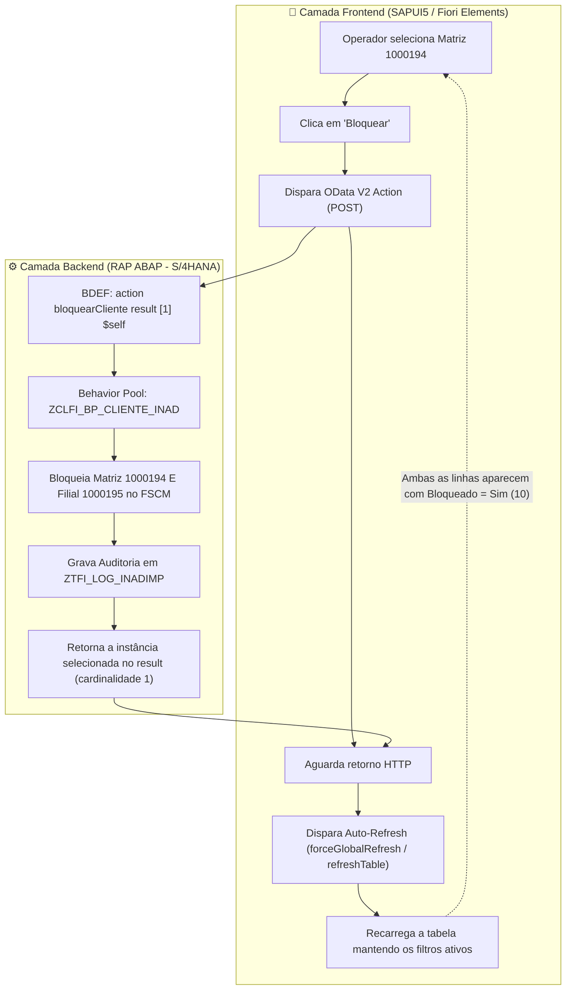

---
tags:
  - projeto
  - insi
  - veiling-holambra
  - sap
  - fi-ar
  - fscm
  - rap
  - abap-cloud
  - del-r2r-009
  - guia-atualizacao
id_demanda: DEL-R2R-009
tipo: guia-atualizacao
data: 2026-10-30
aliases:
  - "DEL-R2R-009 - Guia de Atualização (Bloqueio em Cascata de Grupo Econômico)"
---

# 🔄 DEL-R2R-009 · Guia de Atualização: Bloqueio em Cascata (OData V2) e Auto-Refresh via Frontend

⬅️ [[01 - DEL-R2R-009 - Guia de Implementação|Guia de Implementação]] | 🧪 [[03 - DEL-R2R-009 - Guia de Testes e Homologação|Guia de Testes e Homologação]] | 🧠 [[08 - ZCLFI_BP_CLIENTE_INAD|Behavior Pool ZCLFI_BP_CLIENTE_INAD]] | ⚙️ [[07 - ZI_FI_CLIENTE_INADIMPLENTE (BDEF)|BDEF Raiz]] | 🔌 [[11 - ZC_FI_CLIENTE_INADIMPLENTE (BDEF)|BDEF Projeção]] | 🎨 [[10 - ZC_FI_CLIENTE_INADIMPLENTE (MDE)|Metadata Extension]] | 📱 [[14 - bloqinadimplente (App Fiori)|App Fiori bloqinadimplente]]

---

## 📌 1. Diagnóstico do Mandante 120 e Divisão de Responsabilidades

Realizamos a leitura direta dos objetos ativos no mandante **`Veiling_S4D_120_GVSOUZA_PT`**:
1. **O que causou o erro `ZERO_TO_MANY not supported`:** A declaração de `result [0..*] $self;` no BDEF raiz não é permitida pelo motor SADL do SAP Gateway no protocolo **OData V2**. Ações OData V2 aceitam estritamente retorno unitário (**`result [1] $self;`**).
2. **Divisão de Responsabilidades na Arquitetura:**
   - **Backend ABAP/RAP:** É 100% responsável pela regra de negócio e integridade transacional. Bloqueia e desbloqueia em cascata a Matriz e todas as Filiais no **FSCM** (*Financial Supply Chain Management*), grava auditoria em `ZTFI_LOG_INADIMP` e retorna a linha processada via `result [1] $self;`.
   - **Frontend Fiori Elements:** É o responsável por atualizar a tela automaticamente. Ele dispara o recarregamento dos dados (`refresh`) logo após o término da ação, **mantendo 100% dos filtros que o usuário já aplicou**.



---

## 🛠️ 2. Passo a Passo de Execução no Backend (Eclipse ADT)

Siga os passos a seguir no Eclipse ADT para normalizar o backend e eliminar a exceção `ZERO_TO_MANY`.

---

### 🔹 PASSO 1: Retornar a Cardinalidade no BDEF Raiz (`ZI_FI_CLIENTE_INADIMPLENTE`)

* **Objeto Técnico:** Behavior Definition **`ZI_FI_CLIENTE_INADIMPLENTE`**
* **Caminho no Eclipse ADT:** `Core Data Services` ➔ `Behavior Definitions` ➔ `ZI_FI_CLIENTE_INADIMPLENTE`

#### 🔴 Código Atual (com erro de runtime no OData V2):
```abap
  action bloquearCliente    result [0..*] $self;
  action desbloquearCliente result [0..*] $self;
```

#### 🟢 Como Deve Ficar (Padrão OData V2):
```abap
  action bloquearCliente    result [1] $self;
  action desbloquearCliente result [1] $self;
```

> **Ação:** Altere o valor `[0..*]` de volta para `[1]` e ative o arquivo com **`Ctrl + F3`**.

---

### 🔹 PASSO 2: Reativar o BDEF de Projeção (`ZC_FI_CLIENTE_INADIMPLENTE`)

* **Objeto Técnico:** Behavior Definition **`ZC_FI_CLIENTE_INADIMPLENTE`**
* **Caminho no Eclipse ADT:** `Core Data Services` ➔ `Behavior Definitions` ➔ `ZC_FI_CLIENTE_INADIMPLENTE`

O código se mantém inalterado:
```abap
projection;
strict ( 2 );

define behavior for ZC_FI_CLIENTE_INADIMPLENTE alias ClienteInadimplente
{
  use action bloquearCliente;
  use action desbloquearCliente;
}
```

> **Ação:** Abra o objeto e pressione **`Ctrl + F3`** para sincronizar os metadados de projeção.

---

### 🔹 PASSO 3: Atualizar o Behavior Pool (`ZCLFI_BP_CLIENTE_INAD`) na Aba `Local Types`

* **Objeto Técnico:** Behavior Implementation Class **`ZCLFI_BP_CLIENTE_INAD`**
* **Caminho no Eclipse ADT:** `Source Code Library` ➔ `Classes` ➔ `ZCLFI_BP_CLIENTE_INAD`
* **Local:** Aba **`Local Types`** (Include local `CCIMP`)

---

#### 🔍 3.1 Comparação no método `bloquearCliente`:

##### 🔴 Trecho Atual no final do método `bloquearCliente`:
```abap
    IF lt_chaves_result IS NOT INITIAL.
      SELECT *
        FROM zi_fi_cliente_inadimplente
        FOR ALL ENTRIES IN @lt_chaves_result
        WHERE PartnerMatriz = @lt_chaves_result-partnermatriz
          AND CreditSegment = @lt_chaves_result-creditsegment
        INTO TABLE @DATA(lt_membros_atualizados).

      LOOP AT lt_membros_atualizados ASSIGNING FIELD-SYMBOL(<ls_membro>).
        <ls_membro>-IsBlocked   = abap_true.
        <ls_membro>-BlockReason = gc_motivo_inadimplencia.

        APPEND VALUE #(
          %tky   = VALUE #( PartnerMatriz = <ls_membro>-PartnerMatriz
                            CreditSegment = <ls_membro>-CreditSegment )
          %param = CORRESPONDING #( <ls_membro> )
        ) TO result.
      ENDLOOP.
    ENDIF.
```

##### 🟢 Como Deve Ficar no método `bloquearCliente`:
```abap
      IF lv_bloqueio_ok = abap_true.
        <ls_cliente>-IsBlocked   = abap_true.
        <ls_cliente>-BlockReason = gc_motivo_inadimplencia.

        APPEND VALUE #(
          %tky = <ls_cliente>-%tky
          %msg = new_message(
            id       = 'ZFI_INADIMPLENCIA'
            number   = '001'
            severity = if_abap_behv_message=>severity-success
            v1       = <ls_cliente>-PartnerMatriz
            v2       = <ls_cliente>-CreditSegment
          )
        ) TO reported-clienteinadimplente.
      ELSE.
        APPEND VALUE #( %tky = <ls_cliente>-%tky ) TO failed-clienteinadimplente.
        APPEND VALUE #(
          %tky = <ls_cliente>-%tky
          %msg = new_message_with_text(
            severity = if_abap_behv_message=>severity-error
            text     = |Erro ao bloquear cliente { <ls_cliente>-PartnerMatriz } ou filiais do grupo.|
          )
        ) TO reported-clienteinadimplente.
      ENDIF.

      APPEND VALUE #( %tky   = <ls_cliente>-%tky
                      %param = <ls_cliente> ) TO result.
    ENDLOOP.

    lo_bupa_factory->save_all( i_upd_task = abap_false ).

    IF lt_log IS NOT INITIAL.
      INSERT ztfi_log_inadimp FROM TABLE @lt_log.
    ENDIF.
```

---

#### 🔍 3.2 Comparação no método `desbloquearCliente`:

##### 🔴 Trecho Atual no final do método `desbloquearCliente`:
```abap
    IF lt_chaves_result IS NOT INITIAL.
      SELECT *
        FROM zi_fi_cliente_inadimplente
        FOR ALL ENTRIES IN @lt_chaves_result
        WHERE PartnerMatriz = @lt_chaves_result-partnermatriz
          AND CreditSegment = @lt_chaves_result-creditsegment
        INTO TABLE @DATA(lt_membros_atualizados_desb).

      LOOP AT lt_membros_atualizados_desb ASSIGNING FIELD-SYMBOL(<ls_membro_desb>).
        <ls_membro_desb>-IsBlocked   = abap_false.
        CLEAR <ls_membro_desb>-BlockReason.

        APPEND VALUE #(
          %tky   = VALUE #( PartnerMatriz = <ls_membro_desb>-PartnerMatriz
                            CreditSegment = <ls_membro_desb>-CreditSegment )
          %param = CORRESPONDING #( <ls_membro_desb> )
        ) TO result.
      ENDLOOP.
    ENDIF.
```

##### 🟢 Como Deve Ficar no método `desbloquearCliente`:
```abap
      IF lv_desbloqueio_ok = abap_true.
        <ls_cliente>-IsBlocked   = abap_false.
        CLEAR <ls_cliente>-BlockReason.

        APPEND VALUE #(
          %tky = <ls_cliente>-%tky
          %msg = new_message(
            id       = 'ZFI_INADIMPLENCIA'
            number   = '002'
            severity = if_abap_behv_message=>severity-success
            v1       = <ls_cliente>-PartnerMatriz
            v2       = <ls_cliente>-CreditSegment
          )
        ) TO reported-clienteinadimplente.
      ELSE.
        APPEND VALUE #( %tky = <ls_cliente>-%tky ) TO failed-clienteinadimplente.
        APPEND VALUE #(
          %tky = <ls_cliente>-%tky
          %msg = new_message_with_text(
            severity = if_abap_behv_message=>severity-error
            text     = |Erro ao desbloquear cliente { <ls_cliente>-PartnerMatriz } ou filiais do grupo.|
          )
        ) TO reported-clienteinadimplente.
      ENDIF.

      APPEND VALUE #( %tky   = <ls_cliente>-%tky
                      %param = <ls_cliente> ) TO result.
    ENDLOOP.

    lo_bupa_factory->save_all( i_upd_task = abap_false ).

    IF lt_log IS NOT INITIAL.
      INSERT ztfi_log_inadimp FROM TABLE @lt_log.
    ENDIF.
```

---

#### 🚀 3.3 Código Integral da Aba `Local Types` (Pronto para Copiar e Colar)

Copie e substitua o conteúdo integral da aba **`Local Types`** da classe **`ZCLFI_BP_CLIENTE_INAD`**:

```abap
CLASS lhc_clienteinadimplente DEFINITION INHERITING FROM cl_abap_behavior_handler.
  PRIVATE SECTION.
    TYPES:
      tt_partner TYPE STANDARD TABLE OF bu_partner WITH DEFAULT KEY.

    CONSTANTS:
      gc_motivo_inadimplencia TYPE ukm_block_reason VALUE '10',
      gc_segmento_credito     TYPE ukm_credit_sgmnt VALUE '1000',
      gc_acao_bloquear        TYPE c LENGTH 1       VALUE 'B',
      gc_acao_desbloquear     TYPE c LENGTH 1       VALUE 'D'.

    METHODS get_instance_authorizations FOR INSTANCE AUTHORIZATION
      IMPORTING keys REQUEST requested_authorizations FOR ClienteInadimplente RESULT result.

    METHODS bloquearCliente FOR MODIFY
      IMPORTING keys FOR ACTION ClienteInadimplente~bloquearCliente RESULT result.

    METHODS desbloquearCliente FOR MODIFY
      IMPORTING keys FOR ACTION ClienteInadimplente~desbloquearCliente RESULT result.

    METHODS read FOR READ
      IMPORTING keys FOR READ ClienteInadimplente RESULT result.

    METHODS lock FOR LOCK
      IMPORTING keys FOR LOCK ClienteInadimplente.

    METHODS obter_grupo_economico
      IMPORTING
        iv_partner   TYPE bu_partner
      EXPORTING
        ev_matriz    TYPE bu_partner
        et_parceiros TYPE tt_partner.
ENDCLASS.

CLASS lhc_clienteinadimplente IMPLEMENTATION.

  METHOD get_instance_authorizations.
    LOOP AT keys ASSIGNING FIELD-SYMBOL(<ls_key>).

      AUTHORITY-CHECK OBJECT 'ZFI_BLOQ'
        ID 'BUKRS'     FIELD 'CVH1'
        ID 'UKM_SGMNT' FIELD <ls_key>-CreditSegment
        ID 'ACTVT'     FIELD '05'.

      DATA(lv_pode_bloquear) = COND #( WHEN sy-subrc = 0
                                       THEN if_abap_behv=>auth-allowed
                                       ELSE if_abap_behv=>auth-unauthorized ).

      AUTHORITY-CHECK OBJECT 'ZFI_BLOQ'
        ID 'BUKRS'     FIELD 'CVH1'
        ID 'UKM_SGMNT' FIELD <ls_key>-CreditSegment
        ID 'ACTVT'     FIELD '43'.

      DATA(lv_pode_desbloquear) = COND #( WHEN sy-subrc = 0
                                          THEN if_abap_behv=>auth-allowed
                                          ELSE if_abap_behv=>auth-unauthorized ).

      APPEND VALUE #(
        %tky                        = <ls_key>-%tky
        %action-bloquearCliente    = lv_pode_bloquear
        %action-desbloquearCliente  = lv_pode_desbloquear
      ) TO result.
    ENDLOOP.
  ENDMETHOD.

  METHOD obter_grupo_economico.
    CLEAR: ev_matriz, et_parceiros.

    SELECT partner2
      FROM but050
      WHERE partner1 = @iv_partner
        AND reltyp   = 'UKM001'
      INTO TABLE @DATA(lt_filiais).

    IF sy-subrc = 0 AND lt_filiais IS NOT INITIAL.
      ev_matriz = iv_partner.
      APPEND iv_partner TO et_parceiros.
      LOOP AT lt_filiais ASSIGNING FIELD-SYMBOL(<lv_filial>).
        APPEND <lv_filial> TO et_parceiros.
      ENDLOOP.
      SORT et_parceiros.
      DELETE ADJACENT DUPLICATES FROM et_parceiros.
      RETURN.
    ENDIF.

    SELECT SINGLE partner1
      FROM but050
      WHERE partner2 = @iv_partner
        AND reltyp   = 'UKM001'
      INTO @DATA(lv_matriz_encontrada).

    IF sy-subrc = 0 AND lv_matriz_encontrada IS NOT INITIAL.
      ev_matriz = lv_matriz_encontrada.
      APPEND lv_matriz_encontrada TO et_parceiros.

      SELECT partner2
        FROM but050
        WHERE partner1 = @lv_matriz_encontrada
          AND reltyp   = 'UKM001'
        INTO TABLE @lt_filiais.

      LOOP AT lt_filiais ASSIGNING FIELD-SYMBOL(<lv_f>).
        APPEND <lv_f> TO et_parceiros.
      ENDLOOP.
      SORT et_parceiros.
      DELETE ADJACENT DUPLICATES FROM et_parceiros.
      RETURN.
    ENDIF.

    ev_matriz = iv_partner.
    APPEND iv_partner TO et_parceiros.
  ENDMETHOD.

  METHOD bloquearCliente.
    DATA lt_log                   TYPE STANDARD TABLE OF ztfi_log_inadimp.
    DATA lr_classes_excluidas     TYPE RANGE OF ukm_risk_class.
    DATA lt_parceiros_processados TYPE HASHED TABLE OF bu_partner WITH UNIQUE KEY table_line.

    TRY.
        zclca_tabela_parametros=>get_instance( )->m_get_range(
          EXPORTING
            iv_modulo = 'FI'
            iv_chave1 = 'DEL_R2R_009'
            iv_chave2 = 'RISK_CLASS'
            iv_chave3 = 'EXCLUIR'
          IMPORTING
            et_range  = lr_classes_excluidas ).
      CATCH cx_root.
        lr_classes_excluidas = VALUE #( ( sign = 'I' option = 'EQ' low = '5' ) ).
    ENDTRY.

    READ ENTITIES OF zi_fi_cliente_inadimplente IN LOCAL MODE
      ENTITY ClienteInadimplente
      ALL FIELDS WITH CORRESPONDING #( keys )
      RESULT DATA(lt_clientes).

    DATA(lo_bupa_factory) = cl_ukm_bupa_factory=>create( ).

    LOOP AT lt_clientes ASSIGNING FIELD-SYMBOL(<ls_cliente>).

      IF <ls_cliente>-RiskClass IN lr_classes_excluidas.
        TRY.
            APPEND VALUE #(
              log_id         = cl_system_uuid=>create_uuid_x16_static( )
              partner        = <ls_cliente>-partnermatriz
              partner_origem = <ls_cliente>-partnerorigem
              credit_sgmnt   = <ls_cliente>-creditsegment
              acao           = gc_acao_bloquear
              block_reason   = space
              status         = 'E'
              mensagem       = |Cliente { <ls_cliente>-partnermatriz } pertence à classe { <ls_cliente>-riskclass } (excluída) e não pode ser bloqueado.|
              risk_class     = <ls_cliente>-riskclass
              moeda          = <ls_cliente>-moeda
              vlr_vencido    = <ls_cliente>-valortotalvencido
              dias_atraso    = <ls_cliente>-diasatraso
              created_by     = sy-uname
              created_at     = utclong_current( )
            ) TO lt_log.
          CATCH cx_uuid_error.
        ENDTRY.

        APPEND VALUE #( %tky = <ls_cliente>-%tky ) TO failed-clienteinadimplente.
        APPEND VALUE #(
          %tky = <ls_cliente>-%tky
          %msg = new_message_with_text(
            severity = if_abap_behv_message=>severity-warning
            text     = |Cliente { <ls_cliente>-partnermatriz } pertence à classe { <ls_cliente>-riskclass } (excluída) e não pode ser bloqueado.|
          )
        ) TO reported-clienteinadimplente.

        APPEND VALUE #( %tky   = <ls_cliente>-%tky
                        %param = <ls_cliente> ) TO result.
        CONTINUE.
      ENDIF.

      obter_grupo_economico(
        EXPORTING
          iv_partner   = <ls_cliente>-PartnerMatriz
        IMPORTING
          ev_matriz    = DATA(lv_matriz)
          et_parceiros = DATA(lt_grupo) ).

      DATA lv_bloqueio_ok TYPE abap_bool VALUE abap_false.

      LOOP AT lt_grupo INTO DATA(lv_bp_membro).
        IF line_exists( lt_parceiros_processados[ table_line = lv_bp_membro ] ).
          lv_bloqueio_ok = abap_true.
          CONTINUE.
        ENDIF.
        INSERT lv_bp_membro INTO TABLE lt_parceiros_processados.

        TRY.
            DATA(lo_account) = CAST cl_ukm_account(
              lo_bupa_factory->get_credit_account(
                i_partner      = lv_bp_membro
                i_credit_sgmnt = <ls_cliente>-CreditSegment ) ).

            lo_account->get_bp_cms_sgm( IMPORTING es_bp_cms_sgm = DATA(ls_sgm) ).
            ls_sgm-xblocked     = abap_true.
            ls_sgm-block_reason = gc_motivo_inadimplencia.
            lo_account->set_bp_cms_sgm( EXPORTING is_bp_cms_sgm = ls_sgm ).

            APPEND VALUE #(
              log_id         = cl_system_uuid=>create_uuid_x16_static( )
              partner        = lv_bp_membro
              partner_origem = <ls_cliente>-PartnerOrigem
              credit_sgmnt   = <ls_cliente>-CreditSegment
              acao           = gc_acao_bloquear
              block_reason   = gc_motivo_inadimplencia
              status         = 'S'
              mensagem       = COND #( WHEN lv_bp_membro = <ls_cliente>-PartnerMatriz
                                       THEN 'Cliente bloqueado com sucesso.'
                                       ELSE |Bloqueio em cascata (Grupo Matriz { lv_matriz }).| )
              risk_class     = <ls_cliente>-RiskClass
              moeda          = <ls_cliente>-Moeda
              vlr_vencido    = <ls_cliente>-ValorTotalVencido
              dias_atraso    = <ls_cliente>-DiasAtraso
              created_by     = sy-uname
              created_at     = utclong_current( )
            ) TO lt_log.

            lv_bloqueio_ok = abap_true.

          CATCH cx_root INTO DATA(lx_erro_membro).
            TRY.
                APPEND VALUE #(
                  log_id         = cl_system_uuid=>create_uuid_x16_static( )
                  partner        = lv_bp_membro
                  partner_origem = <ls_cliente>-PartnerOrigem
                  credit_sgmnt   = <ls_cliente>-CreditSegment
                  acao           = gc_acao_bloquear
                  block_reason   = gc_motivo_inadimplencia
                  status         = 'E'
                  mensagem       = lx_erro_membro->get_text( )
                  risk_class     = <ls_cliente>-RiskClass
                  moeda          = <ls_cliente>-Moeda
                  vlr_vencido    = <ls_cliente>-ValorTotalVencido
                  dias_atraso    = <ls_cliente>-DiasAtraso
                  created_by     = sy-uname
                  created_at     = utclong_current( )
                ) TO lt_log.
              CATCH cx_uuid_error.
            ENDTRY.
        ENDTRY.
      ENDLOOP.

      IF lv_bloqueio_ok = abap_true.
        <ls_cliente>-IsBlocked   = abap_true.
        <ls_cliente>-BlockReason = gc_motivo_inadimplencia.

        APPEND VALUE #(
          %tky = <ls_cliente>-%tky
          %msg = new_message(
            id       = 'ZFI_INADIMPLENCIA'
            number   = '001'
            severity = if_abap_behv_message=>severity-success
            v1       = <ls_cliente>-PartnerMatriz
            v2       = <ls_cliente>-CreditSegment
          )
        ) TO reported-clienteinadimplente.
      ELSE.
        APPEND VALUE #( %tky = <ls_cliente>-%tky ) TO failed-clienteinadimplente.
        APPEND VALUE #(
          %tky = <ls_cliente>-%tky
          %msg = new_message_with_text(
            severity = if_abap_behv_message=>severity-error
            text     = |Erro ao bloquear cliente { <ls_cliente>-PartnerMatriz } ou filiais do grupo.|
          )
        ) TO reported-clienteinadimplente.
      ENDIF.

      APPEND VALUE #( %tky   = <ls_cliente>-%tky
                      %param = <ls_cliente> ) TO result.
    ENDLOOP.

    lo_bupa_factory->save_all( i_upd_task = abap_false ).

    IF lt_log IS NOT INITIAL.
      INSERT ztfi_log_inadimp FROM TABLE @lt_log.
    ENDIF.
  ENDMETHOD.

  METHOD desbloquearCliente.
    DATA lt_log                   TYPE STANDARD TABLE OF ztfi_log_inadimp.
    DATA lt_parceiros_processados TYPE HASHED TABLE OF bu_partner WITH UNIQUE KEY table_line.

    READ ENTITIES OF zi_fi_cliente_inadimplente IN LOCAL MODE
      ENTITY ClienteInadimplente
      ALL FIELDS WITH CORRESPONDING #( keys )
      RESULT DATA(lt_clientes).

    DATA(lo_bupa_factory) = cl_ukm_bupa_factory=>create( ).

    LOOP AT lt_clientes ASSIGNING FIELD-SYMBOL(<ls_cliente>).

      obter_grupo_economico(
        EXPORTING
          iv_partner   = <ls_cliente>-PartnerMatriz
        IMPORTING
          ev_matriz    = DATA(lv_matriz_desb)
          et_parceiros = DATA(lt_grupo_desb) ).

      DATA lv_desbloqueio_ok TYPE abap_bool VALUE abap_false.

      LOOP AT lt_grupo_desb INTO DATA(lv_bp_membro_desb).
        IF line_exists( lt_parceiros_processados[ table_line = lv_bp_membro_desb ] ).
          lv_desbloqueio_ok = abap_true.
          CONTINUE.
        ENDIF.
        INSERT lv_bp_membro_desb INTO TABLE lt_parceiros_processados.

        TRY.
            DATA(lo_account) = CAST cl_ukm_account(
              lo_bupa_factory->get_credit_account(
                i_partner      = lv_bp_membro_desb
                i_credit_sgmnt = <ls_cliente>-CreditSegment ) ).

            lo_account->get_bp_cms_sgm( IMPORTING es_bp_cms_sgm = DATA(ls_sgm) ).
            ls_sgm-xblocked     = abap_false.
            CLEAR ls_sgm-block_reason.
            lo_account->set_bp_cms_sgm( EXPORTING is_bp_cms_sgm = ls_sgm ).

            APPEND VALUE #(
              log_id         = cl_system_uuid=>create_uuid_x16_static( )
              partner        = lv_bp_membro_desb
              partner_origem = <ls_cliente>-PartnerOrigem
              credit_sgmnt   = <ls_cliente>-CreditSegment
              acao           = gc_acao_desbloquear
              block_reason   = space
              status         = 'S'
              mensagem       = COND #( WHEN lv_bp_membro_desb = <ls_cliente>-PartnerMatriz
                                       THEN 'Cliente desbloqueado com sucesso.'
                                       ELSE |Desbloqueio em cascata (Grupo Econômico Matriz { lv_matriz_desb }).| )
              risk_class     = <ls_cliente>-RiskClass
              moeda          = <ls_cliente>-Moeda
              vlr_vencido    = <ls_cliente>-ValorTotalVencido
              dias_atraso    = <ls_cliente>-DiasAtraso
              created_by     = sy-uname
              created_at     = utclong_current( )
            ) TO lt_log.

            lv_desbloqueio_ok = abap_true.

          CATCH cx_root INTO DATA(lx_erro_desb).
            TRY.
                APPEND VALUE #(
                  log_id         = cl_system_uuid=>create_uuid_x16_static( )
                  partner        = lv_bp_membro_desb
                  partner_origem = <ls_cliente>-PartnerOrigem
                  credit_sgmnt   = <ls_cliente>-CreditSegment
                  acao           = gc_acao_desbloquear
                  block_reason   = space
                  status         = 'E'
                  mensagem       = lx_erro_desb->get_text( )
                  risk_class     = <ls_cliente>-RiskClass
                  moeda          = <ls_cliente>-Moeda
                  vlr_vencido    = <ls_cliente>-ValorTotalVencido
                  dias_atraso    = <ls_cliente>-DiasAtraso
                  created_by     = sy-uname
                  created_at     = utclong_current( )
                ) TO lt_log.
              CATCH cx_uuid_error.
            ENDTRY.
        ENDTRY.
      ENDLOOP.

      IF lv_desbloqueio_ok = abap_true.
        <ls_cliente>-IsBlocked   = abap_false.
        CLEAR <ls_cliente>-BlockReason.

        APPEND VALUE #(
          %tky = <ls_cliente>-%tky
          %msg = new_message(
            id       = 'ZFI_INADIMPLENCIA'
            number   = '002'
            severity = if_abap_behv_message=>severity-success
            v1       = <ls_cliente>-PartnerMatriz
            v2       = <ls_cliente>-CreditSegment
          )
        ) TO reported-clienteinadimplente.
      ELSE.
        APPEND VALUE #( %tky = <ls_cliente>-%tky ) TO failed-clienteinadimplente.
        APPEND VALUE #(
          %tky = <ls_cliente>-%tky
          %msg = new_message_with_text(
            severity = if_abap_behv_message=>severity-error
            text     = |Erro ao desbloquear cliente { <ls_cliente>-PartnerMatriz } ou filiais do grupo.|
          )
        ) TO reported-clienteinadimplente.
      ENDIF.

      APPEND VALUE #( %tky   = <ls_cliente>-%tky
                      %param = <ls_cliente> ) TO result.
    ENDLOOP.

    lo_bupa_factory->save_all( i_upd_task = abap_false ).

    IF lt_log IS NOT INITIAL.
      INSERT ztfi_log_inadimp FROM TABLE @lt_log.
    ENDIF.
  ENDMETHOD.

  METHOD lock.
  ENDMETHOD.

  METHOD read.
    SELECT *
      FROM zi_fi_cliente_inadimplente
      FOR ALL ENTRIES IN @keys
      WHERE PartnerMatriz = @keys-PartnerMatriz
        AND CreditSegment = @keys-CreditSegment
      INTO TABLE @DATA(lt_dados).
    result = CORRESPONDING #( lt_dados ).
  ENDMETHOD.

ENDCLASS.

CLASS lsc_zi_fi_cliente_inadimplente DEFINITION INHERITING FROM cl_abap_behavior_saver.
  PROTECTED SECTION.
    METHODS save REDEFINITION.
    METHODS cleanup REDEFINITION.
    METHODS cleanup_finalize REDEFINITION.
ENDCLASS.

CLASS lsc_zi_fi_cliente_inadimplente IMPLEMENTATION.
  METHOD save.
  ENDMETHOD.

  METHOD cleanup.
  ENDMETHOD.

  METHOD cleanup_finalize.
  ENDMETHOD.
ENDCLASS.
```

> **Ação:** Cole o código acima na aba **`Local Types`** e ative com **`Ctrl + F3`**.

---

### 🔹 PASSO 4: Republicar a Service Binding (`ZUI_O2_FI_CLIENTE_INAD`)

* **Objeto Técnico:** Service Binding **`ZUI_O2_FI_CLIENTE_INAD`**
* **Caminho no Eclipse ADT:** `Business Services` ➔ `Service Bindings` ➔ `ZUI_O2_FI_CLIENTE_INAD`

#### Procedimento:
1. Abra a Service Binding **`ZUI_O2_FI_CLIENTE_INAD`**.
2. Clique no botão **`Unpublish`** (Despublicar).
3. Aguarde o status mudar para *Unpublished*.
4. Clique no botão **`Publish`** (Publicar).
5. O SAP Gateway regera o `$metadata` com o *Function Import* em cardinalidade unitária. O erro `Return Multiplicity 'ZERO_TO_MANY'` é **definitivamente eliminado**.

---

## 💻 3. Como Implementar o Auto-Refresh no Frontend (SAP Fiori Elements)

Para que a tela atualize automaticamente Matriz e Filiais simultaneamente sem exigir clique manual em "Iniciar", existem duas abordagens no projeto do app Fiori:

---

### 🌟 Método Recomendado: Parâmetro no `manifest.json` (`forceGlobalRefresh`)

Este método **não requer programação JavaScript**. Ele instrui o próprio motor do SAP Fiori Elements a disparar uma nova leitura dos dados da tabela assim que qualquer ação em massa for concluída.

* **Arquivo:** `webapp/manifest.json` do projeto **`bloqinadimplente`**
* **Local:** Bloco `"sap.ui.generic.app"` ➔ `"settings"`

#### Snippet no `manifest.json`:
```jsonc
  "sap.ui.generic.app": {
    "_version": "1.3.0",
    "settings": {
      "forceGlobalRefresh": true                                       // ⚡ Força a releitura da lista mantendo os filtros ativos após a ação
    },
    "pages": {
      "ListReport|ClienteInadimplente": {
        "entitySet": "ClienteInadimplente",
        "component": {
          "name": "sap.suite.ui.generic.template.ListReport",
          "list": true,
          "settings": {
            "condensedTableLayout": true,
            "smartVariantManagement": true,
            "enableTableFilterInPageVariant": true,
            "tableSettings": {
              "type": "ResponsiveTable",
              "multiSelect": true
            }
          }
        }
      }
    }
  }
```

> **Resultado:** Ao clicar em Bloquear ou Desbloquear, o framework conclui o lote e automaticamente dispara um `GET` no backend trazendo o estado atualizado de todas as linhas. Os filtros preenchidos na tela são **100% mantidos**.

---

### 🛠️ Método Alternativo: Extensão de Controlador (`ListReportExtension.controller.js`)

Se a versão do SAPUI5 em uso não honrar o `forceGlobalRefresh`, podemos programar a extensão oficial do Fiori Elements:

#### 1. Criar o arquivo no projeto VS Code:
* **Caminho:** `webapp/ext/controller/ListReportExtension.controller.js`

```javascript
sap.ui.define([
    "sap/ui/core/mvc/ControllerExtension"
], function (ControllerExtension) {
    "use strict";

    return ControllerExtension.extend("br.com.veiling.bloqinadimplente.ext.controller.ListReportExtension", {
        override: {
            // Hook disparado automaticamente pelo Fiori Elements após a execução de uma ação
            onAfterLineItemAction: function (oEvent) {
                // Executa a releitura completa da tabela preservando os filtros aplicados
                this.base.getExtensionAPI().refreshTable();
            }
        }
    });
});
```

#### 2. Registrar a extensão no `webapp/manifest.json`:
Dentro de `"sap.ui5"`:
```json
  "sap.ui5": {
    "extends": {
      "extensions": {
        "sap.ui.controllerExtensions": {
          "sap.suite.ui.generic.template.ListReport.view.ListReport": {
            "controllerName": "br.com.veiling.bloqinadimplente.ext.controller.ListReportExtension"
          }
        }
      }
    }
  }
```

---

### 🖱️ Fallback Operacional (Preview do Eclipse ADT / Sem Deploy de Frontend)

Caso você esteja testando a aplicação diretamente através do **Preview do Eclipse ADT** (sem compilar o projeto do frontend com `npm run deploy`):
- O operador executa a ação (ex: seleciona a Matriz `1000194` e clica em **Bloquear**).
- O operador clica no botão **"Iniciar"** ou no **ícone de atualizar** da tabela (`Refresh`).
- **Comportamento dos Filtros:** O Fiori Elements mantém **100% dos filtros digitados**, e ambas as linhas (Matriz e Filiais) aparecem imediatamente atualizadas.

---

## 🧪 4. Roteiro de Teste e Validação

1. **Abrir a Aplicação:**
   - Execute o Preview da Service Binding `ZUI_O2_FI_CLIENTE_INAD`.
   - Filtre por `1000194` e `1000195` e clique em **Iniciar**.
   - Confirme que o erro `ZERO_TO_MANY` **não ocorre mais** e a listagem carrega perfeitamente.
2. **Homologar Bloqueio em Cascata:**
   - Selecione apenas a Matriz `1000194` e clique em **Bloquear**.
   - Ao concluir a ação (ou clicar em Iniciar se estiver no preview), ambas as linhas passam para `Bloqueado = Sim (10)`.
3. **Homologar Desbloqueio em Cascata:**
   - Selecione a Filial `1000195` e clique em **Desbloquear**.
   - Ambas as linhas retornam para `Bloqueado = Não`.
4. **Validar Auditoria:**
   - Abra a tabela `ZTFI_LOG_INADIMP` e confira os registros de sucesso para cada parceiro do grupo.
