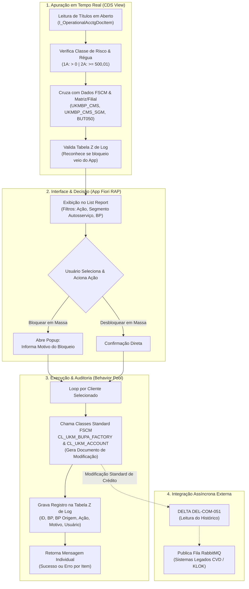

---
tags:
  - projeto
  - insi
  - veiling-holambra
  - sap
  - fi-ar
  - fscm
  - rap
  - del-r2r-009
id_demanda: DEL-R2R-009
modulo: FI-AR / FSCM
tipo: especificacao-tecnica
data: 2026-10-22
---

# DEL-R2R-009 – Resumo Técnico para Desenvolvimento
**Bloqueio e Desbloqueio Massivo de Clientes Inadimplentes**

---

## 1. Visão Geral (O "Porquê")

* **Problema de Negócio:** No SAP standard, o bloqueio de crédito de clientes por inadimplência é estritamente manual e individual (cliente a cliente via transação/app de crédito). No Veiling Holambra, a liberação de compras no leilão e aluguel de materiais depende do status financeiro do cliente no SAP, que é replicado para os sistemas legados (via mensageria pelo delta `DEL-COM-051`). Fazer essa gestão de forma manual geraria alto risco de clientes inadimplentes continuarem comprando ou clientes que já pagaram ficarem travados.
* **Decisão Arquitetural Recente (Alinhamento de 22/10/2026):**
  * **Sem bloqueio automático:** A área de negócios (*Key User*) determinou que nenhum cliente deve ser bloqueado automaticamente sem validação humana.
  * **Eliminação de Job:** Foi descartada a ideia original de criar um *Job* (execução em background) para gerar propostas em tabelas intermediárias. Toda a apuração de inadimplência será feita **em tempo real via CDS View** diretamente na abertura do aplicativo.

---

## 2. O Que Deve Ser Criado

Para implementar a solução ponta a ponta, o desenvolvedor ABAP precisará construir os seguintes artefatos:

| Artefato Técnico                     | Tipo de Objeto                      | Descrição / Responsabilidade                                                                                                                                                                                                                                       |
| :----------------------------------- | :---------------------------------- | :----------------------------------------------------------------------------------------------------------------------------------------------------------------------------------------------------------------------------------------------------------------- |
| **App Fiori Elements (List Report)** | RAP / Fiori UI                      | Aplicativo para o analista visualizar a lista de propostas, filtrar por segmento e acionar as ações em massa (**Bloquear** e **Desbloquear**). Permite navegação aos apps standard de crédito e partidas.                                                          |
| **CDS Views (Basic / Consumption)**  | CDS (Core Data Services)            | Visão de consumo e composição que cruza as partidas em aberto vencidas da CDS standard `I_OperationalAcctgDocItem` com os dados de BP (*Business Partner*) e crédito FSCM (*Financial Supply Chain Management*), aplicando a régua de negócio dinamicamente.       |
| **Behavior Pool / Ações RAP**        | Classe ABAP (`ZCLFI_*`)             | Métodos de ação do RAP para executar o bloqueio/desbloqueio chamando as classes standard do SAP Credit Management (`CL_UKM_BUPA_FACTORY` e `CL_UKM_ACCOUNT`), garantindo a geração de histórico standard de modificação (sem update direto em tabelas SAP).        |
| **Tabela Z de Log**                  | Dicionário ABAP (`SE11` / `ZTFI_*`) | Tabela customizada para registrar cada ação de bloqueio/desbloqueio (ID, BP, BP de origem, motivo, status, saldo vencido, usuário, data e hora). Essa tabela é essencial para auditoria e para que a CDS reconheça se o bloqueio ativo foi feito pelo próprio app. |
| **Objeto de Autorização**            | Segurança (`SU21` / `Z_FI_BLOQ`)    | Controle de permissão com campos de Empresa (`CVH1`), Segmento de Crédito (`1000`) e Atividade (`ACTVT`: Exibir, Bloquear, Desbloquear).                                                                                                                           |

> [!NOTE]
> **Fora do escopo deste delta:** O envio de mensagens para os sistemas legados via mensageria (RabbitMQ) **não** é feito por este app. O delta `DEL-COM-051` lê o histórico standard gerado pela classe de crédito e dispara as integrações de forma desacoplada.

---

## 3. Regras de Negócio e Critérios de Decisão

### A. Réguas de Inadimplência (Filtro Dinâmico na CDS)
* **Empresa:** Fixo `CVH1`.
* **Segmento de Crédito:** Fixo `1000`.
* **Classes de Risco (`UKMBP_CMS-RISK_CLASS`):**
  * **Classe 1A (À Vista):** Proposta de bloqueio com **qualquer valor** vencido há **1 dia ou mais**.
  * **Classe 2A (A Prazo):** Proposta de bloqueio com saldo vencido **a partir de R$ 500,01** há **1 dia ou mais**.
  * **Classe 5 (CVH Interna):** Desconsiderada totalmente (não avaliada e não exibida).
* **Composição do Saldo Vencido:**
  * Baseado em partidas em aberto de Contas a Receber (`I_OperationalAcctgDocItem`).
  * Não considera juros e multas já lançados nem partidas de razão especial (CME).
  * Deduz eventuais adiantamentos financeiros.
* **Exceções de Bloqueio (Supermercados):**
  * Clientes de redes/supermercados não devem ser bloqueados. Eles são identificados pelo segmento de atuação `BP001-GROUP_FEATURE = '002'` (Autosserviço) e devem ser disponibilizados como filtro no app para exclusão na seleção em massa.

### B. Hierarquia Matriz e Filiais (Crédito Centralizado)
* As filiais não possuem gestão de crédito individual (`UKM000`); o limite e os bloqueios de crédito residem unicamente na **Matriz** via hierarquia standard de parceiros (`BUT050`).
* Se uma filial estiver inadimplente:
  * A linha no app exibe a pendência apontando o **BP de Origem** (a filial devedora).
  * A ação de bloqueio e motivo é aplicada diretamente no cadastro da **Matriz**.
* **Critério de Desbloqueio do Grupo:** A matriz só pode ser proposta para desbloqueio quando **todas as filiais e a matriz** estiverem 100% sem pendências financeiras.

### C. Critérios para a Ação Proposta (CDS)
* **Proposta = "Bloquear":**
  * Cliente ultrapassa a régua de inadimplência E indicador de bloqueio de crédito está inativo (`UKMBP_CMS_SGM-XBLOCKED = ' '`).
* **Proposta = "Desbloquear":**
  * Cliente regularizado (não ultrapassa mais a régua) E está atualmente bloqueado (`XBLOCKED = 'X'`).
  * **Validação de Origem do Bloqueio:** O cliente só é proposto para desbloqueio se o último registro dele na tabela Z de log for um bloqueio realizado pelo próprio app e com o mesmo motivo. Se o cliente foi bloqueado manualmente no app standard (ex: pendência fiscal ou jurídica), o app **não** propõe desbloqueio, mantendo a gestão individual.

---

## 4. Fluxo Lógico

---

## 5. Próximos Passos para o Desenvolvedor ABAP

1. **Dicionário de Dados:** Criar a tabela transparente de log (`ZTFI_R2R009_LOG`) com campos-chave e estrutura de auditoria.
2. **Camada Core (CDS):** Desenvolver as CDS Views com a agregação de partidas vencidas (`CVH1`, filtro de juros/multas e dedução de adiantamentos) e o join com as tabelas de crédito FSCM e hierarquia de BP.
3. **Behavior Definition & Pool:** Configurar as ações RAP `bloquear` (com parâmetro de motivo) e `desbloquear`, implementando as chamadas das classes standard `CL_UKM_BUPA_FACTORY` e gravação do log.
4. **Camada de Apresentação:** Publicar a Service Definition / OData V4 e gerar o app Fiori Elements List Report com anotações de UI.
