---
tags:
  - projeto
  - insi
  - veiling-holambra
  - sap
  - fi-ar
  - rap
  - clean-core
  - tabela-parametros
  - del-r2r-009
  - guia-atualizacao
id_demanda: DEL-R2R-009
tipo: guia-atualizacao
data: 2026-10-28
---

# 🔄 DEL-R2R-009 · Guia de Atualização de Objetos (Clean Core & Tabela de Parâmetros)

⬅️ [[DEL-R2R-009 - Guia de Implementação|Guia de Implementação Principal]] | ⬅️ [[DEL-R2R-009 - Arquitetura e Objetos|Arquitetura e Objetos]] | ⚙️ [[DEL-R2R-009 - Configuração da Tabela de Parâmetros|Configuração da Tabela de Parâmetros]]

---

## 📌 1. Contexto e Motivação da Atualização

Durante a implementação da demanda **DEL-R2R-009**, foi avaliada a possibilidade de consumir a Tabela de Parâmetros corporativa da Veiling (**`zi_ca_get_parameter`**) diretamente via múltiplos `LEFT OUTER JOIN` dentro das **CDS Views**.

Após análise sob a ótica de **Clean Core** e **boas práticas de engenharia de software SAP**, foi decidido adotar a **Arquitetura Desacoplada (Opção 1)**:

```mermaid
flowchart TD
    subgraph Camada_CDS["1. Camada de Modelagem (CDS Views)"]
        CDS1["ZI_FI_PARCEIRO_CREDITO"] -->|Projeção rápida e direta| CDS2["ZI_FI_CLIENTE_INADIMPLENTE"]
        CDS2 -->|Cálculo da Régua Estável 0 e 500,01| TELA["Tela Fiori Elements (Lista de Clientes)"]
    end

    subgraph Camada_ABAP["2. Camada Transacional (Behavior Pool RAP)"]
        BOTAO["Operador seleciona e clica 'Bloquear'"] --> BEHAVIOR["ZCLFI_BP_CLIENTE_INAD"]
        BEHAVIOR -->|Consome zclca_tabela_parametros=>m_get_range| MOTOR["Motor Nativo de Ranges ABAP (I/E, EQ/BT/CP)"]
        MOTOR -->|Validação Defensiva| FSCM["Atualiza FSCM (CL_UKM_ACCOUNT) + Log ZTFI_LOG_INADIMP"]
    end
```



### 🎯 Por que a Opção 1 é Superior (Clean Core)?
1. **CDS Views Rápidas e Limpas:** A CDS View atua exclusivamente na projeção relacional dos dados no banco HANA, sem sobrecarga de múltiplos `JOINs` em tabelas de parametrização.
2. **Respeito ao Motor de Ranges do ABAP:** O App de Parâmetros da Veiling gera estruturas de **Range** (`SIGN`, `OPTION`, `LOW`, `HIGH`). No SQL/CDS, um `JOIN` só consegue avaliar igualdades pontuais (`I EQ`), falhando caso sejam cadastrados intervalos (`BT`), padrões (`CP`) ou exclusões (`E`).
3. **Consumo Oficial pela Camada ABAP:** O método oficial da Veiling **`zclca_tabela_parametros=>m_get_range`** foi projetado exatamente para rodar na camada ABAP com cache em memória (`m_get_data_to_memory`), garantindo performance e integridade transacional.

---

## 🛠️ 2. Detalhamento Passo a Passo do que Atualizar

Abaixo está a relação dos **3 objetos técnicos** que devem ser ajustados no **Eclipse ADT**:

- [x] **Passo 1:** Garantir a CDS de Crédito limpa e direta em [[ZI_FI_PARCEIRO_CREDITO]] ✅ 2026-10-28
- [x] **Passo 2:** Garantir a CDS Raiz analítica e sem joins de parâmetros em [[ZI_FI_CLIENTE_INADIMPLENTE (CDS)]] ✅ 2026-10-28
- [x] **Passo 3:** Implementar a validação da Tabela de Parâmetros na ação `bloquearCliente` em [[ZCLFI_BP_CLIENTE_INAD]] ✅ 2026-10-28

---

### 🔹 Passo 1: Atualização da CDS `ZI_FI_PARCEIRO_CREDITO`

> **O que mudou:** Remove qualquer tentativa de `LEFT OUTER JOIN` na tabela de parâmetros. A CDS projeta a carteira de crédito no segmento 1000 e mantém o filtro direto da classe interna (`5`), garantindo velocidade máxima de leitura analítica.

#### 📝 Código Comentado (Para Estudo)

```abap
@AbapCatalog.viewEnhancementCategory: [#NONE]
@AccessControl.authorizationCheck: #NOT_REQUIRED
@EndUserText.label: 'DEL-R2R-009: Parceiro e Crédito FSCM'
@Metadata.ignorePropagatedAnnotations: true
@ObjectModel.usageType:{
  serviceQuality: #X,
  sizeCategory: #L,
  dataClass: #MASTER
}
define view entity ZI_FI_PARCEIRO_CREDITO
  as select from    ukmbp_cms_sgm      as Segmento     // Tabela de dados de crédito do parceiro por segmento (FSCM)
    inner join      ukmbp_cms          as CreditoGeral on  CreditoGeral.partner = Segmento.partner   // Tabela mestre de crédito geral (classe de risco)
    left outer join I_BusinessPartner  as BP           on  BP.BusinessPartner   = Segmento.partner   // CDS Standard para obter a razão social do cliente
    left outer join bp001              as Atuacao      on  Atuacao.partner      = Segmento.partner   // Dados adicionais do BP (segmento de atuação)
    left outer join but050             as Relacao      on  Relacao.partner1     = Segmento.partner   // Relacionamentos entre parceiros (Matriz x Filial)
                                                       and Relacao.reltyp       = 'UKM001'           // Categoria de relação FSCM: Conta de crédito de nível superior
{
  key Segmento.partner                                           as PartnerMatriz,   // Chave 1: BP da Matriz (onde o bloqueio de crédito é aplicado)
  key coalesce( Relacao.partner2, Segmento.partner )             as PartnerOrigem,   // Chave 2: BP da filial devedora (ou a própria Matriz se não houver filial)
      Segmento.credit_sgmnt                                      as CreditSegment,   // Segmento de crédito do FSCM avaliado (1000)
      BP.BusinessPartnerFullName                                 as NomeCliente,     // Nome/Razão social do cliente para exibição no aplicativo
      CreditoGeral.risk_class                                    as RiskClass,       // Classe de risco do cliente (1A = À vista, 2A = A prazo)
      Atuacao.group_feature                                      as GroupFeature,   // Segmento de atuação (identifica se o cliente é Autosserviço)
      Segmento.xblocked                                          as IsBlocked,       // Status de bloqueio atual no FSCM (X = Bloqueado, vazio = Liberado)
      Segmento.block_reason                                      as BlockReason      // Motivo do bloqueio atual gravado no FSCM (10 = Inadimplência)
}
where
      Segmento.credit_sgmnt     = '1000'                                             // Filtra exclusivamente o segmento de crédito 1000 da Veiling
  and CreditoGeral.risk_class  <> '5'                                                // Exclui a classe 5 (contas internas da própria Veiling Holambra)
```

#### 🚀 Código Limpo (Sem Comentários - Para Copiar e Colar)

```abap
@AbapCatalog.viewEnhancementCategory: [#NONE]
@AccessControl.authorizationCheck: #NOT_REQUIRED
@EndUserText.label: 'DEL-R2R-009: Parceiro e Crédito FSCM'
@Metadata.ignorePropagatedAnnotations: true
@ObjectModel.usageType:{
  serviceQuality: #X,
  sizeCategory: #L,
  dataClass: #MASTER
}
define view entity ZI_FI_PARCEIRO_CREDITO
  as select from    ukmbp_cms_sgm      as Segmento
    inner join      ukmbp_cms          as CreditoGeral on  CreditoGeral.partner = Segmento.partner
    left outer join I_BusinessPartner  as BP           on  BP.BusinessPartner   = Segmento.partner
    left outer join bp001              as Atuacao      on  Atuacao.partner      = Segmento.partner
    left outer join but050             as Relacao      on  Relacao.partner1     = Segmento.partner
                                                       and Relacao.reltyp       = 'UKM001'
{
  key Segmento.partner                                           as PartnerMatriz,
  key coalesce( Relacao.partner2, Segmento.partner )             as PartnerOrigem,
      Segmento.credit_sgmnt                                      as CreditSegment,
      BP.BusinessPartnerFullName                                 as NomeCliente,
      CreditoGeral.risk_class                                    as RiskClass,
      Atuacao.group_feature                                      as GroupFeature,
      Segmento.xblocked                                          as IsBlocked,
      Segmento.block_reason                                      as BlockReason
}
where
      Segmento.credit_sgmnt     = '1000'
  and CreditoGeral.risk_class  <> '5'
```

---

### 🔹 Passo 2: Atualização da CDS Raiz `ZI_FI_CLIENTE_INADIMPLENTE`

> **O que mudou:** Remove os `LEFT OUTER JOINs` das chaves `A_VISTA` e `A_PRAZO`. A coluna calculada `AcaoProposta` aplica a régua estável de corte (R$ 0,00 para À Vista e R$ 500,01 para A Prazo) diretamente no banco HANA.

#### 📝 Código Comentado (Para Estudo)

```abap
@AccessControl.authorizationCheck: #CHECK
@EndUserText.label: 'DEL-R2R-009: Clientes Inadimplentes'
@Metadata.ignorePropagatedAnnotations: true
define root view entity ZI_FI_CLIENTE_INADIMPLENTE
  as select from    ZI_FI_PARCEIRO_CREDITO as Parceiro   // CDS de dados de crédito e parceiros elegíveis (Passo 05)
    left outer join ZI_FI_TITULOS_VENCIDOS as Titulos    // CDS de agregação financeira de títulos vencidos (Passo 04)
      on Titulos.Customer = Parceiro.PartnerOrigem       // Cruza os títulos em aberto pelo BP da filial devedora
{
  key Parceiro.PartnerMatriz,                            // Chave 1: BP da Matriz (onde a conta de crédito reside e onde o bloqueio é aplicado)
  key Parceiro.CreditSegment,                            // Chave 2: Segmento de crédito do FSCM avaliado (1000)

      Parceiro.PartnerOrigem,                            // BP de Origem: filial que originou a dívida contábil (ou Matriz se não houver filial)
      Parceiro.NomeCliente,                              // Razão social / Nome do cliente para exibição no aplicativo
      Parceiro.RiskClass,                                // Classe de risco do cliente (1A = À vista, 2A = A prazo)
      Parceiro.GroupFeature,                             // Segmento de atuação (identifica se o cliente é Autosserviço)
      Parceiro.IsBlocked,                                // Status atual de bloqueio no FSCM (X = Bloqueado, vazio = Liberado)
      Parceiro.BlockReason,                              // Motivo atual de bloqueio no FSCM (ex.: 10 = Inadimplência)

      coalesce( Titulos.CompanyCodeCurrency, cast( 'BRL' as abap.cuky(5) ) ) as Moeda, // Moeda dos títulos (ou default BRL caso em dia)

      @Semantics.amount.currencyCode: 'Moeda'
      coalesce( Titulos.ValorTotalVencido, cast( 0 as abap.curr(15,2) ) )    as ValorTotalVencido, // Saldo vencido consolidado (0 se sem atraso)

      Titulos.MenorDataVencimento,                       // Data da fatura vencida mais antiga (base para o cálculo de dias de atraso)

      // Calcula a quantidade de dias em atraso entre a data de vencimento mais antiga e a data atual do sistema
      case
        when Titulos.MenorDataVencimento is not null
         and Titulos.MenorDataVencimento <> '00000000'
        then dats_days_between( Titulos.MenorDataVencimento, $session.system_date )
        else 0
      end                                                                    as DiasAtraso,

      // Régua de Inadimplência: sugere 'Bloquear', 'Desbloquear' ou '' (sem proposta) para orientar o operador
      case
        when Parceiro.IsBlocked is initial
         and ( ( Parceiro.RiskClass = '1A' and Titulos.ValorTotalVencido > 0 )
            or ( Parceiro.RiskClass = '2A' and Titulos.ValorTotalVencido >= 500.01 ) )
          then 'Bloquear'
        when Parceiro.IsBlocked    = 'X'
         and Parceiro.BlockReason  = '10'
         and ( Titulos.ValorTotalVencido is null
            or ( Parceiro.RiskClass = '1A' and Titulos.ValorTotalVencido <= 0 )
            or ( Parceiro.RiskClass = '2A' and Titulos.ValorTotalVencido < 500.01 ) )
          then 'Desbloquear'
        else ''
      end                                                                    as AcaoProposta,

      // Campo auxiliar de ordenação: garante que 'Bloquear' apareça no topo da lista na tela
      case
        when Parceiro.IsBlocked is initial
         and ( ( Parceiro.RiskClass = '1A' and Titulos.ValorTotalVencido > 0 )
            or ( Parceiro.RiskClass = '2A' and Titulos.ValorTotalVencido >= 500.01 ) )
          then 1
        when Parceiro.IsBlocked    = 'X'
         and Parceiro.BlockReason  = '10'
          then 2
        else 3
      end                                                                    as OrdemProposta
}
where
     Parceiro.IsBlocked   is initial                     // Inclui clientes liberados para verificar se devem ser bloqueados
  or Parceiro.BlockReason = '10'                         // Inclui bloqueados por inadimplência (oculta bloqueios fiscais/jurídicos <> 10)
```

#### 🚀 Código Limpo (Sem Comentários - Para Copiar e Colar)

```abap
@AccessControl.authorizationCheck: #CHECK
@EndUserText.label: 'DEL-R2R-009: Clientes Inadimplentes'
@Metadata.ignorePropagatedAnnotations: true
define root view entity ZI_FI_CLIENTE_INADIMPLENTE
  as select from    ZI_FI_PARCEIRO_CREDITO as Parceiro
    left outer join ZI_FI_TITULOS_VENCIDOS as Titulos
      on Titulos.Customer = Parceiro.PartnerOrigem
{
  key Parceiro.PartnerMatriz,
  key Parceiro.CreditSegment,

      Parceiro.PartnerOrigem,
      Parceiro.NomeCliente,
      Parceiro.RiskClass,
      Parceiro.GroupFeature,
      Parceiro.IsBlocked,
      Parceiro.BlockReason,

      coalesce( Titulos.CompanyCodeCurrency, cast( 'BRL' as abap.cuky(5) ) ) as Moeda,

      @Semantics.amount.currencyCode: 'Moeda'
      coalesce( Titulos.ValorTotalVencido, cast( 0 as abap.curr(15,2) ) )    as ValorTotalVencido,

      Titulos.MenorDataVencimento,

      case
        when Titulos.MenorDataVencimento is not null
         and Titulos.MenorDataVencimento <> '00000000'
        then dats_days_between( Titulos.MenorDataVencimento, $session.system_date )
        else 0
      end                                                                    as DiasAtraso,

      case
        when Parceiro.IsBlocked is initial
         and ( ( Parceiro.RiskClass = '1A' and Titulos.ValorTotalVencido > 0 )
            or ( Parceiro.RiskClass = '2A' and Titulos.ValorTotalVencido >= 500.01 ) )
          then 'Bloquear'
        when Parceiro.IsBlocked    = 'X'
         and Parceiro.BlockReason  = '10'
         and ( Titulos.ValorTotalVencido is null
            or ( Parceiro.RiskClass = '1A' and Titulos.ValorTotalVencido <= 0 )
            or ( Parceiro.RiskClass = '2A' and Titulos.ValorTotalVencido < 500.01 ) )
          then 'Desbloquear'
        else ''
      end                                                                    as AcaoProposta,

      case
        when Parceiro.IsBlocked is initial
         and ( ( Parceiro.RiskClass = '1A' and Titulos.ValorTotalVencido > 0 )
            or ( Parceiro.RiskClass = '2A' and Titulos.ValorTotalVencido >= 500.01 ) )
          then 1
        when Parceiro.IsBlocked    = 'X'
         and Parceiro.BlockReason  = '10'
          then 2
        else 3
      end                                                                    as OrdemProposta
}
where
     Parceiro.IsBlocked   is initial
  or Parceiro.BlockReason = '10'
```

---

### 🔹 Passo 3: Atualização do Behavior Pool `ZCLFI_BP_CLIENTE_INAD`

> **O que mudou:** Na aba inferior **`Local Types`** (Include `CCIMP`), o método **`bloquearCliente`** passa a carregar dinamicamente o parâmetro `EXCLUIR` via `zclca_tabela_parametros=>m_get_range`. Se o operador selecionar um cliente cuja classe pertença a esse range, a ação é rejeitada com registro no log de auditoria `[[ZTFI_LOG_INADIMP]]` e notificação amigável na tela.

#### 📝 Código Comentado (Para Estudo)

```abap
METHOD bloquearCliente.
    DATA lt_log               TYPE STANDARD TABLE OF ztfi_log_inadimp. " Tabela interna para acúmulo dos logs de auditoria
    DATA lr_classes_excluidas TYPE RANGE OF ukm_risk_class.            " Range de classes desconsideradas (ex: CVH Interna)

    " 🟢 1. CARREGA O RANGE DE CLASSES EXCLUÍDAS VIA TABELA DE PARÂMETROS OFICIAL
    TRY.
        zclca_tabela_parametros=>m_get_range(
          EXPORTING
            iv_modulo = 'FI'
            iv_chave1 = 'DEL_R2R_009'
            iv_chave2 = 'RISK_CLASS'
            iv_chave3 = 'EXCLUIR'
          IMPORTING
            et_range  = lr_classes_excluidas ).
      CATCH cx_root.
        " Fallback defensivo: se a tabela estiver vazia, assume a classe 5 padrão
        lr_classes_excluidas = VALUE #( ( sign = 'I' option = 'EQ' low = '5' ) ).
    ENDTRY.

    " 2. Lê os dados atuais dos clientes selecionados pelo operador na tela do Fiori
    READ ENTITIES OF ZI_FI_CLIENTE_INADIMPLENTE IN LOCAL MODE
      ENTITY ClienteInadimplente
      ALL FIELDS WITH CORRESPONDING #( keys )
      RESULT DATA(lt_clientes).

    DATA(lo_bupa_factory) = cl_ukm_bupa_factory=>create( ).       " Factory singleton do SAP Credit Management (FSCM)

    " 3. Processa cliente por cliente de forma independente (resiliência em lote)
    LOOP AT lt_clientes ASSIGNING FIELD-SYMBOL(<ls_cliente>).

      " 🟢 4. VALIDAÇÃO DEFENSIVA CLEAN CORE: Se o cliente estiver no range excluído, não bloqueia!
      IF <ls_cliente>-RiskClass IN lr_classes_excluidas.
        APPEND VALUE #(
          log_id         = cl_system_uuid=>create_uuid_x16_static( )
          partner        = <ls_cliente>-PartnerMatriz
          partner_origem = <ls_cliente>-PartnerOrigem
          credit_sgmnt   = <ls_cliente>-CreditSegment
          acao           = gc_acao_bloquear
          block_reason   = space
          status         = 'E'                                    " E = Erro / Rejeitado
          mensagem       = |Cliente { <ls_cliente>-PartnerMatriz } pertence à classe { <ls_cliente>-RiskClass } (excluída) e não pode ser bloqueado.|
          risk_class     = <ls_cliente>-RiskClass
          moeda          = <ls_cliente>-Moeda
          vlr_vencido    = <ls_cliente>-ValorTotalVencido
          dias_atraso    = <ls_cliente>-DiasAtraso
          created_by     = sy-uname
          created_at     = utclong_current( )
        ) TO lt_log.

        APPEND VALUE #( %tky   = <ls_cliente>-%tky
                        %param = <ls_cliente> ) TO result.
        CONTINUE. " Pula para o próximo cliente sem aplicar bloqueio
      ENDIF.

      TRY.
          " Obtém a conta de crédito da Matriz no segmento 1000
          DATA(lo_account) = CAST cl_ukm_account(
            lo_bupa_factory->get_credit_account(
              i_partner      = <ls_cliente>-PartnerMatriz
              i_credit_sgmnt = <ls_cliente>-CreditSegment ) ).

          " Lê os dados do segmento, define o bloqueio e o motivo 10
          lo_account->get_bp_cms_sgm( IMPORTING es_bp_cms_sgm = DATA(ls_sgm) ).
          ls_sgm-xblocked     = abap_true.                        " Marca o cliente como bloqueado
          ls_sgm-block_reason = gc_motivo_inadimplencia.          " Atribui o motivo fixo de inadimplência (10)
          lo_account->set_bp_cms_sgm( EXPORTING is_bp_cms_sgm = ls_sgm ).

          " Adiciona registro de sucesso na tabela de log
          APPEND VALUE #(
            log_id         = cl_system_uuid=>create_uuid_x16_static( )
            partner        = <ls_cliente>-PartnerMatriz
            partner_origem = <ls_cliente>-PartnerOrigem
            credit_sgmnt   = <ls_cliente>-CreditSegment
            acao           = gc_acao_bloquear
            block_reason   = gc_motivo_inadimplencia
            status         = 'S'                                  " S = Sucesso
            mensagem       = 'Cliente bloqueado com sucesso.'
            risk_class     = <ls_cliente>-RiskClass
            moeda          = <ls_cliente>-Moeda
            vlr_vencido    = <ls_cliente>-ValorTotalVencido
            dias_atraso    = <ls_cliente>-DiasAtraso
            created_by     = sy-uname
            created_at     = utclong_current( )
          ) TO lt_log.

          " Atualiza a memória da entidade para devolver os novos dados à tela
          <ls_cliente>-IsBlocked   = abap_true.
          <ls_cliente>-BlockReason = gc_motivo_inadimplencia.

        CATCH cx_root INTO DATA(lx_erro).
          APPEND VALUE #(
            log_id         = cl_system_uuid=>create_uuid_x16_static( )
            partner        = <ls_cliente>-PartnerMatriz
            partner_origem = <ls_cliente>-PartnerOrigem
            credit_sgmnt   = <ls_cliente>-CreditSegment
            acao           = gc_acao_bloquear
            block_reason   = gc_motivo_inadimplencia
            status         = 'E'                                  " E = Erro
            mensagem       = lx_erro->get_text( )
            risk_class     = <ls_cliente>-RiskClass
            moeda          = <ls_cliente>-Moeda
            vlr_vencido    = <ls_cliente>-ValorTotalVencido
            dias_atraso    = <ls_cliente>-DiasAtraso
            created_by     = sy-uname
            created_at     = utclong_current( )
          ) TO lt_log.
      ENDTRY.

      APPEND VALUE #( %tky   = <ls_cliente>-%tky
                      %param = <ls_cliente> ) TO result.
    ENDLOOP.

    lo_bupa_factory->save_all( i_upd_task = abap_false ).

    IF lt_log IS NOT INITIAL.
      INSERT ztfi_log_inadimp FROM TABLE @lt_log.
    ENDIF.
  ENDMETHOD.
```

#### 🚀 Código Limpo (Sem Comentários - Para Copiar e Colar)

```abap
METHOD bloquearCliente.
    DATA lt_log               TYPE STANDARD TABLE OF ztfi_log_inadimp.
    DATA lr_classes_excluidas TYPE RANGE OF ukm_risk_class.

    TRY.
        zclca_tabela_parametros=>m_get_range(
          EXPORTING
            iv_modulo = 'FI'
            iv_chave1 = 'DEL_R2R_009'
            iv_chave2 = 'RISK_CLASS'
            iv_chave3 = 'EXCLUIR'
          IMPORTING
            et_range  = lr_classes_excluidas ).
      CATCH cx_root.
        lr_classes_excluidas = VALUE #( ( sign = 'I' option = 'EQ' low = '5' ) ).
    ENDTRY.

    READ ENTITIES OF ZI_FI_CLIENTE_INADIMPLENTE IN LOCAL MODE
      ENTITY ClienteInadimplente
      ALL FIELDS WITH CORRESPONDING #( keys )
      RESULT DATA(lt_clientes).

    DATA(lo_bupa_factory) = cl_ukm_bupa_factory=>create( ).

    LOOP AT lt_clientes ASSIGNING FIELD-SYMBOL(<ls_cliente>).

      IF <ls_cliente>-RiskClass IN lr_classes_excluidas.
        APPEND VALUE #(
          log_id         = cl_system_uuid=>create_uuid_x16_static( )
          partner        = <ls_cliente>-PartnerMatriz
          partner_origem = <ls_cliente>-PartnerOrigem
          credit_sgmnt   = <ls_cliente>-CreditSegment
          acao           = gc_acao_bloquear
          block_reason   = space
          status         = 'E'
          mensagem       = |Cliente { <ls_cliente>-PartnerMatriz } pertence à classe { <ls_cliente>-RiskClass } (excluída) e não pode ser bloqueado.|
          risk_class     = <ls_cliente>-RiskClass
          moeda          = <ls_cliente>-Moeda
          vlr_vencido    = <ls_cliente>-ValorTotalVencido
          dias_atraso    = <ls_cliente>-DiasAtraso
          created_by     = sy-uname
          created_at     = utclong_current( )
        ) TO lt_log.

        APPEND VALUE #( %tky   = <ls_cliente>-%tky
                        %param = <ls_cliente> ) TO result.
        CONTINUE.
      ENDIF.

      TRY.
          DATA(lo_account) = CAST cl_ukm_account(
            lo_bupa_factory->get_credit_account(
              i_partner      = <ls_cliente>-PartnerMatriz
              i_credit_sgmnt = <ls_cliente>-CreditSegment ) ).

          lo_account->get_bp_cms_sgm( IMPORTING es_bp_cms_sgm = DATA(ls_sgm) ).
          ls_sgm-xblocked     = abap_true.
          ls_sgm-block_reason = gc_motivo_inadimplencia.
          lo_account->set_bp_cms_sgm( EXPORTING is_bp_cms_sgm = ls_sgm ).

          APPEND VALUE #(
            log_id         = cl_system_uuid=>create_uuid_x16_static( )
            partner        = <ls_cliente>-PartnerMatriz
            partner_origem = <ls_cliente>-PartnerOrigem
            credit_sgmnt   = <ls_cliente>-CreditSegment
            acao           = gc_acao_bloquear
            block_reason   = gc_motivo_inadimplencia
            status         = 'S'
            mensagem       = 'Cliente bloqueado com sucesso.'
            risk_class     = <ls_cliente>-RiskClass
            moeda          = <ls_cliente>-Moeda
            vlr_vencido    = <ls_cliente>-ValorTotalVencido
            dias_atraso    = <ls_cliente>-DiasAtraso
            created_by     = sy-uname
            created_at     = utclong_current( )
          ) TO lt_log.

          <ls_cliente>-IsBlocked   = abap_true.
          <ls_cliente>-BlockReason = gc_motivo_inadimplencia.

        CATCH cx_root INTO DATA(lx_erro).
          APPEND VALUE #(
            log_id         = cl_system_uuid=>create_uuid_x16_static( )
            partner        = <ls_cliente>-PartnerMatriz
            partner_origem = <ls_cliente>-PartnerOrigem
            credit_sgmnt   = <ls_cliente>-CreditSegment
            acao           = gc_acao_bloquear
            block_reason   = gc_motivo_inadimplencia
            status         = 'E'
            mensagem       = lx_erro->get_text( )
            risk_class     = <ls_cliente>-RiskClass
            moeda          = <ls_cliente>-Moeda
            vlr_vencido    = <ls_cliente>-ValorTotalVencido
            dias_atraso    = <ls_cliente>-DiasAtraso
            created_by     = sy-uname
            created_at     = utclong_current( )
          ) TO lt_log.
      ENDTRY.

      APPEND VALUE #( %tky   = <ls_cliente>-%tky
                      %param = <ls_cliente> ) TO result.
    ENDLOOP.

    lo_bupa_factory->save_all( i_upd_task = abap_false ).

    IF lt_log IS NOT INITIAL.
      INSERT ztfi_log_inadimp FROM TABLE @lt_log.
    ENDIF.
  ENDMETHOD.
```

---

## ⚡ 3. Sequência Obrigatória de Ativação no Eclipse ADT

Para não ocorrer erro de dependência de compilação (*dependency error*), siga exatamente esta ordem ao salvar e ativar (**`Ctrl + F3`**):

1. **`ZI_FI_PARCEIRO_CREDITO`** (Pressione `Ctrl + F3`);
2. **`ZI_FI_CLIENTE_INADIMPLENTE`** (Pressione `Ctrl + F3`);
3. **`ZCLFI_BP_CLIENTE_INAD`** (Pressione `Ctrl + F3`);
4. *(Opcional / Verificação)* BDEF **`ZI_FI_CLIENTE_INADIMPLENTE`** (Pressione `Ctrl + F3` para garantir o vínculo).

---

## 🧪 4. Como Validar a Atualização no Sistema

1. **Validação das CDS no Eclipse:**
   * Abra a CDS `ZI_FI_CLIENTE_INADIMPLENTE` e pressione **`F8`** (*Data Preview*);
   * Verifique se os clientes de classes `1A` e `2A` aparecem com a coluna `AcaoProposta` calculada corretamente.
2. **Validação da Tabela de Parâmetros no Fiori:**
   * Abra o aplicativo pelo **Service Binding** `[[ZUI_O2_FI_CLIENTE_INAD]]` (botão *Preview* na entidade `ClienteInadimplente`);
   * Selecione um cliente e teste a ação de Bloquear;
   * No SAP GUI (transação `SE16N` ou `SE11`), consulte a tabela **`ZTFI_LOG_INADIMP`** e confirme a gravação do registro de auditoria com status `'S'`.
