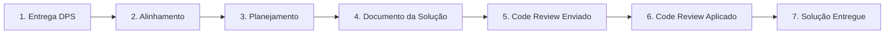

---
tags:
  - projeto
  - insi
  - veiling-holambra
  - sap
  - abap
  - metodologia
  - entrega-solucoes
data: 2026-03-31
---

# Squad Abap Projetos – Entrega de Soluções
* **Data:** 31/03/2026

---

## Sumário

* **01** – [Metodologia](#01--metodologia)
* **02** – [Documentação da Solução](#02--documentação-da-solução)
* **03** – [Code Review](#03--code-review)
* **04** – [Fluxo do Processo](#04--fluxo-do-processo)

---

## 01 – Metodologia

### / Metodologia

A partir do momento que o DPS esteja em Aprovação ou Aprovado, este será o momento que vamos designar um desenvolvedor para inicio da construção da solução.

Será necessário que o funcional envie para o Líder Técnico do projeto um e-mail com o Documento de Proposta da Solução (DPS) copiando a gestão do projeto, ao receber o Líder irá designar um profissional Abap/CPI para que realize uma agenda de alinhamento/entendimento com o funcional responsável pela solução, dessa agenda o Abap/CPI irá estimar um esforço, iremos planejar a data de entrega, informando a gestão do projeto para acompanhamento.

**Em Aprovação =** Se caracteriza quando o funcional realizou uma agenda com o cliente (key User) de apresentação do DPS, a gestão do projeto esta apenas aguardando a formalização ou até um possível ajuste do lado Meta Funcional sendo realizado. Ou seja, neste momento o documento irá sofrer modificações pequenas, alinhadas com todo o time (Gestão/Abap) e seguiremos com o inicio da construção da solução.

Para que possamos minimizar retrabalhos, perda de tempo (custo) de ambos os lados funcional e Abap/CPI se faz necessário seguir conforme estes status do documento de DPS.

---

## 02 – Documentação da Solução

### / Documento da Solução

Junto a entrega de toda a construção da solução o documento de **Especificação Tecnica** deverá ser produzido pelo profissional Abap desenvolvedor do GAP, neste além de informar os [[RICEFW - Reports Interfaces Conversions Enhancements Forms Workflows|Ricefws]], objetos da solução, também será evidenciado os testes técnicos que serão realizados após término do desenvolvimento.

---

## 03 – Code Review

### / Code Review

Além da entrega do documento de Especificação Tecnica, na Squad de Abaps de projetos temos uma metodologia aplicada, onde ao finalizar a solução, profissional irá enviar um enviar um e-mail com os devidos pré requisitos atendidos para o Líder técnico.

O Líder irá direcionar, outro profissional Abap para aplicar o **CODE REVIEW**, validando: formas, métodos, taxonomia, realização de testes TECNICOS evidenciados, atendendo as melhores práticas de desenvolvimento em Abap Cloud orientado a objeto, conforme a SAP recomenda atualmente.

Desta forma também reduzimos tempo de refinamento inicial com idas/vindas entre os profissionais logo que um desenvolvimento é entregue e o funcional inicia os testes.

---

## 04 – Fluxo do Processo

### / Fluxo do Processo

| Etapa | Descrição |
| :--- | :--- |
| **1. Entrega DPS** | Documento Aprovado ou Em Aprovação. |
| **2. Alinhamento** | Agenda Funcional/Abap para alinhamento e Entendimento. |
| **3. Planejamento** | Levantamento do esforço e data de entrega. |
| **4. Documento da Solução** | Especificação técnica finalizada. |
| **5. Code Review Enviado** | Code Review disponibilizado ao Líder Técnico. |
| **6. Code Review Aplicado** | Líder Técnico envia para profissional Abap aplicar code review. |
| **7. Solução Entregue** | A solução entregue ao funcional responsável para execução de testes. |
