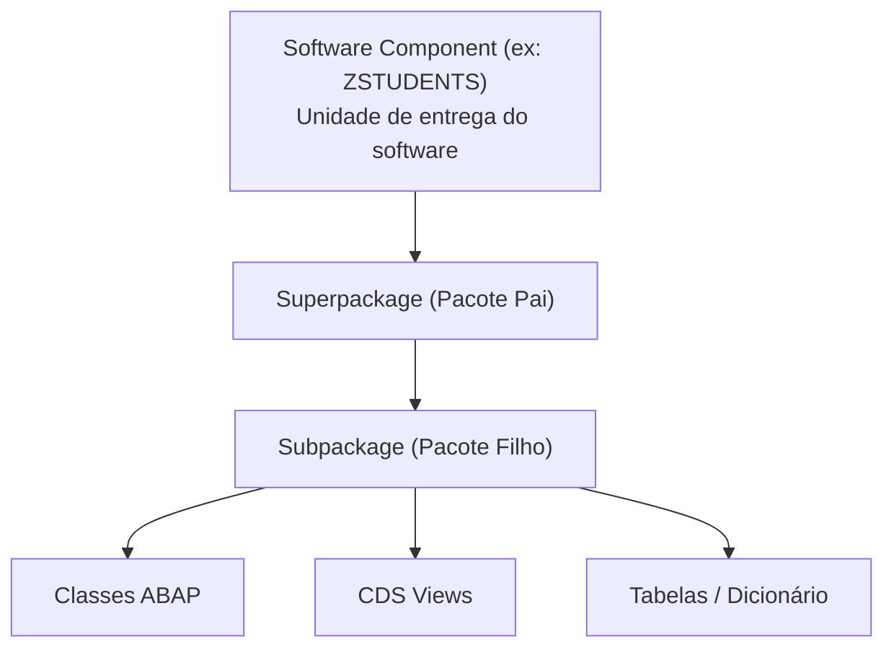
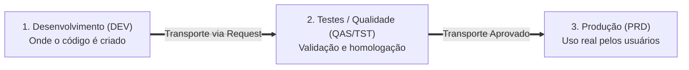

**Roteiro de Estudos Relacionado:** [[Roteiro de Estudos SAP]]
# Objetivo
Após concluir esta lição, você será capaz de criar e organizar um **Pacote ABAP (*ABAP Package*)**.

---

## 1. Pacotes ABAP (ABAP Packages)

### Organizando o Desenvolvimento

![[03_Software_Logistics_001.png]]

Ao criar qualquer objeto de desenvolvimento no ambiente ABAP (como uma classe, interface ou tabela), você deve associá-lo obrigatoriamente a um **Pacote (*Package*)**.

* **O que é um Pacote:** É uma pasta ou contêiner lógico que agrupa objetos de desenvolvimento que pertencem ao mesmo contexto funcional.
* **Componente de Software (*Software Component*):** Cada pacote pertence a um componente de software, que representa a unidade maior de entrega e versionamento de código no SAP.
* **Repositório ABAP (*ABAP Repository*):** É o conjunto completo de todos os objetos de desenvolvimento existentes no sistema. Por essa razão, esses itens também são chamados de **Objetos de Repositório (*Repository Objects*)**.

---

### Espaços de Nomes (Namespaces)

Para evitar conflitos de nomes entre o que a SAP cria e o que a sua empresa desenvolve, o sistema utiliza o conceito de **Namespaces (*Espaços de Nomes*)**:

| Prefixo | Uso | Descrição |
| :--- | :--- | :--- |
| **Z** ou **Y** | **Desenvolvimentos de Clientes** | Todo objeto customizado criado pela sua empresa deve iniciar obrigatoriamente com a letra `Z` ou `Y` (ex: `ZCL_MEU_PROGRAMA`). |
| **/NOME/** | **Parceiros e Produtos Certificados** | Empresas parceiras podem registrar um namespace exclusivo com a SAP delimitado por barras (ex: `/DMO/` ou `/EMPRESA/`). |
| Qualquer outra letra | **Padrão da SAP** | Reservado exclusivamente para objetos padrão entregues pela SAP. |

> [!NOTE]
> **Por que isso é importante?** A separação rígida por namespaces garante que, quando a SAP aplicar uma atualização ou suporte no sistema, nenhum programa customizado da sua empresa seja sobrescrito ou entre em colisão de nomes.

---

### Paisagem de Sistemas e Ambientes

As aplicações corporativas nunca são desenvolvidas diretamente no ambiente final de produção. O ciclo de vida é dividido em três sistemas (ou subcontas no SAP BTP):

---

## 2. Ordens de Transporte (Transport Requests)

![[03_Software_Logistics_002.png]]

Uma **Ordem de Transporte (*Transport Request*)** é como um "pacote de entrega" registrado no sistema que garante que todos os objetos modificados ou criados sejam transportados juntos de forma consistente entre os ambientes (de *DEV* para *TEST*, e depois para *PROD*).

### Como funciona o ciclo de uma Transport Request:

1. **Bloqueio de Objetos (*Locking*):**
   * Ao criar ou alterar um objeto, o sistema exige uma Transport Request e bloqueia o objeto (*lock*).
   * Isso impede que outro desenvolvedor edite o mesmo código ao mesmo tempo, evitando conflitos de versão.
2. **Trabalho em Equipe:**
   * Toda request possui um **Proprietário (*Owner*)**, que pode adicionar outros desenvolvedores como participantes (*Tasks*).
3. **Liberação (*Release*):**
   * Quando o desenvolvimento é concluído, cada desenvolvedor libera sua tarefa individual (*Task Release*).
   * Em seguida, o proprietário libera a requisição principal (*Request Release*).
4. **Desbloqueio e Importação:**
   * No momento da liberação, os objetos são desbloqueados e ficam prontos para o administrador do sistema (ou pipeline automático) importá-los para o ambiente de testes.

---

## 3. Demonstração Prática

* **Demonstração oficial:** [Iniciar Demonstração (Start Demo)](https://learnsap.enable-now.cloud.sap/pub/mmcp/index.html?show=project!PR_89A6964531BD691:uebung)

---

## 4. Exercício Prático: Criar um Pacote ABAP

Neste exercício, você adicionará o pacote de estudos aos seus favoritos e criará seu próprio pacote de desenvolvimento sob o superpacote **ZSTUDENTS**.

> [!IMPORTANT]
> O pacote que você criar agora será a "casa" de todos os objetos e classes que você desenvolverá ao longo deste curso.

### Atributos do Pacote a ser Criado

| Atributo | Valor | Descrição |
| :--- | :--- | :--- |
| **Name (*Nome*)** | `ZS4D400_##` | Substitua `##` pelo seu número de grupo/usuário (ex: `ZS4D400_01`). |
| **Description (*Descrição*)** | `My ABAP Package` | Descrição identificadora do pacote. |
| **Add to favorite packages** | Marcado (`Checked`) | Fixa o pacote na lista de acesso rápido. |
| **Superpackage (*Pacote Pai*)** | `ZSTUDENTS` | Pacote superior na hierarquia. |
| **Software Component** | `ZSTUDENTS` | Componente de software ao qual o pacote pertence. |

---

### Passo a Passo

#### 1. Adicionar o pacote `/LRN/S4D400_EXERCISE` aos Favoritos:
1. No **Project Explorer** (painel à esquerda no Eclipse), expanda a pasta do seu projeto ABAP Cloud.
2. Clique com o botão direito sobre o nó **Favorite Packages** e selecione **Add Package...**.
3. No campo de busca, digite `/LRN/S4D400`.
4. Na lista de resultados, selecione **/LRN/S4D400_EXERCISE** e clique em **OK**.

#### 2. Criar seu próprio Pacote ABAP:
1. No **Project Explorer**, clique com o botão direito na pasta raiz do seu projeto ABAP Cloud e escolha **New** → **ABAP Package**.
2. Preencha os campos iniciais:
   * **Name:** `ZS4D400_##` *(substitua `##` pelo seu número de usuário)*.
   * **Description:** `My ABAP Package`.
   * Marque a caixa de seleção **Add to favorite packages**.
   * **Superpackage:** `ZSTUDENTS`.
3. Clique em **Next**.
4. Confirme se o campo **Software Component** está preenchido com `ZSTUDENTS` e clique em **Next**.
5. Na tela de seleção de Transporte:
   * Se já houver uma request listada na opção **Choose from requests in which I am involved**, selecione-a.
   * Se a lista estiver vazia, marque a opção **Create a new request** e informe uma descrição (exemplo: `ABAP Exercises`).
6. Clique em **Finish**.

#### 3. Confirmar a criação nos Favoritos:
1. No **Project Explorer**, verifique dentro do nó **Favorite Packages** se o seu pacote `ZS4D400_##` já aparece listado.
2. *(Caso não apareça, repita o processo de adicionar pacote favorito buscando pelo seu nome `ZS4D400_##`)*.
