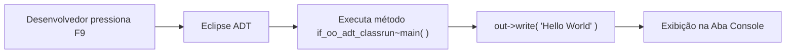

**Roteiro de Estudos Relacionado:** [[Roteiro de Estudos SAP]]
# Objetivo
Após concluir esta lição, você será capaz de criar e executar sua primeira aplicação em ABAP moderno ("Hello World") no Eclipse ADT.

---

## 1. Aplicação 'Hello World' no ABAP Moderno

Assim como em qualquer outra linguagem de programação, o primeiro passo para se familiarizar com a sintaxe e o ambiente de desenvolvimento é criar uma aplicação simples que exiba a mensagem *"Hello World"*.

### O Modelo Clássico vs. O Modelo Moderno

| Aspecto | Modelo Clássico (SAP ECC / GUI) | Modelo Moderno (ABAP Cloud / ADT) |
| :--- | :--- | :--- |
| **Tipo de Objeto** | Programa Executável / Relatório (*Report Executable* via transação `SE38`). | **Classe ABAP Global** (*ABAP Class* orientada a objetos via Eclipse ADT). |
| **Comando de Saída** | Comando legado `WRITE: / 'Hello World'.` | Método `out->write( 'Hello World' ).` |
| **Interface Visual Final** | Telas de seleção clássicas no SAP GUI. | Aplicações web modernas baseadas em **SAP Fiori Elements**. |
| **Ambiente de Teste Rápido** | Execução direta no SAP GUI (`F8`). | **Aba Console do Eclipse** via interface especial (`F9`). |

> [!NOTE]
> **Por que usamos uma classe com console?**
> No ABAP Cloud, os programas do tipo *Report* clássicos e o comando `WRITE` foram descontinuados por violarem os padrões modernos de arquitetura limpa (*Clean Core*). Hoje, toda a lógica de negócio reside em **classes**. Para que possamos testar classes rapidamente sem ter que construir uma tela Fiori completa, a SAP fornece a interface **`IF_OO_ADT_CLASSRUN`**.

---

### O que é a Interface `IF_OO_ADT_CLASSRUN`?

Uma **interface** no ABAP funciona como um "contrato" de programação: ela define regras e métodos que a classe se compromete a implementar.

A interface **`IF_OO_ADT_CLASSRUN`** exige a implementação de um método chamado `main`. Esse método recebe automaticamente um parâmetro chamado `out`, que permite escrever textos, tabelas ou variáveis diretamente na visualização de **Console** do Eclipse ADT:



---

## 2. Demonstração Prática

* **Demonstração oficial:** [Iniciar Demonstração (Start Demo)](https://learnsap.enable-now.cloud.sap/pub/mmcp/index.html?library=library.txt&show=project!PR_B569C1AE21873BA7:demo)

---

## 3. Exercício Prático: Criar a Aplicação Hello World

Neste exercício, você criará uma nova classe ABAP dentro do seu pacote de estudos e a executará no console do Eclipse.

### Atributos da Classe a ser Criada

| Atributo | Valor | Descrição |
| :--- | :--- | :--- |
| **Package (*Pacote*)** | `ZS4D400_##` | O seu pacote criado na lição anterior (`##` = seu número de grupo). |
| **Name (*Nome da Classe*)** | `ZCL_##_HELLO_WORLD` | Nome da classe no padrão de namespace de cliente (`Z`). |
| **Description (*Descrição*)** | `Primeira aplicação ABAP` | Breve texto explicativo da classe. |
| **Interfaces** | `IF_OO_ADT_CLASSRUN` | Interface que permite a execução direta via console no ADT. |
| **Transport Request** | Sua request criada | Ordem de transporte onde a classe será vinculada. |

---

### Passo a Passo

#### 1. Criar a nova Classe ABAP no ADT:
1. No menu superior do Eclipse, escolha **File** → **New** → **ABAP Class** (ou use o atalho **Ctrl + N** e filtre por *ABAP Class*).
2. No campo **Package**, informe o seu pacote: `ZS4D400_##`.
3. No campo **Name**, digite `ZCL_##_HELLO_WORLD` e adicione uma descrição.
4. Na seção **Interfaces**, clique no botão **Add...**.
5. No campo de busca, digite `IF_OO_ADT_CLASSRUN` e dê um duplo clique no resultado correspondente.
6. Clique em **Next**.
7. Na etapa de transporte, mantenha marcada a opção **Choose from requests in which I am involved** e selecione a sua Transport Request.
8. Clique em **Finish**.

#### 2. Implementar a lógica de saída no método `main`:
1. No editor de código aberto, localize o bloco de implementação do método:
   ```abap
   METHOD if_oo_adt_classrun~main.

   ENDMETHOD.
   ```
2. Adicione a linha de comando para imprimir o texto:
   ```abap
   METHOD if_oo_adt_classrun~main.
     out->write( 'Hello World' ).
   ENDMETHOD.
   ```

#### 3. Ativar e Executar a Classe:
1. **Ativação:** Pressione o atalho **Ctrl + F3** para compilar e ativar a classe.
   > [!TIP]
   > No ABAP, apenas salvar o arquivo (**Ctrl + S**) cria uma versão rascunho (*inactive*). Para que a versão se torne executável, ela precisa obrigatoriamente ser **ativada** (**Ctrl + F3**).
2. **Execução:** Com o cursor dentro do código da classe, pressione a tecla **F9** (ou clique com botão direito → *Run As* → *ABAP Application (Console)*).

#### 4. Validar o resultado na visualização de Console:
1. Observe a aba **Console** que se abrirá na parte inferior do Eclipse exibindo o resultado:
   ```text
   Hello World
   ```
2. *(Caso a aba não apareça automaticamente, vá no menu **Window** → **Show View** → **Other...**, digite `Console` e dê um duplo clique).*


