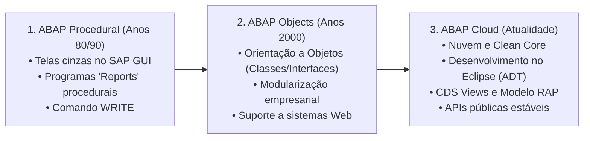

**Roteiro de Estudos Relacionado:** [[Roteiro de Estudos SAP]]
# Objetivos
Após concluir esta lição, você será capaz de:
- Descrever a evolução histórica do ABAP e a transição para a nuvem.
- Compreender as diferentes versões da linguagem ABAP (*ABAP Language Versions*).
- Identificar os componentes tecnológicos fundamentais do **ABAP Cloud**.
- Aplicar as regras básicas de sintaxe do ABAP moderno.

---

## 1. O ABAP Ontem e Hoje

<iframe 
    src="https://cdnapisec.kaltura.com/p/1921661/embedPlaykitJs/uiconf_id/50355372?iframeembed=true&entry_id=1_8jbaexoy" 
    width="100%" 
    height="400" 
    allowfullscreen 
    frameborder="0">
</iframe>

### Origem e Evolução

O **ABAP** (*Advanced Business Application Programming*) é a linguagem de programação de alto nível criada pela SAP para desenvolver e customizar aplicações de negócio empresariais.

Ao longo das décadas, o ABAP passou por três grandes fases:



---

### Versões de Linguagem ABAP 

No SAP, cada programa ou classe possui um atributo interno que define a sua **Versão de Linguagem (*ABAP Language Version*)**. Essa configuração determina quais comandos, tabelas e objetos de sistema aquele código tem permissão de usar:

![[01_-_ABAP_then_and_now_002.png]]

| Versão da Linguagem                           | Onde é Utilizada?                                                             | Regras e Restrições                                                                                                                                                                     |
| :-------------------------------------------- | :---------------------------------------------------------------------------- | :-------------------------------------------------------------------------------------------------------------------------------------------------------------------------------------- |
| **Standard ABAP** (*ABAP Padrão*)             | Sistemas legados (SAP ECC), SAP S/4HANA On-Premise e Private Cloud.           | **Sem restrições de sintaxe:** Permite comandos legados e acesso direto a qualquer tabela ou função interna do sistema. **Desvantagem:** Dificulta upgrades (*quebra o Clean Core*).    |
| **ABAP for Key Users** (*Usuários-Chave*)     | Adaptações no-code / low-code feitas diretamente na interface web do S/4HANA. | **Conjunto muito restrito:** Voltado para analistas de negócio criarem validações simples em campos de tela sem precisar programar classes inteiras.                                    |
| **ABAP for Cloud Development** (*ABAP Cloud*) | **SAP BTP ABAP Environment** e **SAP S/4HANA Cloud (Public e Private)**.      | **Otimizado para a Nuvem:** Permite apenas sintaxe moderna e acesso exclusivo a **APIs Públicas Oficiais (*Released APIs*)**, impedindo o acesso indevido a estruturas internas da SAP. |

> [!NOTE]
> **Foco deste curso:** Este treinamento foca na sintaxe moderna compatível com o **ABAP Cloud**, garantindo que todo o código aprendido seja pronto para a nuvem (*Cloud-Ready*) e compatível com as melhores práticas de [[Clean Core]].

---

## 2. A Arquitetura do ABAP Cloud

<iframe 
    src="https://cdnapisec.kaltura.com/p/1921661/embedPlaykitJs/uiconf_id/50355372?iframeembed=true&entry_id=1_80fxqpsp" 
    width="100%" 
    height="400" 
    allowfullscreen 
    frameborder="0">
</iframe>

![[02-ABAP_Cloud.png]]

O **ABAP Cloud** não é apenas uma nova versão da linguagem, mas sim um modelo arquitetural completo para desenvolvimento de software moderno:

* **Linguagem ABAP Cloud (*ABAP for Cloud Development*):** Linguagem enxuta, sem comandos obsoletos e com verificação automática de compilação (*ATC - ABAP Test Cockpit*).
* **Ambiente de Desenvolvimento (ADT):** Uso exclusivo do **Eclipse** com o plug-in *ABAP Development Tools*. O antigo ambiente SAP GUI (`SE38`, `SE80`) não é utilizado no ABAP Cloud.
* **Modelo de Dados com [[CDS - Core Data Services|CDS Views]]:** Modelagem de dados executada diretamente na camada do banco SAP HANA (*Code Pushdown*).
* **Modelo Transacional com [[RAP - ABAP RESTful Application Programming Model|RAP]]:** Framework padrão para criação de serviços web OData e aplicações web modernas em **SAP Fiori**.
* **APIs Públicas Liberadas (*Released APIs*):** Acesso estritamente controlado a funcionalidades do sistema através de interfaces garantidas pela SAP contra quebras de versão.

![[02 - ABAP Cloud Availability.png]]

> [!IMPORTANT]
> **Onde o ABAP Cloud é obrigatório?**
> * **Obrigatório:** No **SAP BTP** e no **SAP S/4HANA Cloud Public Edition**.
> * **Fortemente Recomendado:** No **SAP S/4HANA Private Edition** e instalações *On-Premise*, para garantir a estratégia de [[Clean Core]] e facilitar migrações futuras.

---

## 3. Fundamentos da Sintaxe ABAP

<iframe 
    src="https://cdnapisec.kaltura.com/p/1921661/embedPlaykitJs/uiconf_id/50355372?iframeembed=true&entry_id=1_8upjznmg" 
    width="100%" 
    height="400" 
    allowfullscreen 
    frameborder="0">
</iframe>

![[02_-_Basics_of_ABAP_syntax_001.png]]

Para quem vem de linguagens como C#, Java, Python ou JavaScript, o ABAP possui particularidades de sintaxe essenciais:

### 1. Instruções terminam com Ponto (`.`)
Ao contrário de linguagens que utilizam ponto e vírgula (`;`), no ABAP **toda instrução (*statement*) é finalizada com um ponto final (`.`)**:
```abap
out->write( 'Olá Mundo' ).
```

### 2. Espaçamento Obrigatório
O compilador ABAP exige espaços em branco entre operadores, parênteses e identificadores. Escrever tudo "junto" gera erro de sintaxe:
```abap
" Correto:
lv_total = lv_valor1 + lv_valor2.

" Incorreto (causa erro de sintaxe no ABAP):
lv_total=lv_valor1+lv_valor2.
```

### 3. Case-Insensitive (Indiferente a maiúsculas/minúsculas)
O compilador não diferencia palavras em maiúsculas ou minúsculas. Os dois exemplos abaixo são idênticos para o sistema:
```abap
DATA lv_nome TYPE string.
data lv_nome type string.
```
*(No Eclipse ADT, você pode utilizar o recurso **Pretty Printer** com **Shift + F1** para padronizar as palavras-chave automaticamente).*

### 4. Instruções em Cadeia (*Chained Statements*)
Quando várias instruções consecutivas iniciam com a mesma palavra-chave, podemos encadear os comandos usando dois-pontos (`:`) e separando os itens por vírgula (`,`), finalizando com ponto (`.`):
```abap
" Sem encadeamento:
DATA gv_id TYPE i.
DATA gv_nome TYPE string.

" Com encadeamento (mais limpo e legível):
DATA: gv_id   TYPE i,
      gv_nome TYPE string.
```

### 5. Comentários de Código
No ABAP, existem duas maneiras de comentar linhas:
* **Aspas duplas (`"`):** Podem ser inseridas em qualquer posição da linha. Tudo o que vier após as aspas será considerado comentário.
* **Asterisco (`*`):** Transforma a linha inteira em comentário (deve ser inserido obrigatoriamente na primeira coluna da linha).

```abap
* Este é um comentário de linha inteira (asterisco na primeira posição)
DATA lv_status TYPE c LENGTH 1. " Este é um comentário ao lado do código
```

> [!TIP]
> **Atalho no Eclipse ADT para Comentários:**  
> Selecione as linhas desejadas e pressione **Ctrl + /** (ou **Ctrl + 7**) para comentar ou descomentar o bloco instantaneamente.

---

## 4. Demonstração Prática: Comentar e Descomentar Código

* **Demonstração oficial:** [Iniciar Demonstração (Start Demo)](https://learnsap.enable-now.cloud.sap/pub/mmcp/index.html?library=library.txt&show=project!PR_BE9803D7D14C7EAB:demo)
