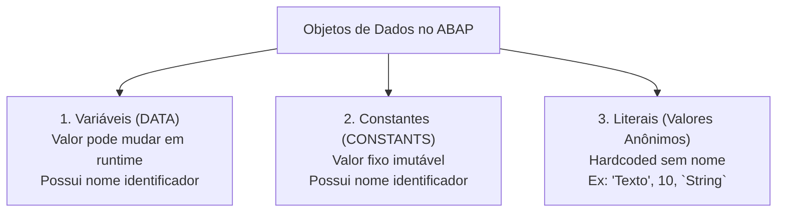

**Roteiro de Estudos Relacionado:** [[Roteiro de Estudos SAP]]
# Objetivos
Após concluir esta lição, você será capaz de:
- Declarar e manipular objetos de dados (*Variáveis*, *Constantes* e *Literais*).
- Identificar e utilizar tipos de dados nativos (*Built-in*), locais (`TYPES`) e globais do Dicionário de Dados.
- Realizar atribuições de valor e compreender os riscos de conversões implícitas.
- Utilizar o comando `CLEAR` e declarações modernas *inline* (`DATA(...)`).

---

## 1. Objetos de Dados no ABAP (*Data Objects*)

<iframe 
    src="https://cdnapisec.kaltura.com/p/1921661/embedPlaykitJs/uiconf_id/50355372?iframeembed=true&entry_id=1_6ei6t5pz" 
    width="100%" 
    height="400" 
    allowfullscreen 
    frameborder="0">
</iframe>

Um **objeto de dados (*data object*)** representa uma área de memória reservada pelo programa durante a execução para armazenar informações.

No ABAP, existem três categorias fundamentais de objetos de dados:

![[01_-_Data_Objects_and_Types_001.png]]



1. **Variáveis (`DATA`):** Seu conteúdo pode ser alterado a qualquer momento em tempo de execução (*runtime*). São identificadas por um nome e sempre iniciam com um valor padrão bem definido (*initial value*).
2. **Constantes (`CONSTANTS`):** Possuem valor fixo definido no código-fonte que **não pode ser alterado**. Qualquer tentativa de modificar uma constante em execução resulta em erro de compilação.
3. **Literais:** Valores fixos anônimos digitados diretamente no código (sem nome de variável). Devem ser usados apenas para inicializar variáveis ou definir constantes.

> [!NOTE]
> **Tipagem Forte e Estática:** Todo objeto de dados em ABAP possui um tipo de dados associado. Uma vez declarado, o tipo de dados daquele objeto permanece inalterado durante toda a execução do programa.

---

## 2. Declaração de Variáveis (`DATA`)

Uma variável é declarada utilizando a palavra-chave **`DATA`**:

![[01_-_Data_Objects_and_Types_002.png]]

Uma instrução `DATA` é composta por três partes principais:

```abap
DATA lv_quantidade TYPE i VALUE 10.
```

1. **Nome da Variável (`DATA <nome>`):** Pode ter até 30 caracteres, contendo letras (A-Z), dígitos (0-9) e sublinhado (`_`). Deve iniciar obrigatoriamente com uma letra ou sublinhado.
2. **Tipo de Dados (`TYPE <tipo>`):** Especifica a estrutura técnica do dado (ex: `i` para números inteiros, `string` para texto de tamanho dinâmico).
3. **Valor Inicial (`VALUE <valor>` - Opcional):** Define o valor de partida da variável. Se for omitido, a variável assume o valor inicial padrão do tipo (números começam com `0`, textos com vazio `""`, datas com `'00000000'`).

---
## 3. Fontes de Tipos de Dados no ABAP
 ![[01_-_Data_Objects_and_Types_003 (1).png]]

No ABAP, você pode tipar suas variáveis a partir de três origens:

| Origem do Tipo | Como Funciona | Exemplo |
| :--- | :--- | :--- |
| **1. Tipos Pré-definidos (*Built-in*)** | 14 tipos primitivos nativos da linguagem para dados numéricos, alfanuméricos e binários. | `i`, `string`, `c`, `n`, `d`, `t`, `p` |
| **2. Tipos Locais (`TYPES`)** | Criados pelo desenvolvedor dentro do programa ou classe para reutilização local. | `TYPES ty_valor TYPE p LENGTH 8 DECIMALS 2.` |
| **3. Dicionário de Dados (*DDIC / Global Types*)** | Tipos globais gerenciados pelo Repositório SAP. Além de definirem o tipo técnico, contêm rótulos de tela (*labels*), documentação e validações de negócio. | `DATA lv_aeroporto TYPE /dmo/airport_id.` |

### Principais Tipos Nativos (*Built-in*):
* **`i` (Integer):** Números inteiros de 4 bytes (ex: `-10`, `0`, `450`).
* **`string`:** Texto de tamanho dinâmico (aloca memória sob demanda; ideal para textos sem limite fixo).
* **`c` (Character):** Texto de tamanho fixo definido por `LENGTH n` (preenchido com espaços à direita).
* **`n` (Numeric Text):** Caracteres que contêm apenas dígitos (ex: CEP, CPF, números de documento onde não se realizam operações matemáticas). Preenchido com zeros à esquerda.
* **`d` (Date):** Data no formato fixo de 8 posições (`YYYYMMDD`).
* **`t` (Time):** Hora no formato fixo de 6 posições (`HHMMSS`).
* **`p` (Packed Decimal):** Números decimais de alta precisão com `LENGTH l DECIMALS d`. **Essencial para finanças, moedas e cálculos comerciais**, pois evita erros de arredondamento de ponto flutuante.

---
## 4. Prática Guiada: Testando Tipos Nativos (*Built-in*)

1. Abra sua classe de testes no Eclipse ADT (ou crie uma nova com a interface `IF_OO_ADT_CLASSRUN`).
2. Adicione o seguinte código no método `if_oo_adt_classrun~main`:

```abap
* Objetos de Dados com Tipos Built-in
**********************************************************************
    " Descomente uma declaração por vez para testar:
    DATA variable TYPE string.
*    DATA variable TYPE i.
*    DATA variable TYPE d.
*    DATA variable TYPE c LENGTH 10.
*    DATA variable TYPE n LENGTH 10.
*    DATA variable TYPE p LENGTH 8 DECIMALS 2.

* Exibição no Console
**********************************************************************
    out->write( 'Resultado com Valor Inicial:' ).
    out->write( variable ).
    out->write( '---------' ).
    
    variable = '19891109'.
    out->write( 'Resultado com Valor Atribuído (19891109):' ).
    out->write( variable ).
    out->write( '---------' ).
```

3. Pressione **Ctrl + F3** para ativar e **F9** para rodar no console.
4. **O que observar:** Note como a mesma string `'19891109'` é formatada diferentemente dependendo do tipo da variável:
   * No tipo `d`, vira uma data formatada (`1989-11-09`).
   * No tipo `i`, vira o número inteiro `19.891.109`.
   * No tipo `p`, aplica as casas decimais configuradas.

---

## 5. Constantes e Literais

### Declaração de Constantes (`CONSTANTS`)
![[01_-_Data_Objects_and_Types_007.png]]

A declaração de uma constante segue a mesma sintaxe de `DATA`, com uma regra obrigatória: **a adição `VALUE` é indispensável**:

```abap
CONSTANTS c_pi TYPE p LENGTH 2 DECIMALS 2 VALUE '3.14'.
CONSTANTS c_status_ativo TYPE c LENGTH 1 VALUE 'A'.
```

> [!WARNING]
> Tentar declarar uma constante sem `VALUE` ou tentar atribuir um novo valor a ela em tempo de execução causará um erro de sintaxe imediato.

---

### Tipos de Literais em ABAP

![[01_-_Data_Objects_and_Types_008.png]]

O ABAP reconhece três tipos de literais:

1. **Literais Numéricos (*Number Literals*):** Inteiros escritos sem aspas (ex: `12345`). Assumem o tipo `i` por padrão.
   > [!IMPORTANT]
   > Não existe literal numérico com ponto direto no código (ex: `12345.67` gera erro de sintaxe). Decimais devem ser declarados com o valor entre aspas `'12345.67'` para variáveis do tipo `p`.
2. **Literais de Texto (*Text Literals* - `'...'`):** Delimitados por **aspas simples**. Têm o tipo `c`. Espaços em branco no final são descartados pelo compilador.
3. **Literais de String (*String Literals* - `` `...` ``):** Delimitados por **crases (*backticks*)**. Têm o tipo `string`. Preservam exatamente todos os espaços em branco no início e no final.

---

## 6. Prática Guiada: Tipos Locais, Globais e Literais

Copie o trecho abaixo para o método `main` da sua classe de testes:

```abap
* Exemplo 1: Tipos Locais (TYPES)
**********************************************************************
    TYPES my_type TYPE p LENGTH 3 DECIMALS 2.
*    TYPES my_type TYPE i.
*    TYPES my_type TYPE string.

    DATA my_variable TYPE my_type.
    out->write( `my_variable (TYPE MY_TYPE):` ).
    out->write( my_variable ).
    out->write( `---------` ).

* Exemplo 2: Tipos Globais do Dicionário de Dados
**********************************************************************
    " Posicione o cursor sobre /dmo/airport_id e pressione F2 ou F3
    DATA airport TYPE /dmo/airport_id VALUE 'FRA'.
    out->write( `airport (TYPE /DMO/AIRPORT_ID):` ).
    out->write( airport ).
    out->write( `---------` ).

* Exemplo 3: Constantes
**********************************************************************
    CONSTANTS c_text   TYPE string VALUE `Hello World`.
    CONSTANTS c_number TYPE i      VALUE 12345.

    out->write( `c_text:` ).
    out->write( c_text ).
    out->write( `c_number:` ).
    out->write( c_number ).
    out->write( `---------` ).

* Exemplo 4: Diferença entre Literais
**********************************************************************
    out->write( 'Texto com aspas simples      ' ). " Tipo C: remove espaços extras
    out->write( `Texto com crase (backtick)   ` ). " Tipo STRING: preserva espaços exatos
    out->write( 12345 ).                           " Tipo I: literal numérico
```

---

## 7. Atribuição de Valores e Conversões Implícitas

A atribuição de valor é feita com o operador de igualdade (`=`):
```abap
lv_total = 150.
```

### Conversões Implícitas de Tipo (*Implicit Type Conversions*)

![[02_-_Value_Assignements_002 (1).png]]
Se a variável de destino e a expressão de origem tiverem tipos diferentes, o ambiente de execução tentará realizar uma **conversão implícita**. 

**Por que você deve evitar conversões de tipos diferentes:**
1. **Consumo de Memória e CPU:** Fazer o sistema converter tipos a cada atribuição consome tempo desnecessário de processamento.
2. **Risco de Dump (*Runtime Error*):** Se o sistema tentar converter um texto com letras para um número inteiro (`lv_num = 'ABC'.`), o programa abortará com erro fatal (*Dump de Runtime*).
3. **Perda de Dados (*Truncamento*):** Se você atribuir um texto de 20 caracteres a uma variável de tamanho fixo com apenas 10 caracteres, o conteúdo excedente será cortado silenciosamente.

---

## 8. Resetando Variáveis com o Comando `CLEAR`

Para limpar uma variável e devolvê-la ao seu valor inicial padrão, utiliza-se a instrução **`CLEAR`**:

![[02_-_Value_Assignements_003.png]]

```abap
DATA lv_valor TYPE i VALUE 100. " Começa com 100

CLEAR lv_valor. " Agora lv_valor volta a ser 0
```

> [!NOTE]
> O comando `CLEAR` sempre redefine o objeto para o **valor inicial técnico do tipo** (`0`, `""`, etc.), desconsiderando qualquer valor inicial que tenha sido informado na adição `VALUE` durante a declaração.

---

## 9. Declarações Modernas em Linha (*Inline Declarations*)

<iframe 
    src="https://cdnapisec.kaltura.com/p/1921661/embedPlaykitJs/uiconf_id/50355372?iframeembed=true&entry_id=1_9ig9t2qc" 
    width="100%" 
    height="400" 
    allowfullscreen 
    frameborder="0">
</iframe>

No ABAP moderno, você não precisa declarar todas as variáveis no início do método. É possível declarar a variável no exato momento em que ela recebe um valor, utilizando o operador **`DATA(...)`**:

```abap
" Forma Antiga (Declaração prévia obrigatória):
DATA lv_mensagem TYPE string.
lv_mensagem = 'Processamento concluído'.

" Forma Moderna (Declaração Inline):
DATA(lv_mensagem) = 'Processamento concluído'.
```

O compilador infere o tipo técnico da nova variável automaticamente com base no valor da expressão à direita.

---