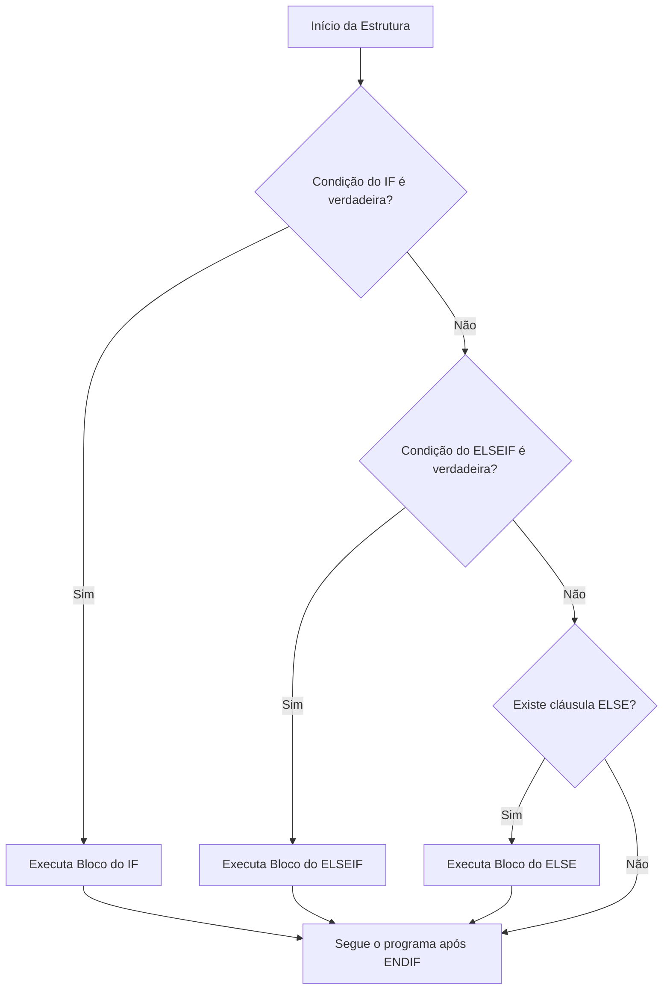
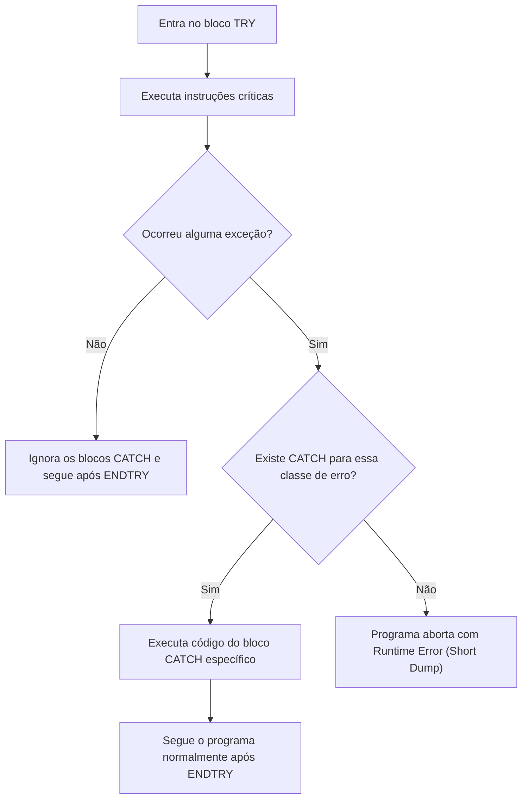

**Roteiro de Estudos Relacionado:** [[Roteiro de Estudos SAP]]
# Objetivos
Após concluir esta lição, você será capaz de:
- Implementar desvios condicionais com as estruturas `IF ... ENDIF` e `CASE ... ENDCASE`.
- Construir condições lógicas avançadas com operadores relacionais e expressões especiais (`IS INITIAL`, `BETWEEN`).
- Tratar exceções em tempo de execução com `TRY ... CATCH ... ENDTRY`, prevenindo paradas críticas do programa (*Runtime Errors / Dumps*).
- Implementar laços de repetição controlados com `DO ... ENDDO` e compreender o papel das variáveis de sistema `sy-index` e `sy-tabix`.

---

## 1. Desvios Condicionais (*Conditional Branching*)

Um desvio condicional é uma estrutura que permite ramificar a execução do código de acordo com o resultado de uma ou mais condições lógicas.

![[01_-__Conditional_Branching_001.png]]
### Estrutura `IF ... ELSEIF ... ELSE ... ENDIF`

A forma mais comum de desvio condicional no ABAP:



> [!IMPORTANT]
> **Ponto Final Obrigatório:** Ao contrário de muitas outras linguagens, no ABAP **cada linha de condição**, bem como as palavras-chave `ELSE.` e `ENDIF.`, exigem obrigatoriamente um ponto final (`.`):
> ```abap
> IF lv_valor = 0.
>   out->write( 'Valor é zero' ).
> ELSEIF lv_valor > 0.
>   out->write( 'Valor é positivo' ).
> ELSE.
>   out->write( 'Valor é negativo' ).
> ENDIF.
> ```

---

### Condições e Operadores Lógicos

![[01_-__Conditional_Branching_002.png]]

Uma condição lógica combina variáveis, literais, expressões e operadores que o sistema avalia como verdadeiro (*true*) ou falso (*false*).

#### 1. Operadores de Comparação Básicos:
* `=` (igual)
* `<>` (diferente)
* `>` (maior que) e `>=` (maior ou igual)
* `<` (menor que) e `<=` (menor ou igual)

> [!NOTE]
> O ABAP utiliza o mesmo símbolo (`=`) para atribuição e para comparação de igualdade. O compilador identifica a função com base na posição da instrução.

#### 2. Operadores Booleanos:
* `AND` (E): Ambas as condições devem ser verdadeiras.
* `OR` (OU): Ao menos uma condição deve ser verdadeira.
* `NOT` (NÃO): Inverte o resultado lógico. Sem parênteses, `NOT` tem precedência sobre `AND`, e `AND` tem precedência sobre `OR`.

#### 3. Expressões Lógicas Especiais:
* **`IS INITIAL` / `IS NOT INITIAL`:** Testa se o objeto contém o valor inicial padrão do seu tipo (`0`, vazio `""`, `'00000000'`). É a forma padrão no ABAP de verificar se uma variável está vazia ou preenchida:
  ```abap
  IF lv_nome IS INITIAL.
    out->write( 'O nome não foi informado' ).
  ENDIF.
  ```
* **`BETWEEN ... AND ...`:** Testa se um valor está dentro de uma faixa (inclusive os limites):
  ```abap
  IF lv_idade BETWEEN 18 AND 65.
    out->write( 'Faixa etária ativa' ).
  ENDIF.
  ```

---

### Estrutura `CASE ... WHEN ... ENDCASE`

![[01_-__Conditional_Branching_003.png]]

A estrutura `CASE` é recomendada quando testamos **uma única variável contra múltiplos valores possíveis de igualdade**:

```abap
CASE lv_status.
  WHEN 'A'.
    out->write( 'Status: Ativo' ).
  WHEN 'P'.
    out->write( 'Status: Pendente' ).
  WHEN 'C'.
    out->write( 'Status: Cancelado' ).
  WHEN OTHERS.
    out->write( 'Status desconhecido' ).
ENDCASE.
```

> [!TIP]
> **Quando usar CASE vs. IF?**  
> Embora qualquer `CASE` possa ser escrito como `IF ... ELSEIF`, utilize `CASE` sempre que comparar uma mesma variável com valores literais. Isso deixa o código muito mais legível e limpo.

---

## 2. Prática Guiada: Testando Desvios Condicionais

No método `if_oo_adt_classrun~main` da sua classe de testes, execute o trecho a seguir:

```abap
* Declaração de Constante para Testes
**********************************************************************
    CONSTANTS c_number TYPE i VALUE 0.
*   CONSTANTS c_number TYPE i VALUE 1.
*   CONSTANTS c_number TYPE i VALUE 2.
*   CONSTANTS c_number TYPE i VALUE -1.

* Exemplo 1: IF ... ELSE ... ENDIF simples
**********************************************************************
    out->write( |--- Exemplo 1: IF Simples ---| ).
    IF c_number = 0.
      out->write( |O valor de c_number é ZERO| ).
    ELSE.
      out->write( |O valor de c_number NÃO é zero| ).
    ENDIF.

* Exemplo 2: IF ... ELSEIF ... ELSE ... ENDIF
**********************************************************************
    out->write( |--- Exemplo 2: Múltiplas Ramificações ---| ).
    IF c_number = 0.
      out->write( |O valor de c_number é ZERO| ).
    ELSEIF c_number > 0.
      out->write( |O valor de c_number é MAIOR que zero| ).
    ELSE.
      out->write( |O valor de c_number é MENOR que zero| ).
    ENDIF.

* Exemplo 3: CASE ... WHEN ... ENDCASE
**********************************************************************
    out->write( |--- Exemplo 3: Estrutura CASE ---| ).
    CASE c_number.
      WHEN 0.
        out->write( |Valor ZERO| ).
      WHEN 1.
        out->write( |Valor UM| ).
      WHEN 2.
        out->write( |Valor DOIS| ).
      WHEN OTHERS.
        out->write( |Nenhuma das opções anteriores| ).
    ENDCASE.
```

---

## 3. Tratamento de Exceções (*Exception Handling*)

<iframe 
    src="https://cdnapisec.kaltura.com/p/1921661/embedPlaykitJs/uiconf_id/50355372?iframeembed=true&entry_id=1_p1u9q3et" 
    width="100%" 
    height="400" 
    allowfullscreen 
    frameborder="0">
</iframe>

![[03_-_Handle_Exceptions_001.png]]

Uma **exceção (*exception*)** representa uma condição de erro que ocorre durante a execução do programa (ex: divisão por zero, conversão inválida de texto para número ou tentativa de ler uma linha inexistente em uma tabela).

### O que acontece se uma exceção não for tratada?
Se o programa não contiver um bloco de captura para o erro:
* O sistema interrompe imediatamente a execução da aplicação.
* É gerado um erro fatal conhecido como **Runtime Error / Short Dump** (analisável via transação `ST22` no ambiente clássico ou visualizável no console do ADT).

---

### A Estrutura `TRY ... CATCH ... ENDTRY`

<iframe 
    src="https://cdnapisec.kaltura.com/p/1921661/embedPlaykitJs/uiconf_id/50355372?iframeembed=true&entry_id=1_xgayu5wy" 
    width="100%" 
    height="400" 
    allowfullscreen 
    frameborder="0">
</iframe>

![[03_-_Handle_Exceptions_003.png]]

Para evitar a parada inesperada da aplicação, envolvemos o código com risco de erro dentro de um bloco **`TRY`**:



### Principais Classes de Exceção do Sistema:
* **`cx_sy_zerodivide`:** Disparada ao tentar dividir qualquer número por zero.
* **`cx_sy_conversion_no_number`:** Disparada ao tentar converter uma string com letras em um tipo numérico.
* **`cx_sy_itab_line_not_found`:** Disparada ao tentar ler um índice de linha inexistente em uma tabela interna via expressão de tabela `tabela[ indice ]`.

---

## 4. Prática Guiada: Tratamento de Exceções

Copie o código a seguir para o método `main` e analise como os erros são capturados:

```abap
* Declarações
**********************************************************************
    DATA result  TYPE i.
    DATA numbers TYPE TABLE OF i.

    APPEND 123 TO numbers. " Insere uma linha na tabela interna

* Exemplo 1: Erro de Conversão
**********************************************************************
    CONSTANTS c_text TYPE string VALUE 'ABC'. " Tente alterar para '123'
    out->write( |--- Exemplo 1: Conversão Inválida ---| ).
    TRY.
        result = c_text.
        out->write( |Valor convertido: { result }| ).
      CATCH cx_sy_conversion_no_number.
        out->write( |Erro capturado: '{ c_text }' não é um número válido!| ).
    ENDTRY.

* Exemplo 2: Divisão por Zero
**********************************************************************
    CONSTANTS c_number TYPE i VALUE 0. " Tente alterar para 5
    out->write( |--- Exemplo 2: Divisão por Zero ---| ).
    TRY.
        result = 100 / c_number.
        out->write( |100 / { c_number } = { result }| ).
      CATCH cx_sy_zerodivide.
        out->write( |Erro capturado: Divisão por zero não é permitida!| ).
    ENDTRY.

* Exemplo 3: Linha Não Encontrada em Tabela Interna
**********************************************************************
    CONSTANTS c_index TYPE i VALUE 2. " Tabela só possui 1 linha
    out->write( |--- Exemplo 3: Linha Não Encontrada ---| ).
    TRY.
        result = numbers[ c_index ].
        out->write( |Conteúdo da linha { c_index }: { result }| ).
      CATCH cx_sy_itab_line_not_found.
        out->write( |Erro capturado: A tabela não possui a linha { c_index }!| ).
    ENDTRY.

* Exemplo 4: Múltiplos Blocos CATCH Combinados
**********************************************************************
    CONSTANTS c_char TYPE c LENGTH 1 VALUE '0'.
    out->write( |--- Exemplo 4: Múltiplas Exceções ---| ).
    TRY.
        result = numbers[ 2 / c_char ].
        out->write( |Resultado: { result }| ).
      CATCH cx_sy_zerodivide.
        out->write( |Erro: Divisão por zero!| ).
      CATCH cx_sy_conversion_no_number.
        out->write( |Erro: Caractere '{ c_char }' não é numérico!| ).
      CATCH cx_sy_itab_line_not_found.
        out->write( |Erro: Linha da tabela não encontrada!| ).
    ENDTRY.
```

---

## 5. Laços de Repetição (*Iterations*)

![[02_-_Implement_Itterations_001.png]]

Iterações são estruturas de repetição que executam um bloco de instruções múltiplas vezes.

### 1. Laço `DO ... ENDDO` com Contagem Fixa (`TIMES`)
Permite definir explicitamente quantas vezes o bloco será executado:
```abap
DO 5 TIMES.
  out->write( |Execução número { sy-index }| ).
ENDDO.
```

### 2. O Contador de Sistema `sy-index`
Dentro de um laço `DO ... ENDDO`, o sistema SAP atualiza automaticamente a variável inteira **`sy-index`**, que atua como contador de repetições:
> [!IMPORTANT]
> **Base 1:** Ao contrário de linguagens como C#, Python ou Java (onde loops iniciam em 0), no ABAP a variável **`sy-index` sempre começa em 1** na primeira iteração.

---

### 3. Interrupção do Laço com a Instrução `EXIT`
Podemos interromper a execução de um loop antes do término utilizando o comando `EXIT`:
```abap
DO.
  out->write( |Iteração: { sy-index }| ).
  
  IF sy-index >= 10.
    EXIT. " Sai do loop imediatamente
  ENDIF.
ENDDO.
```

> [!WARNING]
> Cuidado com laços infinitos! Se um `DO ... ENDDO` não tiver a cláusula `TIMES` e a condição do `EXIT` nunca se tornar verdadeira, o programa entrará em loop infinito até estourar o tempo limite de execução do servidor (*Timeout Dump*).

---

### 4. Laços sobre Tabelas Internas (`LOOP ... ENDLOOP`)
Para percorrer coleções de dados (tabelas internas), utiliza-se a estrutura `LOOP AT`:
* O laço é executado uma vez para cada linha existente na tabela interna.
* A variável de sistema **`sy-tabix`** armazena o número da linha atual que está sendo processada na tabela.

---

## 6. Prática Guiada: Testando Laços de Repetição

Copie o código a seguir para testar o laço `DO` com `TIMES` e com condição de interrupção:

```abap
* Declarações
**********************************************************************
    CONSTANTS c_number TYPE i VALUE 3.
    DATA number TYPE i.

* Exemplo 1: DO com TIMES
**********************************************************************
    out->write( |--- Exemplo 1: DO com TIMES ---| ).
    DO c_number TIMES.
      out->write( |Iteração { sy-index }: Olá Mundo| ).
    ENDDO.

* Exemplo 2: DO com Condição de Parada (EXIT)
**********************************************************************
    out->write( |--- Exemplo 2: DO com Condição de Parada ---| ).
    number = c_number * c_number. " Inicia com 3 * 3 = 9

    " Contagem regressiva até c_number
    DO.
      out->write( |{ sy-index } - Valor atual de number: { number }| ).
      number = number - 1.
      
      IF number <= c_number.
        EXIT. " Encerra a repetição
      ENDIF.
    ENDDO.
```

---

## 📌 Termos e Conceitos para Adicionar em `03_Resources/SAP/Conceitos`

Abaixo estão os conceitos fundamentais apresentados nesta lição recomendados para criação de notas dedicadas na pasta `03_Resources/SAP/Conceitos`:

- `[[Estruturas Condicionais no ABAP (IF e CASE)]]` — Regras de sintaxe, ramificações `ELSEIF`, pontuação obrigatória e escolha de arquitetura entre IF e CASE.
- `[[Tratamento de Exceções no ABAP (TRY-CATCH e Classes CX_)]]` — Captura de exceções tratáveis do sistema, prevenção de Short Dumps (`ST22`) e classes padrão.
- `[[Laços de Repetição (DO, LOOP e Variáveis de Sistema sy-index e sy-tabix)]]` — Controle de iterações, cláusula TIMES, saída antecipada com EXIT e indexação baseada em 1.
- `[[Expressões Lógicas e Verificação de Estado (IS INITIAL)]]` — Operadores relacionais e validação de valores padrão em tipos de dados ABAP.
