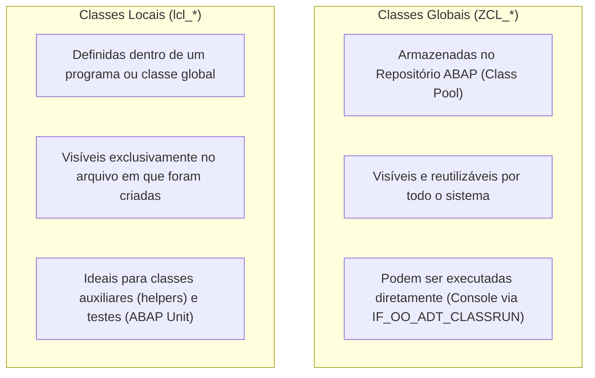

**Roteiro de Estudos Relacionado:** [[Roteiro de Estudos SAP]]
# Objetivos
Após concluir esta lição, você será capaz de:
- Diferenciar **Classes Globais** de **Classes Locais** na arquitetura de Orientação a Objetos do ABAP.
- Navegar na aba **Local Types** do Eclipse ADT e usar templates de código rápido.
- Compreender a estrutura de uma classe ABAP: bloco de **Definição (`DEFINITION`)** e bloco de **Implementação (`IMPLEMENTATION`)**.
- Declarar atributos nas seções de visibilidade (**PUBLIC**, **PROTECTED** e **PRIVATE**).
- Diferenciar **Atributos de Instância (`DATA`)** de **Atributos Estáticos (`CLASS-DATA`)**.

---

## 1. Classes Globais vs. Classes Locais

No ABAP, toda classe pertence a uma destas duas categorias:

![[01_-_Define_a_local_class_001.png]]



| Critério | Classe Global (*Global Class*) | Classe Local (*Local Class*) |
| :--- | :--- | :--- |
| **Armazenamento** | Objeto de repositório centralizado (*Class Pool*). | Declarada internamente na aba **Local Types** de uma classe global. |
| **Visibilidade** | Acessível por qualquer classe ou programa no sistema. | Acessível **apenas dentro da própria classe global** que a contém. |
| **Convenção de Nome** | Inicia com `ZCL_` ou `YCL_` (desenvolvimento de cliente). | Inicia convencionalmente com o prefixo `lcl_` (*local class*). |
| **Sintaxe** | Quase idêntica à sintaxe da classe local. | Idêntica à global, mas sem a necessidade de registro no DDIC. |

---

## 2. Onde Criar Classes Locais no Eclipse ADT?

![[01_-_Define_a_local_class_002 1.png]]

Ao abrir uma classe global no Eclipse ADT:
1. O editor abre por padrão na aba **Global Class** (código-fonte da classe principal).
2. Na barra inferior do editor, selecione a aba **Local Types** para visualizar e escrever classes locais auxiliares.

> [!TIP]
> **Atalho para Gerar Esqueleto de Classe Local:**  
> Na aba *Local Types*, digite **`lcl`** e pressione **Ctrl + Espaço**. Escolha o template **`lcl - Local class`** e pressione **Enter**. O Eclipse gerará o esqueleto completo da classe instantaneamente.

---

## 3. Anatomia de uma Classe em ABAP

![[01_-_Define_a_local_class_003.png]]

Toda classe ABAP completa é composta por dois blocos estruturais:

### 1. Bloco de Definição (`CLASS ... DEFINITION. ... ENDCLASS.`)

<iframe 
    src="https://cdnapisec.kaltura.com/p/1921661/embedPlaykitJs/uiconf_id/50355372?iframeembed=true&entry_id=1_bh85qgb5" 
    width="100%" 
    height="400" 
    allowfullscreen 
    frameborder="0">
</iframe>

É onde você declara "o que a classe tem e o que ela faz" (tipos, constantes, atributos e métodos).
É dividido em até três **Seções de Visibilidade**:

* **`PUBLIC SECTION.`**: Componentes acessíveis livremente por qualquer programa ou classe consumidora.
* **`PROTECTED SECTION.`**: Componentes acessíveis apenas pela própria classe e por suas subclasses (herança).
* **`PRIVATE SECTION.`**: Componentes acessíveis estritamente pelo código interno da própria classe (encapsulamento).

> [!IMPORTANT]
> **Regra de Ordem Obrigatória:**  
> Se uma classe tiver mais de uma seção, a ordem no código **deve ser estritamente:**  
> `PUBLIC SECTION` $\rightarrow$ `PROTECTED SECTION` $\rightarrow$ `PRIVATE SECTION`.  
> Nenhuma declaração é permitida fora dessas seções.

---

### 2. Bloco de Implementação (`CLASS ... IMPLEMENTATION. ... ENDCLASS.`)
Contém o código executável dos métodos declarados no bloco de definição. Se a classe não declarar métodos executáveis, o bloco de implementação pode ser vazio ou omitido.

---

## 4. Atributos: Instância vs. Estáticos

![[01_-_Define_a_local_class_006.png]]

Os atributos representam os dados (variáveis e constantes) mantidos pela classe:

| Tipo de Atributo | Como Declarar | Comportamento na Memória |
| :--- | :--- | :--- |
| **Atributo de Instância** | Comando **`DATA`** | Cada objeto criado a partir da classe possui **sua própria cópia** independente do valor (ex: o ID da conexão de um voo). |
| **Atributo Estático** | Comando **`CLASS-DATA`** | Existe **uma única cópia compartilhada** por todas as instâncias da classe. Mudanças no valor refletem para todos os objetos (ex: um contador global de conexões). No UML, aparece sublinhado. |

---

## 5. Exercício Prático: Definir uma Classe Local

Neste exercício, você criará uma classe global como programa de execução e definirá uma classe local chamada **`lcl_connection`** para representar uma conexão de voo.

### Tarefa 1: Criar a Classe Global
1. No Eclipse ADT, crie uma classe global chamada **`ZCL_##_LOCAL_CLASS`** (substitua `##` pelo seu número de usuário).
2. Adicione a interface **`IF_OO_ADT_CLASSRUN`**.
3. Associe ao seu pacote de estudos (**`ZS4D400_##`**) e confirme a Transport Request.

---

### Tarefa 2: Definir a Classe Local na Aba *Local Types*
1. Na janela do editor da classe global, clique na aba **Local Types** (na barra inferior).
2. Digite **`lcl`**, pressione **Ctrl + Espaço** e selecione o template **`lcl - Local class`**.
3. Renomeie a classe para **`lcl_connection`**.
4. **Remova a cláusula `CREATE PRIVATE`** do final da instrução `CLASS lcl_connection DEFINITION.`, permitindo que a classe global instancie essa classe local.
5. Na **`PUBLIC SECTION`**, declare os seguintes atributos:

| Nome do Atributo | Escopo | Tipo de Dados |
| :--- | :--- | :--- |
| **`carrier_id`** | Instância (`DATA`) | `/dmo/carrier_id` |
| **`connection_id`** | Instância (`DATA`) | `/dmo/connection_id` |
| **`conn_counter`** | Estático (`CLASS-DATA`) | `i` |

6. O código resultante na aba **Local Types** deve ficar assim:

```abap
*"* use this source file for the definition and implementation of
*"* local helper classes, interface definitions and type
*"* declarations

CLASS lcl_connection DEFINITION.
  PUBLIC SECTION.
    DATA carrier_id         TYPE /dmo/carrier_id.
    DATA connection_id      TYPE /dmo/connection_id.
    CLASS-DATA conn_counter TYPE i.

  PROTECTED SECTION.
  PRIVATE SECTION.
ENDCLASS.

CLASS lcl_connection IMPLEMENTATION.
ENDCLASS.
```

7. Pressione **Ctrl + F3** para compilar e ativar a classe.

> [!NOTE]
> Como o método `main` da classe global ainda não contém instruções executáveis, não há nada para testar no console neste momento. A instanciação e uso dessa classe serão implementados na próxima lição.

---

## 📌 Termos e Conceitos para Adicionar em `03_Resources/SAP/Conceitos`

Abaixo estão os conceitos fundamentais apresentados nesta lição recomendados para criação de notas dedicadas na pasta `03_Resources/SAP/Conceitos`:

- `[[Classes Globais vs. Classes Locais no ABAP]]` — Diferença de escopo, repositório central (*Class Pool*) versus classes auxiliares em *Local Types*.
- `[[Seções de Visibilidade (PUBLIC, PROTECTED, PRIVATE)]]` — Encapsulamento de objetos, regras de acesso externo e ordem obrigatória de declaração.
- `[[Atributos de Instância (DATA) vs. Estáticos (CLASS-DATA)]]` — Escopo de memória, ciclo de vida de variáveis de objeto e dados compartilhados de classe.
- `[[Estrutura de Classe ABAP (DEFINITION e IMPLEMENTATION)]]` — Separação entre assinatura/contrato da classe e corpo executável dos métodos.
