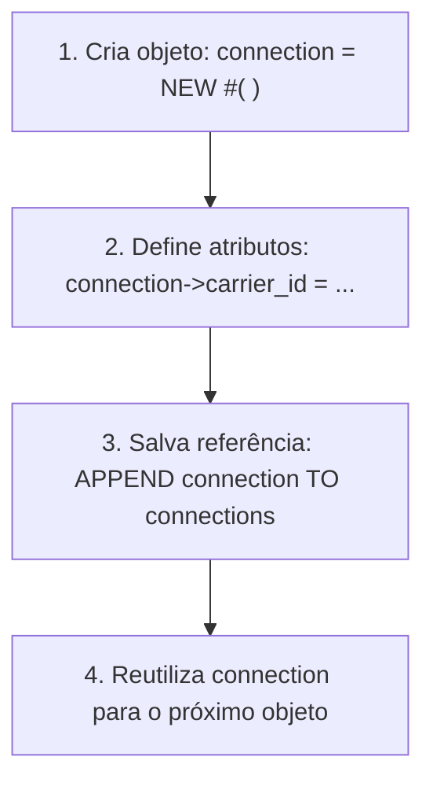

**Roteiro de Estudos Relacionado:** [[Roteiro de Estudos SAP]]
# Objetivos
Após concluir esta lição, você será capaz de:
- Declarar e utilizar **Variáveis de Referência** (`TYPE REF TO`).
- Instanciar objetos utilizando o operador moderno **`NEW #( )`**.
- Diferenciar os seletores de componentes estáticos (**=>**) e de instância (**->**).
- Compreender o ciclo de vida dos objetos em memória e a atuação do **Garbage Collector**.
- Gerenciar coleções de múltiplos objetos armazenando referências em **Tabelas Internas**.

---

## 1. Acesso a Componentes Estáticos (**=>**)


Componentes estáticos pertencem à classe como um todo, e não a um objeto individual. Por isso, para acessá-los fora da classe, **não é necessário criar uma instância**:

Utilizamos o **Seletor de Componente Estático (**=>**)** diretamente após o nome da classe:

```abap
lcl_connection=>conn_counter = 0.
```

> [!WARNING]
> Não são permitidos espaços em branco antes ou depois do seletor **=>**:
> * Correto: `classe=>atributo`
> * Erro de Sintaxe: `classe => atributo`

---

## 2. Variáveis de Referência e o Operador `NEW`

Para componentes de instância, a situação é diferente: eles só existem na memória após a criação do objeto. Para manipulá-los, precisamos de uma **Variável de Referência**.


### 1. Declaração da Variável de Referência
Uma variável de referência não guarda os dados do objeto diretamente, mas sim um ponteiro para o endereço de memória onde o objeto será alocado:

```abap
DATA connection TYPE REF TO lcl_connection.
```
* **Estado Inicial (*Null Reference*):** Antes da instanciação, o valor da referência é nulo (`initial / null`). Se você tentar acessar qualquer atributo ou método de uma referência nula, o programa abortará com o erro fatal `OBJECTS_OBJREF_NOT_ASSIGNED`.

---

### 2. Instanciação com o Operador Construtor `NEW`


No ABAP moderno, criamos uma nova instância utilizando o operador **`NEW`**:

```abap
connection = NEW #( ).
```

* **O que significa o caractere `#`:** O símbolo cerquilha/hash indica inferência de tipo: o compilador verifica o tipo declarado da variável `connection` (`TYPE REF TO lcl_connection`) e cria uma instância exatamente dessa classe.
* **Espaço Obrigatório:** Deve haver pelo menos um espaço em branco dentro dos parênteses: `NEW #( )`.

> [!NOTE]
> **Evolução do ABAP:** No modelo antigo, a criação de instâncias era feita com o comando `CREATE OBJECT connection.`. No ABAP Cloud e no desenvolvimento moderno, o operador `NEW #( )` é o padrão oficial.

---

## 3. Acesso a Componentes de Instância (`->`)


Para acessar atributos ou chamar métodos de uma instância específica, utilizamos o **Seletor de Componente de Instância (`->`)**:

```abap
connection->carrier_id    = 'LH'.
connection->connection_id = '0400'.
```

### Resumo dos Seletores no ABAP:
| Tipo de Componente | Seletor | Sintaxe de Acesso | Exemplo Prático |
| :--- | :---: | :--- | :--- |
| **Estático** | **=>** | `NomeDaClasse=>Componente` | `lcl_connection=>conn_counter` |
| **Instância** | **->** | `VariavelDeReferencia->Componente` | `connection->carrier_id` |

---

## 4. Múltiplas Instâncias e Isolamento de Memória


Quando criamos várias instâncias da mesma classe:
* Cada objeto ocupa um espaço próprio e isolado na memória RAM.
* Os **atributos de instância** (`carrier_id`, `connection_id`) possuem valores independentes em cada objeto.
* Os **atributos estáticos** (`conn_counter`) são únicos e compartilhados por todas as instâncias da classe.

---

## 5. Ciclo de Vida do Objeto e o Garbage Collector


O que acontece se atribuirmos uma nova instância à mesma variável de referência?

```abap
connection = NEW #( ). " Cria Instância 1
connection = NEW #( ). " Cria Instância 2 e sobrescreve o ponteiro
```

1. A variável `connection` agora aponta para a **Instância 2**.
2. A **Instância 1** perdeu sua única referência e tornou-se inalcançável pelo código.
3. **Atuação do Garbage Collector:** O ambiente de execução do SAP possui um processo em segundo plano chamado **Garbage Collector (Coletor de Lixo)**, que varre a memória periodicamente para destruir objetos órfãos e liberar memória RAM.

---

## 6. Gerenciamento de Múltiplos Objetos em Tabela Interna


Para manter dezenas ou centenas de instâncias vivas sem perder suas referências, armazenamos as variáveis de referência dentro de uma **Tabela Interna de Objetos**:

```abap
DATA connections TYPE TABLE OF REF TO lcl_connection.
```

### O Fluxo de Criação Contínua:


Como a tabela interna guarda uma cópia da referência para cada instância criada, nenhuma delas é destruída pelo Garbage Collector!

---

## 7. Exercício Prático: Criar e Gerenciar Instâncias

Neste exercício, você criará múltiplas instâncias da classe local `lcl_connection` e armazenará suas referências em uma tabela interna.

### Passo a Passo

1. Abra a classe global **`ZCL_##_LOCAL_CLASS`** (ou duplique o modelo para **`ZCL_##_INSTANCES`**).
2. Na aba **Global Class**, ajuste o método `if_oo_adt_classrun~main`:

```abap
METHOD if_oo_adt_classrun~main.
  * 1. Declarações
  ********************************************************************
  DATA connection  TYPE REF TO lcl_connection.
  DATA connections TYPE TABLE OF REF TO lcl_connection.

  * 2. Primeira Instância (LH 0400)
  ********************************************************************
  connection = NEW #( ).
  connection->carrier_id    = 'LH'.
  connection->connection_id = '0400'.
  APPEND connection TO connections.

  * 3. Segunda Instância (AA 0017)
  ********************************************************************
  connection = NEW #( ).
  connection->carrier_id    = 'AA'.
  connection->connection_id = '0017'.
  APPEND connection TO connections.

  * 4. Terceira Instância (SQ 0001)
  ********************************************************************
  connection = NEW #( ).
  connection->carrier_id    = 'SQ'.
  connection->connection_id = '0001'.
  APPEND connection TO connections.

  * 5. Exibição no Console
  ********************************************************************
  out->write( |Quantidade de conexões criadas: { lines( connections ) }| ).
ENDMETHOD.
```

3. **Ativação e Análise no Debugger:**
   * Pressione **Ctrl + F3** para ativar a classe.
   * Insira um Breakpoint na primeira linha com `APPEND connection TO connections.`.
   * Execute com **F9**.
   * Ao parar no debugger, dê duplo clique nas variáveis `connection` e `connections` para inspecioná-las na aba **Variables**.
   * Avance com **F5** para observar as referências sendo adicionadas na tabela interna e confirme que os dados de cada voo são mantidos independentes.

---

## 📌 Termos e Conceitos para Adicionar em `03_Resources/SAP/Conceitos`

Abaixo estão os conceitos fundamentais apresentados nesta lição recomendados para criação de notas dedicadas na pasta `03_Resources/SAP/Conceitos`:

- `[[Variáveis de Referência e Instanciação (TYPE REF TO e Operador NEW)]]` — Ponteiros de objetos em memória e o operador construtor moderno `NEW #( )`.
- `[[Seletores de Componentes no ABAP (=> vs ->)]]` — Diferença de sintaxe e acesso entre membros estáticos de classe e membros de instância de objeto.
- `[[Garbage Collector no ABAP]]` — Gerenciamento automático de memória, contagem de referências e destruição de objetos inalcançáveis.
- `[[Tabelas Internas de Referências a Objetos]]` — Padrão de arquitetura para armazenar e iterar coleções dinâmicas de instâncias.
