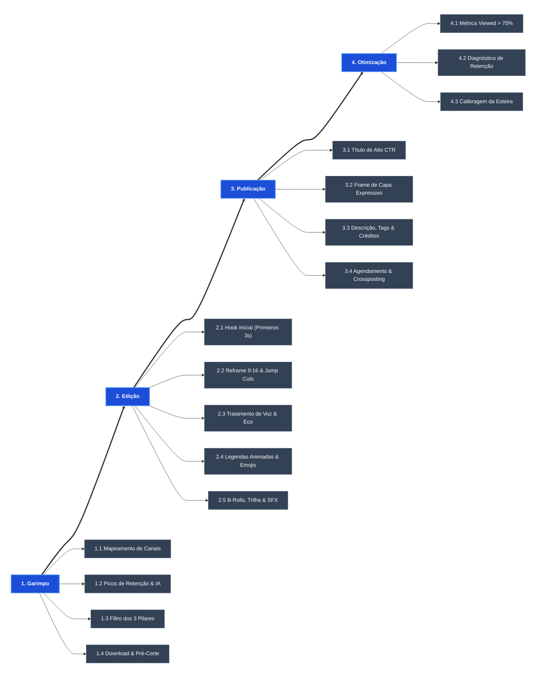

# 🎬 Linha de Produção: Canal Dark de Cortes (Cultos & Podcasts)

> [!INFO] Visão Geral do Projeto
> **Objetivo:** Construir uma esteira enxuta, escalável e de alta conversão para transformar vídeos longos (pregações, cultos e podcasts) em vídeos curtos (Shorts/Reels/TikTok) otimizados para retenção, viralização e monetização no YouTube.

---

## 🗺️ Mapa de Fluxo Visual da Esteira (Espinha de Peixe)

---

## ⚙️ Detalhamento das 4 Etapas de Produção

### 1. 🔍 Garimpo (Curadoria + Captura)
*O objetivo desta etapa é encontrar vídeos longos, isolar os momentos com alto potencial emocional e já salvar o arquivo recortado pronto para editar.*

- **1.1. Mapeamento de Canais-Fonte:**
  - Manter catálogo de canais de culto (pastores e pregadores renomados) e podcasts com convidados de forte apelo público.
  - Foco em temas universais de alta identificação: cura da ansiedade, superação, casamento, propósito de vida e testemunhos de impacto.
- **1.2. Caça aos Momentos de Ouro (Heatmaps & IA):**
  - Analisar o recurso *Most Replayed* do YouTube para achar os picos de maior audiência do vídeo original.
  - Rastrear comentários em busca de marcações de tempo (*timestamps*) deixadas pelo público.
  - Usar IAs de decupagem automática (Opus Clip, Klap ou Vizard) para gerar uma lista rápida de cortes com score de viralização.
- **1.3. Filtro dos 3 Pilares:**
  - Cada trecho deve obrigatoriamente cumprir:
    1. *Gancho verbal imediato:* Uma frase de impacto logo de cara.
    2. *Carga emocional:* Toca o coração, consola, alerta ou surpreende.
    3. *Mensagem autocontida:* Faz total sentido de forma independente sem precisar assistir à pregação inteira.
- **1.4. Download & Pré-Corte Imediato:**
  - Baixar a fonte em alta resolução (1080p/4K) com `yt-dlp` ou Cobalt.tools.
  - Usar o **LosslessCut** para extrair cirurgicamente apenas os 1 a 3 minutos necessários (sem re-renderizar, em menos de 10 segundos).
  - Salvar na pasta `01_Brutos` com padrão: `[DATA]_[ORADOR]_[TEMA].mp4`.

---

### 2. 🎨 Edição (Decupagem + Pós-Produção)
*Lapidar o bruto na timeline, garantindo ritmo dinâmico, retenção acima de 90% e conformidade com as políticas do YouTube.*

- **2.1. O "Hook" Inicial (Cold Open nos 3 primeiros segundos):**
  - Pinçar a frase mais impactante de todo o discurso e colocá-la bem no início antes de voltar ao raciocínio cronológico.
  - Eliminar saudações, pigarros e introduções mornas ("boa noite irmãos", "vamos abrir a Bíblia..."). Ir direto para o ponto central.
- **2.2. Reframe Vertical (9:16) & Jump Cuts:**
  - Enquadrar o orador no centro (ou montagem dividida caso seja um podcast com duas pessoas).
  - Cortar cada pausa ou respiração morta com *jump cuts* dinâmicos, mantendo a fala acelerada e envolvente.
  - Adicionar zooms sutis (in/out) a cada 3 a 5 segundos para quebrar a estagnação visual da tela.
- **2.3. Tratamento de Áudio & Eco de Templo:**
  - Limpar ruído de fundo e reverberação de igreja com o *Adobe Podcast AI* ou compressor/equalizador.
  - Normalizar o volume final entre `-14 LUFS` e `-16 LUFS` (áudio alto e cristalino no celular).
- **2.4. Legendas Dinâmicas & Emojis Contextuais:**
  - Gerar legendas palavra por palavra no CapCut/Premiere com animação ativa (*pop-in*).
  - Destacar termos-chave em cores de contraste (Amarelo, Verde limão ou Vermelho).
  - Inserir emojis sincronizados nas frases de impacto (ex: 🔥, 🕊️, ⚠️, 💔, 🙏).
- **2.5. B-Rolls, Trilha Sonora Emocional & SFX:**
  - Adicionar vídeos de arquivo sobrepostos (pessoas orando, chuva, superação, vitória) para ilustrar as narrativas.
  - Inserir trilha instrumental sem direitos autorais (*worship pad*, piano reflexivo ou tensão) regulada em `-24 dB` para não cobrir a voz.
  - Usar efeitos sonoros sutis (risers, swoosh, hits) no gancho e nas transições.

---

### 3. 🚀 Publicação (Embalagem + Distribuição)
*Preparar a embalagem irresistível e colocar o conteúdo na frente da audiência no momento certo.*

- **3.1. Título de Alto CTR (Curiosidade + Promessa Emocional):**
  - Títulos curtos (máximo 50 a 60 caracteres) com gatilhos de alerta, conselho ou revelação:
    - *"Deus mandou você ouvir essa frase antes de dormir..."*
    - *"O erro que quase destruiu o casamento dele (Cuidado)"*
    - *"Se você está sofrendo com ansiedade, escute isso agora"*
- **3.2. Frame de Capa Expressivo:**
  - Selecionar o frame de maior intensidade emocional do orador (lágrima, surpresa, firmeza no olhar) como capa do Short.
  - Se for compilação de vídeo longo, criar thumbnail de alto contraste no Canva/Photoshop.
- **3.3. Descrição, Tags & Créditos Éticos (Anti-Strike):**
  - Inserir breve resumo e hashtags focadas: `#shorts #fe #pregacao #motivacional #palavradedeus`.
  - **Crédito obrigatório:** Link para a mensagem completa e menção clara ao canal original da igreja/podcast (protege sua reputação e reduz risco de disputas).
- **3.4. Agendamento em Lote & Crossposting:**
  - Programar os vídeos com 2 a 3 dias de antecedência no YouTube Studio.
  - Postar nos horários de maior afinidade: 06:30 (devocional matinal), 12:30 (almoço) e 20:30 (noite).
  - Subir simultaneamente o mesmo arquivo no **TikTok**, **Instagram Reels** e **Kwai**.
  - Fixar comentário no topo fazendo uma pergunta para estimular respostas e gerar engajamento.

---

### 4. 📊 Otimização (Métricas + Calibragem)
*A esteira retroalimentada: transformar os dados do YouTube Analytics em decisões práticas para o próximo lote.*

- **4.1. Taxa de "Viewed vs. Swiped Away":**
  - Alvo: **> 70%**. Se o número estiver abaixo disso, significa que o gancho (primeiros 3 segundos) ou a capa do Short precisam ser mais provocativos.
- **4.2. Duração Média de Visualização (Retenção):**
  - Alvo: **> 85-100%**. Abrir o gráfico de retenção no YouTube Studio e identificar os segundos exatos onde as pessoas abandonam o vídeo para corrigir na edição seguinte.
- **4.3. Calibragem da Esteira:**
  - Reforçar no *Garimpo* os temas e oradores que tiveram melhor desempenho e eliminar abordagens que floparam.

---

## 🛡️ Diretrizes de Proteção Anti-Strike & Monetização

> [!WARNING] Atenção às Regras de "Conteúdo Reutilizado"
> O YouTube não monetiza canais que apenas republicam trechos de terceiros sem transformação substancial. Para monetizar e manter o canal seguro:
> 1. **Transformação Real:** Adicione valor concreto com nova narrativa, cortes rápidos, legendas estilizadas, B-rolls de apoio e trilha sonora própria.
> 2. **Canal de Contato Direto:** Mantenha na descrição do canal: *"Canal de cortes e reflexões. Se você é o detentor dos direitos autorais deste trecho e deseja que ele seja removido, entre em contato via [seu-email] que atenderemos em até 24h"*.
> 3. **Nunca Distorcer a Mensagem:** Não use títulos sensacionalistas que acusem ou descontextualizem a mensagem do pregador para evitar denúncias comunitárias em massa.

---

## 🧰 Stack de Ferramentas Recomendadas

| Macro Etapa | Ferramentas Principais | Alternativas Gratuitas |
| :--- | :--- | :--- |
| **1. Garimpo** | yt-dlp / Opus Clip / Klap | Cobalt.tools / LosslessCut |
| **2. Edição** | CapCut PC / Adobe Podcast AI | DaVinci Resolve / Audacity |
| **3. Publicação** | YouTube Studio / Canva Pro | Photoshop / Postman / CapCut Web |
| **4. Otimização** | YouTube Analytics | VidIQ / TubeBuddy |

---

## 📋 Checklist Semanal (Rotina em 4 Blocos)

-  **Segunda-feira (Bloco 1 - Garimpo):**
  -  Rastrear 5 pregações/podcasts em alta.
  -  Recortar e arquivar 15 momentos de ouro brutos com o LosslessCut na pasta `01_Brutos`.
-  **Terça & Quarta-feira (Bloco 2 - Edição):**
  -  Importar os brutos para o CapCut.
  -  Editar os 14 a 21 cortes verticais (gancho, cortes de silêncio, legendas, b-rolls e áudio).
  -  Exportar todos os vídeos prontos para a pasta `03_Finalizados`.
- **Quinta-feira (Bloco 3 - Publicação):**
  -  Criar títulos atrativos e definir frames de capa.
  -  Subir e agendar os vídeos de sexta até a próxima quinta-feira no YouTube Studio.
  -  Programar os mesmos cortes no TikTok, Reels e Kwai.
- **Sexta-feira (Bloco 4 - Otimização):**
  -  Analisar os relatórios de retenção e *Viewed vs. Swiped Away* da semana anterior.
  -  Registrar os melhores temas e oradores para calibrar a curadoria da próxima segunda.
