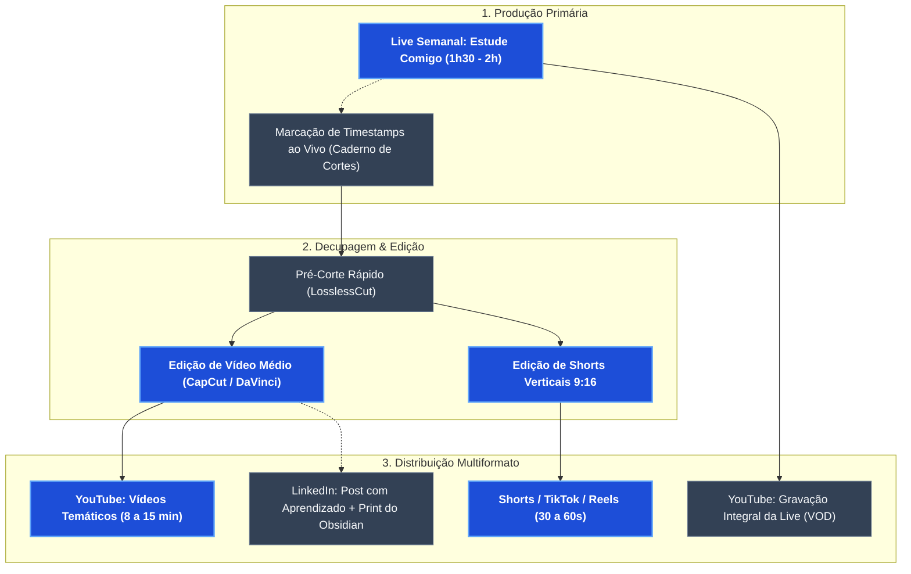

# 🚀 Linha de Produção: Canal Estude Comigo & Build in Public (SAP + IA)

> [!INFO] Visão Geral do Projeto
> **Objetivo:** Criar um ecossistema escalável de criação de conteúdo no YouTube baseado em lives de estudo ativo ("Estude Comigo Comentado"), documentando a jornada de preparação para a certificação **SAP Certified - Backend Developer - ABAP Cloud**.
> 
> As transmissões ao vivo servem como motor primário de geração de conteúdo (*Core Content*), sendo posteriormente decupadas e reaproveitadas em vídeos temáticos médios (8 a 15 min) e vídeos curtos de alta tração (Shorts, Reels e TikTok).

---

## 🧭 Pilares do Posicionamento

1. **Estudo Ativo & Técnica Feynman ao Vivo:**
   * Diferente dos formatos passivos de "Study With Me" com música de fundo silenciosa, o diferencial aqui é o raciocínio em voz alta. Ao explicar o conteúdo enquanto estuda, você consolida a retenção para si mesmo e gera valor didático imediato para quem acompanha.
2. **Ecossistema Técnico Moderno:**
   * Demonstração transparente das ferramentas do dia a dia: **Obsidian** (organização do Segundo Cérebro e notas atômicas), **Google NotebookLM & Gemini** (criação de simulados e tira-dúvidas) e o ambiente **SAP BTP / ADT (ABAP Development Tools)** no Eclipse.
3. **Build in Public (Construção de Autoridade):**
   * Compartilhar vitórias, erros de lógica, pegadinhas de prova superadas e o progresso real de um Desenvolvedor Júnior, gerando identificação genuína com a comunidade e visibilidade profissional.

---

## 🗺️ Mapa de Fluxo: Esteira de Reaproveitamento de Conteúdo

---

## ⚙️ Detalhamento das 4 Etapas Operacionais

### 1. 🎙️ Preparação & Transmissão da Live
*O foco da live é estudar com profundidade, mantendo uma experiência visual agradável e capturando marcações de tempo para corte imediato.*

- **1.1. Cenários no OBS Studio (Open Broadcaster Software):**
  - **Cena Principal (Estudo):** Divisão de tela (70% tela útil + 30% câmera do criador com fundo limpo e microfone de boa captação).
  - **Cena de Discussão:** Foco na câmera do criador para introdução, pausas técnicas e encerramento.
  - **Cena de Exibição:** Foco em tela cheia para leitura de enunciados e código no Eclipse ADT ou no Obsidian.
- **1.2. Estrutura em Blocos da Live (Exemplo para 2 Horas):**
  - **00:00 - 00:10:** Abertura, boas-vindas e definição clara da meta do dia (ex: *"Hoje vamos resolver 10 questões do módulo de CDS Views e alimentar o Obsidian"*).
  - **00:10 - 00:50:** **Bloco 1 de Estudo Ativo:** Leitura da documentação/material oficial da SAP e anotação ativa de conceitos.
  - **00:50 - 01:00:** Intervalo rápido (interação com chat e água).
  - **01:00 - 01:45:** **Bloco 2 de Resolução Comentada:** Resolução de questões de simulado, confronto de alternativas e testes no NotebookLM.
  - **01:45 - 02:00:** **Fechamento Feynman:** Revisão geral em 5 minutos do que foi aprendido e encerramento.
- **1.3. Registro de Timestamps (Caderno de Cortes):**
  - Manter um bloco de notas aberto ou atalho de teclado no OBS para marcar a minutagem exata sempre que:
    1. Uma explicação de conceito ficou muito clara e didática.
    2. Ocorreu uma discussão profunda sobre uma pegadinha de questão.
    3. Foi demonstrado um fluxo prático interessante de IA ou Obsidian.

---

### 2. ✂️ Decupagem & Edição (Reaproveitamento Inteligente)
*Transformar 2 horas de gravação bruta em múltiplos ativos de conteúdo com alto valor de retenção.*

- **2.1. Extração sem Perda (LosslessCut):**
  - Abrir o arquivo de vídeo gravado localmente no OBS pelo **LosslessCut**.
  - Recortar com base nos timestamps anotados na etapa anterior (processo instantâneo, sem renderização).
- **2.2. Vídeos Médios Temáticos (8 a 15 Minutos):**
  - Formato horizontal (16:9).
  - Adicionar um gancho dinâmico nos primeiros 10 segundos: mostrar o resultado ou o erro de código antes da vinheta/abertura.
  - Cortar silêncios longos e hesitações para imprimir ritmo dinâmico.
  - Inserir zoom digital (punch-in) nos trechos de código e anotações para facilitar a leitura no celular.
- **2.3. Vídeos Curtos (Shorts / Reels / TikTok - 30 a 60 Segundos):**
  - Formato vertical (9:16).
  - Enquadrar o rosto na parte superior e o código/Obsidian na parte central.
  - Legendas automáticas dinâmicas com palavras-chave destacadas em cores.
  - **Regra de Ouro do Gancho (0 a 3s):** Fazer uma promessa ou alerta que desperte curiosidade imediata.

---

### 3. 🚀 Publicação & Distribuição Estratégica
*Embalar o conteúdo com títulos de alta taxa de clique (CTR) e descrições otimizadas para busca (SEO).*

- **3.1. Arquitetura de Títulos:**
  - **Lives (VOD):** *Estude Comigo SAP #04: Resolvendo Questões de CDS Views & RAP ao Vivo | Dev Júnior*
  - **Vídeos Médios:** *Como uso o NotebookLM para ser aprovado na Certificação SAP ABAP Cloud*
  - **Shorts:** *Essa pegadinha na prova da SAP derruba muita gente! Cuidado com isso.*
- **3.2. Thumbnails de Alto Contraste:**
  - Expressão facial nítida do criador.
  - Elementos visuais reconhecíveis: logo da SAP, logo do Obsidian ou interface do NotebookLM.
  - Texto de apoio curto (máximo 3 a 4 palavras impactantes).
- **3.3. Descrição com Links Bidirecionais:**
  - Links para o repositório público/templates de estudo (caso disponibilizados).
  - Minutagem completa (*Chapters*) nos vídeos médios para retenção positiva.

---

### 4. 📊 Métricas de Sucesso & Calibragem
*Critérios objetivos para medir a tração do canal e refinar os formatos.*

| Formato | Métrica Primária | Alvo Recomendado | Ação de Ajuste |
| :--- | :--- | :--- | :--- |
| **Live** | Duração Média de Visualização | > 20 a 30 minutos | Dinamizar os blocos e interagir mais com o chat nos intervalos. |
| **Vídeo Médio** | CTR da Miniatura + Retenção | CTR > 6% \| Retenção > 45% | Se CTR for baixo: trocar título e capa. Se retenção cair: cortar enrolações. |
| **Shorts** | Taxa *Viewed vs. Swiped Away* | > 70% assistidos | Se < 70%: fortalecer os primeiros 2 segundos com ganchos mais visuais. |

---

## 💡 Matriz de Ideias & Roteiros por Tema

### Pilar 1: Certificação SAP & ABAP Cloud
* **Vídeo Longo/Médio:** *"Guia de Estudos: Como me preparo para o exame SAP Backend Developer ABAP Cloud do zero"*.
* **Corte da Live:** *"O que é Clean Core e por que a SAP aposentou o código legado?"*.
* **Corte da Live:** *"Resolvendo uma questão cabeluda de CDS Views passo a passo"*.
* **Short:** *"A diferença entre ABAP Clássico e ABAP Cloud em 45 segundos"*.

### Pilar 2: Obsidian & Segundo Cérebro para Desenvolvedores
* **Vídeo Longo/Médio:** *"Como organizo todo o meu conhecimento de programação usando o Obsidian"*.
* **Corte da Live:** *"Meu fluxo de anotações atômicas: transformando documentação técnica em mapas mentais"*.
* **Short:** *"Por que todo programador deveria trocar o bloco de notas pelo Obsidian"*.

### Pilar 3: Inteligência Artificial nos Estudos Técnicos
* **Vídeo Longo/Médio:** *"A metodologia de estudos com Google Gemini e NotebookLM que uso para certificações"*.
* **Corte da Live:** *"Criando simulados infinitos no NotebookLM com a documentação oficial da SAP"*.
* **Short:** *"O prompt secreto do NotebookLM para achar falhas no seu aprendizado"*.

---

## 🧰 Stack de Ferramentas Recomendadas

| Finalidade | Ferramenta Recomendada | Benefício Principal |
| :--- | :--- | :--- |
| **Transmissão & Gravação** | OBS Studio | Gratuito, leve e com controle total de cenas e áudio multifaixa. |
| **Decupagem Rápida** | LosslessCut | Corta trechos em segundos sem precisar renderizar o vídeo todo. |
| **Edição de Vídeo** | CapCut Desktop / DaVinci Resolve | Legendas automáticas precisas e facilidade para enquadramento 9:16. |
| **Criação de Thumbnails** | Canva Pro / Photoshop | Criação rápida de capas com contraste e remoção de fundo. |
| **Ambiente de Estudos** | Obsidian + Eclipse ADT + NotebookLM | Base do ecossistema demonstrado em tela. |

---

## 📋 Checklist da Rotina Semanal

- [ ] **Pré-Live (15 minutos antes):**
  - [ ] Abrir OBS, testar microfone e verificar enquadramento da câmera.
  - [ ] Deixar abertas as abas: documento de estudo SAP, Obsidian e NotebookLM.
  - [ ] Definir o objetivo da live e configurar o título no YouTube Studio.
- [ ] **Durante a Live:**
  - [ ] Registrar na folha de timestamps os momentos que renderão bons cortes.
  - [ ] Lembrar de falar o raciocínio em voz alta antes de escrever código ou marcar alternativas.
- [ ] **Pós-Live (Esteira de Decupagem):**
  - [ ] Abrir gravação no LosslessCut e exportar os 3 a 5 trechos marcados.
  - [ ] Editar 1 vídeo médio focado para subir no meio da semana.
  - [ ] Editar 3 a 4 Shorts verticais com legendas para distribuir ao longo da semana.
  - [ ] Publicar um resumo no LinkedIn com aprendizado chave do dia.

---

## 🔗 Notas Relacionadas no Segundo Cérebro
* [[Metodologia de Aprendizado com Gemini e NotebookLM]]
* [[00 - Painel de Progresso]]
* [[Clean Core]]
* [[RAP - ABAP RESTful Application Programming Model]]
