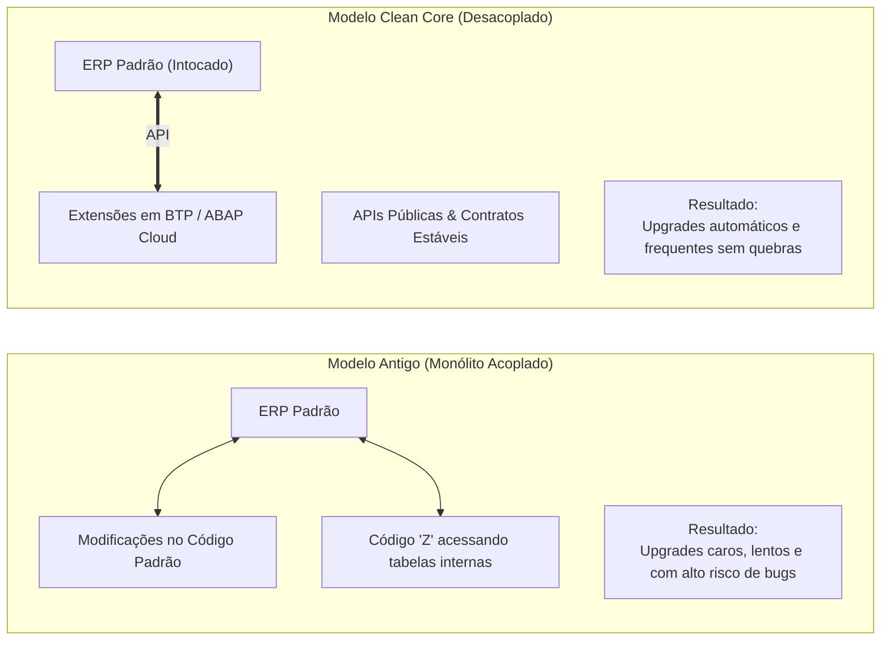
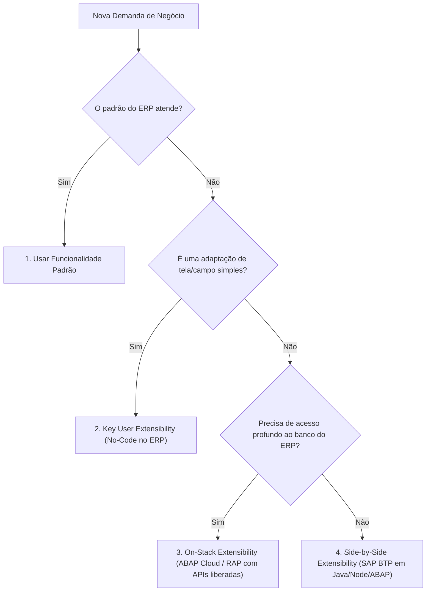

# Clean Core

**Relacionado:** [[BTP - Business Technology Platform|SAP BTP]], [[Roteiro de Estudos SAP]], [[RAP - ABAP RESTful Application Programming Model|RAP]], [[CDS - Core Data Services|CDS]]

---

## 1. O que é Clean Core?

Na literatura moderna de arquitetura de software empresarial (especialmente no ecossistema SAP e nos relatórios de arquitetura de mercado como Gartner e Martin Fowler), o **Clean Core** ("Núcleo Limpo") é um **princípio de design e governança de sistemas**:

> **Definição Prática:** Clean Core significa manter o sistema ERP central estritamente padronizado, sem modificações manuais no seu código original ou nas suas tabelas nativas, garantindo que o sistema possa ser **atualizado continuamente sem quebras e sem projetos demorados de migração**.

Todas as customizações, relatórios específicos e integrações continuam existindo, mas são construídos de forma **desacoplada**, conectando-se ao núcleo do sistema apenas através de **APIs públicas e estáveis** ou rodando em plataformas de nuvem externas (como o [[BTP - Business Technology Platform|SAP BTP]]).

---

## 2. A Origem: O Problema que o Clean Core Resolve

Para entender o Clean Core, é preciso olhar para o erro cometido pelas empresas nas últimas décadas com sistemas ERP tradicionais (como o SAP ECC ou SAP R/3):

### O que acontecia no modelo legado?
1. **Acoplamento Forte:** Desenvolvedores criavam rotinas próprias ("códigos Z") ou alteravam rotinas internas da SAP para atender a necessidades do negócio.
2. **Dependência de Objetos Internos:** Esses programas liam tabelas internas do banco diretamente e chamavam funções que não foram feitas para serem públicas.
3. **A Armadilha do Upgrade:** Quando a SAP lançava um *Upgrade* ou pacote de segurança, ela alterava tabelas internas. O resultado: os programas da empresa paravam de funcionar, exigindo meses de testes caros e retrabalho. O ERP virava um sistema "engessado", onde ninguém tinha coragem de atualizar.

---

## 3. A Analogia do Smartphone

Uma forma muito simples de entender o Clean Core é pensar no seu celular (iOS ou Android):

* **O Sistema Operacional é o Core:** A Apple ou o Google atualizam o sistema periodicamente.
* **Os Aplicativos são as Extensões:** Você instala WhatsApp, Uber e bancos pela loja oficial.
* **A Conexão são as APIs:** O Uber pede acesso à localização do celular por uma permissão padronizada (API pública). Ele não altera o código-fonte do sistema operacional para descobrir onde você está.
* **O Resultado:** Quando o celular atualiza do Android 14 para o 15, os seus aplicativos continuam funcionando normalmente. 

O **Clean Core** faz exatamente isso com o ERP corporativo.

---

## 4. Os 5 Pilares de uma Estratégia Clean Core

Segundo a literatura técnica e a metodologia oficial da SAP, o Clean Core não se resume apenas a código de programação; ele é sustentado por 5 dimensões:

| Pilar | O que significa na prática? |
| :--- | :--- |
| **1. Extensibilidade de Software** | Customizações são feitas exclusivamente com ferramentas oficiais (*Key User*, **ABAP Cloud** e extensões *Side-by-Side* no [[BTP - Business Technology Platform|BTP]]), consumindo apenas APIs liberadas (*Released APIs*). |
| **2. Processos de Negócio** | Priorizar o uso de processos padrão de mercado (*Standard Best Practices*) em vez de reinventar regras internas desnecessárias. |
| **3. Integrações** | Toda comunicação com outros sistemas é feita por APIs seguras (OData, REST, SOAP) ou eventos assíncronos, nunca acessando tabelas do banco diretamente. |
| **4. Dados Consistentes** | Manter os dados cadastrais limpos, sem redundâncias e sem tabelas customizadas paralelas disputando com os dados mestres do ERP. |
| **5. Operações e Governança** | Manter o software sempre na versão mais recente (*Keep Clean*) através de automação de testes e governança contínua com o *ABAP Test Cockpit (ATC)*. |

---

## 5. Como Implementar na Prática: Os Níveis de Extensibilidade

Quando um desenvolvedor precisa criar uma funcionalidade nova, a literatura de Clean Core define uma hierarquia de decisão:

1. **Key User Extensibility (No-Code / Low-Code):** Criação de novos campos em telas padrão ou pequenas regras de validação feitas diretamente na interface web pelo próprio usuário-chave ou analista funcional.
2. **On-Stack Developer Extensibility (No ERP com ABAP Cloud):** Lógicas complexas que rodam dentro do servidor do ERP (por exemplo, cálculos fiscais pesados). Utilizam a linguagem moderna **ABAP Cloud** e o framework [[RAP - ABAP RESTful Application Programming Model|RAP]], sendo auditados pelo compilador para garantir que nenhuma tabela interna seja violada.
3. **Side-by-Side Extensibility (Fora do ERP no BTP):** Portais de fornecedores, apps móveis, automações com IA e integrações com outros sistemas. Ficam 100% desacoplados no [[BTP - Business Technology Platform|SAP BTP]].

---

## 6. Vantagens do Clean Core

* **Upgrades Rápidos e Baratos:** O ERP pode receber pacotes semestrais de novidades sem risco de quebrar o negócio.
* **Facilidade de Inovação:** É possível adotar inteligência artificial e novos portais em nuvem rapidamente, pois o sistema expõe APIs limpas.
* **Fim da Dívida Técnica Acumulada:** O código antigo obsoleto deixa de ser um fardo de manutenção para as equipes de TI.

---

## 7. Referências e Literatura de Apoio

* **SAP Clean Core Strategy Guide (SAP Help & Learning):** Diretrizes oficiais de governança para S/4HANA e BTP.
* **Gartner Research - Composable ERP & Two-Tier Architecture:** O conceito de ERPs modulares baseados em componentes e APIs.
* **Martin Fowler - Patterns of Enterprise Application Architecture:** Padrões de desacoplamento, estabilidade de interfaces e redução de dívida técnica.
