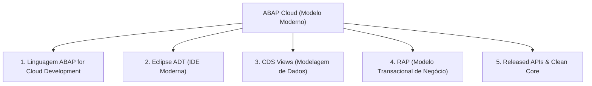

# ABAP Cloud

**Relacionado:** [[Clean Core]], [[BTP - Business Technology Platform|SAP BTP]], [[RAP - ABAP RESTful Application Programming Model|RAP]], [[CDS - Core Data Services|CDS]], [[Roteiro de Estudos SAP]]

---

## 1. O que é o ABAP Cloud?

O **ABAP Cloud** não é apenas uma nova versão da sintaxe ABAP, mas sim o **modelo de desenvolvimento oficial e padronizado da SAP para a era da nuvem**.

Ele foi criado para resolver um problema histórico: permitir que desenvolvedores criem lógicas de negócio personalizadas, integrações e novos aplicativos, garantindo que o núcleo do sistema permaneça limpo e atualizável ([[Clean Core]]).

### Onde o ABAP Cloud é executado?
* **No SAP BTP (Nuvem PaaS):** Através do *SAP BTP, ABAP Environment* (conhecido pelo codinome *Steampunk*), para extensões *Side-by-Side*.
* **No SAP S/4HANA Cloud Public Edition:** Modelo obrigatório e exclusivo para desenvolvimento em nuvem pública (*Embedded Steampunk*).
* **No SAP S/4HANA Cloud Private Edition e On-Premise:** Disponível a partir das versões modernas (S/4HANA 2022+) como o caminho recomendado para evitar dívida técnica.

---

## 2. O Problema que o ABAP Cloud Resolve

Para entender a necessidade do ABAP Cloud, compare o modelo antigo com o modelo atual:

| Critério | ABAP Clássico (*Classic ABAP*) | ABAP Cloud |
| :--- | :--- | :--- |
| **Ambiente de Trabalho** | Telas cinzas no SAP GUI (transações `SE38`, `SE80`). | **Eclipse IDE** com o plug-in **ABAP Development Tools (ADT)**. |
| **Acesso ao Banco e Funções** | Acesso livre e descontrolado a qualquer tabela interna ou rotina padrão da SAP. | Acesso estrito e auditado apenas a **APIs Públicas Liberadas (*Released APIs*)** e **[[CDS - Core Data Services|CDS Views]]**. |
| **Arquitetura de Telas** | Relatórios procedurais (*Reports*), telas Dynpro e comando `WRITE`. | Aplicações web modernas em **SAP Fiori / SAPUI5** geradas via metadados. |
| **Arquitetura Backend** | Código procedural misturado com tabelas e chamadas diretas. | Framework orientado a objetos e RESTful: **[[RAP - ABAP RESTful Application Programming Model|RAP]]**. |
| **Impacto em Upgrades** | **Alto risco:** Atualizações do ERP quebram códigos customizados ("Z"), gerando meses de retrabalho. | **Risco Zero (*Upgrade-Stable*):** Atualizações automáticas sem quebras, garantindo o princípio de [[Clean Core]]. |

---

## 3. Os 5 Pilares Tecnológicos do ABAP Cloud

A arquitetura do ABAP Cloud é sustentada por cinco componentes integrados:

### 1. Linguagem ABAP para Nuvem (*ABAP for Cloud Development*)
* É um subconjunto enxuto e seguro da linguagem ABAP.
* Comandos obsoletos ou inseguros foram removidos (como `WRITE`, `CALL TRANSACTION`, manipulação direta de arquivos no sistema operacional do servidor ou chamadas sem controle de autorização).
* Foco total em programação orientada a objetos (ABAP OO).

### 2. Eclipse com ABAP Development Tools (ADT)
* O desenvolvimento acontece exclusivamente no Eclipse.
* Oferece recursos modernos como autocompletar inteligente, atalhos de navegação rápidos (`F1`, `F2`, `F3`), integração com Git (abapGit) e depuração visual.

### 3. Modelo de Dados com [[CDS - Core Data Services|CDS Views]]
* As regras de leitura de dados não são feitas com queries SQL dispersas no meio do código.
* Toda a modelagem é centralizada em **CDS Views**, que executam os cálculos e relacionamentos diretamente no banco de dados SAP HANA em memória (*Code Pushdown*).

### 4. Camada de Aplicação com [[RAP - ABAP RESTful Application Programming Model|RAP]]
* Framework oficial da SAP para criar aplicações empresariais e serviços **OData** (protocolo web para troca de dados via JSON/REST).
* O RAP gerencia automaticamente operações como criar, atualizar, excluir (CRUD), rascunhos de tela (*Draft handling*) e validações de regras de negócio.

### 5. APIs Públicas Liberadas (*Released APIs*)
* Para ler dados de clientes, fornecedores ou lançar documentos fiscais, o desenvolvedor não acessa tabelas nativas diretamente.
* Ele consome apenas objetos que possuem o status oficial **Released** pela SAP. Esse status funciona como uma garantia contratual: a SAP se compromete a não alterar a estrutura dessa API em atualizações futuras.

---

## 4. Como o Sistema Garante que as Regras Sejam Cumpridas?

Você não precisa memorizar tudo o que é permitido ou proibido: a própria ferramenta atua como fiscalizadora:

1. **Compilador Restrito:** Se você tentar usar uma instrução obsoleta em um pacote configurado para ABAP Cloud, o código simplesmente não compila.
2. **ABAP Test Cockpit (ATC):** Uma ferramenta de análise estática integrada ao Eclipse que inspeciona o código em busca de violações de segurança, performance ou uso de APIs não autorizadas.
3. **Versão de Linguagem do Objeto:** Ao criar uma classe ou pacote, o atributo de linguagem é definido como *ABAP for Cloud Development*, aplicando as regras automaticamente.

---

## 5. Resumo Prático para o Desenvolvedor Iniciante

> [!TIP]
> **A Regra de Ouro do ABAP Cloud:**  
> Sempre que for desenvolver no modelo moderno:
> 1. Desenvolva no **Eclipse (ADT)**, nunca no SAP GUI.
> 2. Modele e consulte dados com **[[CDS - Core Data Services|CDS Views]]**.
> 3. Crie a lógica transacional com **[[RAP - ABAP RESTful Application Programming Model|RAP]]**.
> 4. Acesse dados padrão da SAP apenas através de **Released APIs**.
> 5. Exponha a interface final para o usuário como um aplicativo **SAP Fiori**.

---

## 6. Links e Referências Oficiais

* [SAP Help Portal - ABAP Cloud](https://help.sap.com/docs/abap-cloud): Documentação técnica oficial de referência da arquitetura.
* [ABAP Cloud Roadmap & Overview](https://community.sap.com/topics/abap): Artigos e guias da comunidade técnica oficial da SAP.
