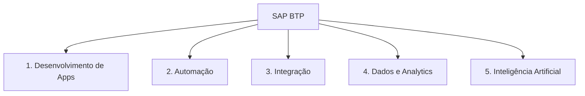
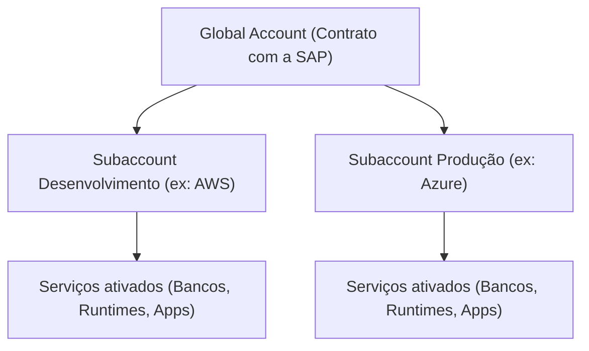
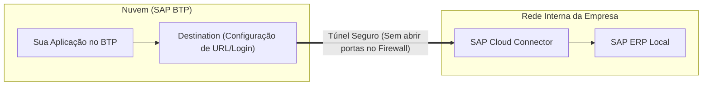

# SAP BTP - Business Technology Platform

**Relacionado:** [[Roteiro de Estudos SAP]], [[RAP - ABAP RESTful Application Programming Model|RAP]], [[CDS - Core Data Services|CDS]], [[PO - Process Orquestration|SAP PO]], [[PI - Process Intagration|SAP PI]]

---

## 1. O que é o SAP BTP?

O **SAP BTP (Business Technology Platform)** é a plataforma em nuvem da SAP onde você cria novos aplicativos, conecta sistemas diferentes, automatiza tarefas e analisa dados.

Pense no BTP como uma **área de desenvolvimento externa** conectada ao ERP:
Em vez de programar ou alterar o código padrão dentro do ERP (SAP S/4HANA), você cria suas soluções **no BTP** e conecta ao ERP por APIs.

### Por que isso é importante? (A estratégia de Clean Core)

* **No modelo antigo (SAP ECC / R/3):** Quando uma empresa precisava de uma tela ou relatório novo, os programadores alteravam o código interno do próprio SAP ou criavam transações "Z" diretamente nele. **O problema:** quando a SAP lançava uma atualização do sistema, essas alterações quebravam, gerando meses de retrabalho e custos altíssimos.
* **No modelo moderno (Clean Core com BTP):** O núcleo do ERP permanece "limpo" e intocado (*Clean Core*). Todas as novidades, aplicativos e integrações são construídos do lado de fora, no **BTP**. Quando a SAP atualiza o ERP, nada do que você fez quebra, pois a comunicação é feita através de APIs oficiais e estáveis.

> [!NOTE]
> **Histórico do nome:** O SAP BTP já se chamou **HCP** (*HANA Cloud Platform*) e **SCP** (*SAP Cloud Platform*). Desde 2021, a SAP unificou todas as ferramentas de nuvem sob o nome **SAP BTP**.

---

## 2. O que dá para fazer no BTP? (Os 5 Pilares)

O BTP reúne ferramentas divididas em cinco áreas principais:

1. **Desenvolvimento de Aplicações:** Ambiente para programar novas telas e sistemas web/mobile.
   * Suporta linguagens web modernas como **Node.js**, **TypeScript** e **Java** (via framework CAP), além de desenvolvimento **ABAP moderno na nuvem** (via [[RAP - ABAP RESTful Application Programming Model|RAP]]).
   * Possui opções *Low-Code / No-Code* (SAP Build Apps) para criar telas visuais rapidamente.

2. **Automação de Processos:** Automatiza tarefas repetitivas e aprovações de negócio.
   * Combina fluxos de aprovação (*Workflows*), robôs que leem planilhas e formulários (*RPA*) e regras de decisão automatizadas (SAP Build Process Automation).

3. **Integração de Sistemas:** Faz o SAP "conversar" com qualquer outro sistema.
   * **SAP Integration Suite:** Conecta o SAP a sistemas externos (Salesforce, bancos, APIs públicas) e substitui os antigos middlewares [[PI - Process Intagration|SAP PI]] e [[PO - Process Orquestration|SAP PO]].
   * **Event Mesh:** Envia avisos e notificações em tempo real entre sistemas (ex: "cliente cadastrado", "pedido criado").

4. **Dados e Analytics:** Armazenamento inteligente e relatórios visuais.
   * **SAP Analytics Cloud (SAC):** Criação de dashboards, gráficos gerenciais e planejamento financeiro.
   * **SAP Datasphere:** Conecta dados espalhados pela empresa sem precisar copiá-los de um banco para outro.
   * **SAP HANA Cloud:** Banco de dados de altíssima velocidade em memória na nuvem.

5. **Inteligência Artificial (IA):**
   * **Joule:** O assistente de inteligência artificial da SAP para ajudar usuários no dia a dia e desenvolvedores a gerar código.
   * **Generative AI Hub:** Conexão segura com grandes modelos de IA (OpenAI, Google Gemini, etc.) sem expor os dados da empresa.

---

## 3. Como o BTP é Organizado (Estrutura de Contas)

A estrutura do BTP se parece com a organização de uma empresa:

* **Global Account:** É o contrato da empresa com a SAP. Controla o saldo financeiro, licenças e créditos de uso.
* **Subaccount:** É o ambiente real de trabalho. As empresas costumam criar uma subaccount para **Desenvolvimento**, uma para **Testes (QA)** e uma para **Produção**. Cada subaccount escolhe onde fica hospedada fisicamente (AWS, Azure, Google Cloud).
* **Entitlements e Quotas:** É a quantidade de recursos que você libera para cada subaccount (exemplo: liberar 4 GB de memória para rodar aplicações e 1 banco de dados).

---

## 4. Onde as Aplicações Rodam (Ambientes / Runtimes)

No BTP, você escolhe qual ambiente usar de acordo com a tecnologia do seu projeto:

| Ambiente | Para que serve | Linguagens |
| :--- | :--- | :--- |
| **Cloud Foundry** | O ambiente padrão e flexível para a maioria das aplicações web corporativas. | Node.js, Java, TypeScript, Python. |
| **Kyma** | Para quem precisa de containers Docker e microsserviços avançados gerenciados via Kubernetes. | Qualquer linguagem em container. |
| **ABAP Environment** | Permite que programadores ABAP criem aplicações na nuvem usando ABAP moderno e [[RAP - ABAP RESTful Application Programming Model|RAP]]. | ABAP Cloud. |

---

## 5. Como o BTP se Conecta com o SAP da Empresa

O BTP fica na nuvem pública, mas muitas empresas possuem seu ERP instalado em servidores locais (*on-premise*). A conexão entre eles funciona assim:

* **SAP Cloud Connector:** Um software pequeno instalado no servidor da empresa que cria um túnel seguro para a nuvem. **Vantagem:** não é necessário abrir portas no firewall da empresa para a internet, mantendo o sistema seguro.
* **Destination:** Um cadastro simples no BTP com a URL e login do sistema de destino, permitindo que os programas acessem o ERP sem gravar senhas no código.

---

## 6. Links Úteis

* [SAP BTP Developer’s Guide](https://help.sap.com/docs/btp/sap-btp-developers-guide/welcome-to-sap-btp-developer-s-guide): Guia prático oficial para desenvolvedores.
* [SAP Discovery Center](https://discovery-center.cloud.sap/): Catálogo visual de todos os serviços do BTP e exercícios práticos (*Missions*).
