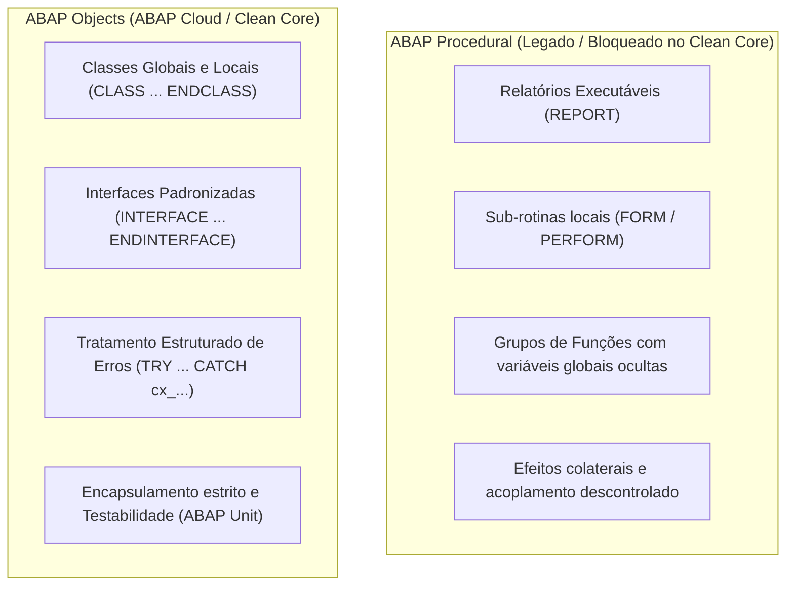
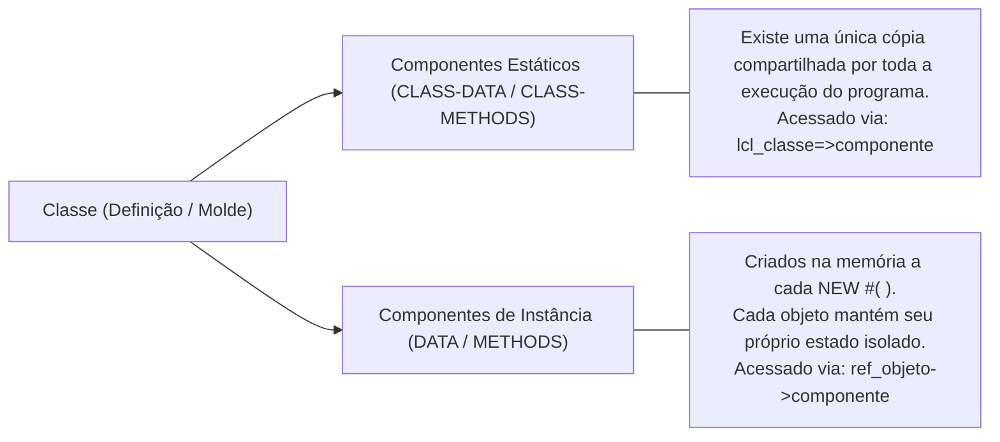

> [!NOTE] Conexões no Segundo Cérebro
> - **Conceitos Base:** [[ABAP Cloud]] | [[Clean Core]] | [[RAP - ABAP RESTful Application Programming Model]]
> - **Aulas de Aplicação:** [[1 - Defining a Local Class]] | [[2 - Creating Instances of a Class]] | [[3 - Defining and Calling Methods]] | [[4 - Using Encapsulation to Ensure Consistency]]

---

## 1. O que é ABAP OO?

**ABAP Objects (ABAP OO)** é a extensão orientada a objetos da linguagem ABAP introduzida a partir da versão R/3 4.0. Enquanto o ABAP clássico nasceu como uma linguagem estritamente procedural voltada para relatórios (`REPORT`) e manipulação direta de tabelas do banco de dados, o ABAP OO trouxe os pilares modernos da engenharia de software para dentro do ecossistema SAP.

No [[ABAP Cloud]] (o ambiente de desenvolvimento oficial para SAP S/4HANA Cloud e Clean Core), **o paradigma orientado a objetos não é opcional — é a única linguagem permitida**. Construções procedurais legadas, como sub-rotinas (`FORM ... PERFORM`), tabelas com header line e programas de relatório clássicos, são bloqueadas pelo compilador.

---

## 2. Por que o ABAP Cloud exige 100% ABAP OO?

| Problema do Modelo Procedural (Legado) | Solução no ABAP Objects ([[Clean Core]]) |
| :--- | :--- |
| **Variáveis Globais Descontroladas:** Declarações como `TABLES` ou variáveis no *Top Include* podiam ser modificadas por qualquer sub-rotina ou transação. | **Encapsulamento de Estado:** Atributos pertencem exclusivamente à classe e só podem ser manipulados através de métodos com visibilidade controlada (`PRIVATE`, `PROTECTED`). |
| **Falta de Padronização de Contratos:** Funções tinham assinaturas abertas que quebravam clientes quando alteradas. | **Interfaces:** Contratos explícitos (`INTERFACES`) que garantem desacoplamento e facilitam injeção de dependências e mockups de teste. |
| **Erros Silenciosos:** Falhas eram tratadas por códigos numéricos (`sy-subrc`), facilmente ignorados por desenvolvedores. | **Classes de Exceção (`cx_...`):** Forçam o chamador a capturar erros explicitamente (`TRY...CATCH`) ou interromper a execução com diagnóstico detalhado. |
| **Impossibilidade de Testes Automatizados:** Relatórios procedurais não suportam testes unitários automatizados confiáveis. | **Testabilidade Nativa:** O framework **ABAP Unit** requer classes e interfaces para isolar e testar componentes de software sem impactar o banco produtivo. |

---

## 3. Os Quatro Pilares da POO no ABAP

### 1. Encapsulamento
Restringe o acesso direto ao estado interno de um objeto. Atributos críticos devem ser protegidos (`PRIVATE SECTION`) e acessados apenas via métodos validadores (getters/setters).
- Garante a consistência interna da aplicação.

### 2. Abstração
Expõe apenas o comportamento essencial para o mundo externo, ocultando a complexidade de implementação.
- No ABAP, isso é feito definindo assinaturas públicas claras (`PUBLIC SECTION`) e contratos de interface (`INTERFACES`).

### 3. Herança
Permite que uma classe filha (`SUBCLASS`) herde atributos e métodos de uma classe pai (`SUPERCLASS`), reutilizando código e especializando comportamentos via redefinição (`METHODS metodo REDEFINITION`).

### 4. Polimorfismo
Permite que diferentes classes respondam à mesma chamada de método de maneiras distintas através de interfaces comuns ou hierarquias de herança.
- Permite que um algoritmo processe objetos de tipos variados de forma unificada.

---

## 4. Elementos Estruturais de uma Classe ABAP

Uma classe ABAP é dividida estritamente em duas partes:

1. **`DEFINITION` (Declaração de Interface):**
   Define os componentes da classe e suas regras de visibilidade:
   - `PUBLIC SECTION`: Acessível por qualquer consumidor externo.
   - `PROTECTED SECTION`: Acessível pela própria classe e por suas subclasses (herança).
   - `PRIVATE SECTION`: Acessível única e exclusivamente pela própria classe.

2. **`IMPLEMENTATION` (Código Executável):**
   Contém a lógica em blocos `METHOD <nome> ... ENDMETHOD.`.

### Componentes de Instância vs. Estáticos

---

## 5. Boas Práticas de ABAP OO no Clean Core

1. **Evite Métodos Estáticos Gigantes:** Não use classes como simples depósitos de sub-rotinas procedurais antigas (o antipadrão *God Object* ou *Utility Class* procedural).
2. **Favoreça Composição sobre Herança:** Use interfaces e delegação em vez de criar hierarquias profundas e rígidas de herança.
3. **Mantenha Métodos Curtos e com Responsabilidade Única (SRP):** Cada método deve resolver exatamente uma tarefa de negócio.
4. **Adote Métodos Funcionais:** Métodos que realizam leituras ou cálculos devem retornar seu resultado via `RETURNING VALUE(...)`, permitindo expressões limpas e legíveis.
5. **Utilize Tratamento de Exceções Baseado em Classes:** Substitua qualquer uso remanescente de `sy-subrc` por classes herdadas de `cx_static_check` ou `cx_no_check`.
