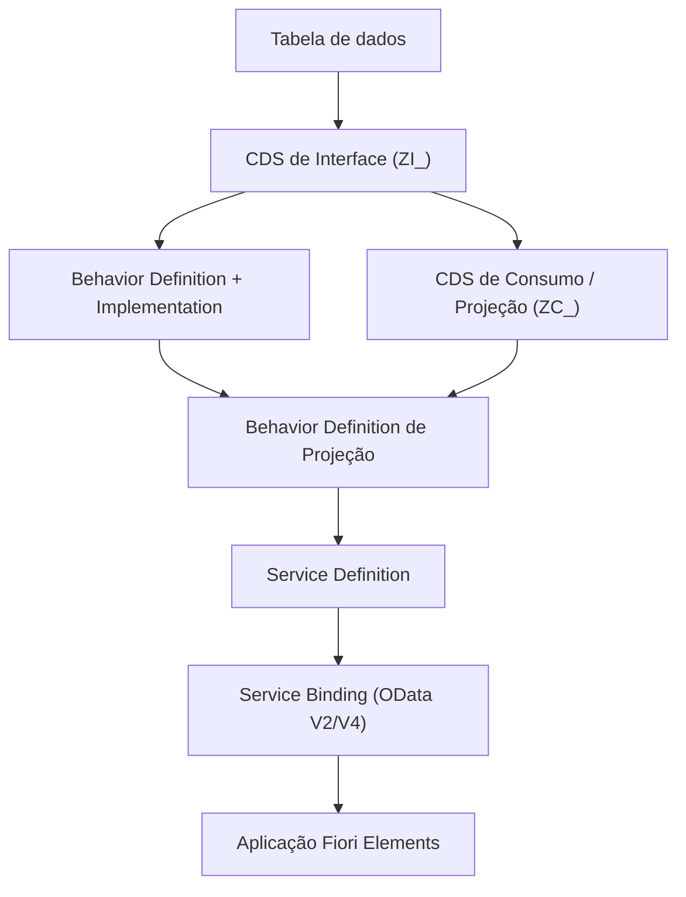

# RAP - ABAP RESTful Application Programming Model

**Relacionado:** [[CDS - Core Data Services|CDS]], [[Como construir um app FIORI com RAP]], [[Roteiro de Estudos SAP]]

## O que é o RAP?

O **RAP (ABAP RESTful Application Programming Model)** é o modelo de programação recomendado pela SAP para desenvolver aplicações e serviços modernos em ABAP, no S/4HANA e na SAP BTP (ABAP Environment). Ele define uma arquitetura padrão para expor dados e regras de negócio como serviços **OData**, normalmente consumidos por aplicações **Fiori Elements**.

Em termos práticos, o RAP responde a pergunta: *"Como transformar uma tabela do banco em um serviço completo, com leitura, criação, alteração, exclusão e ações de negócio, com o mínimo de código de infraestrutura?"*

Ele substitui abordagens mais antigas, como a **SEGW** (SAP Gateway Service Builder) com classes `DPC`/`MPC` escritas à mão, e o modelo baseado em **BOPF**.

## Principais características

- **Baseado em [[CDS - Core Data Services|CDS]]:** o modelo de dados é descrito com CDS View Entities, associações e anotações.
- **Behavior Definition:** declara o que pode ser feito com cada entidade (criar, alterar, excluir, ações, validações, determinações).
- **Framework gerenciado:** em cenários *managed*, o próprio framework cuida de persistência, bloqueio e transação.
- **Serviços OData prontos:** o Service Binding publica o serviço como OData V2 ou V4 sem programar o protocolo.
- **UI por metadados:** as anotações de UI na CDS permitem que o Fiori Elements gere a tela automaticamente.
- **Desenvolvimento no ADT:** todos os objetos são criados e editados no Eclipse com ABAP Development Tools.

## Arquitetura em camadas



## Objetos principais

| Objeto | Para que serve |
| :--- | :--- |
| **Tabela de banco** | Guarda o dado persistido. |
| **CDS de Interface** | Camada reutilizável que modela o dado de negócio. |
| **Behavior Definition** | Declara as operações e ações permitidas na entidade. |
| **Behavior Implementation** | Classe ABAP com a lógica de ações, validações e determinações. |
| **CDS de Consumo (Projeção)** | Adapta a CDS de interface para um cenário de tela ou serviço específico. |
| **Metadata Extension** | Separa as anotações de UI da definição da CDS. |
| **Service Definition** | Define quais entidades são expostas como serviço. |
| **Service Binding** | Publica o serviço como uma URL OData real. |

## Tipos de implementação

| Tipo | Quando usar |
| :--- | :--- |
| **Managed** | Cenário novo (*greenfield*): o framework cuida do CRUD, da persistência e do ciclo transacional. O desenvolvedor só implementa a lógica específica. |
| **Unmanaged** | Já existe lógica ABAP legada (BAPIs, funções): o desenvolvedor implementa leitura, gravação e bloqueio manualmente, reaproveitando o código existente. |
| **Managed com Unmanaged Save** | O framework cuida do ciclo transacional, mas a gravação final é feita por código customizado. |

## Conceitos de comportamento

- **Operações padrão:** `create`, `update` e `delete`.
- **Ações (*actions*):** operações de negócio customizadas, como "aprovar", "cancelar" ou "reenviar".
- **Determinações (*determinations*):** lógica executada automaticamente quando um dado muda, por exemplo preencher um campo calculado.
- **Validações (*validations*):** verificações que impedem a gravação de dados inconsistentes.
- **Draft:** permite salvar rascunhos antes de gravar definitivamente no banco.

## Exemplo mínimo de Behavior Definition

```abap
managed implementation in class zbp_i_flight unique;
strict ( 2 );

define behavior for ZI_Flight alias Flight
persistent table zflight
lock master
authorization master ( instance )
{
  create;
  update;
  delete;

  action ( features : instance ) cancelFlight result [1] $self;
}
```

## RAP vs. abordagens antigas

| Aspecto              | SEGW (clássico)                              | RAP                                         |
| :------------------- | :------------------------------------------- | :------------------------------------------ |
| Definição do modelo  | Projeto SEGW e classes DPC/MPC               | CDS View Entities                           |
| Lógica de CRUD       | Escrita à mão em métodos                     | Framework (managed) ou implementação guiada |
| Publicação           | Registro no Gateway (`/IWFND/MAINT_SERVICE`) | Service Binding                             |
| Interface com a tela | Anotações separadas ou código UI5            | Anotações CDS com Fiori Elements            |
| Ferramenta           | SAP GUI                                      | Eclipse com ADT                             |


## Onde ele se encaixa no desenvolvimento

O RAP cobre o **backend** da aplicação. O frontend é gerado com **Fiori Elements** (List Report e Object Page), publicado no SAP como WAPA e disponibilizado aos usuários por meio do Fiori Launchpad. O passo a passo completo está em [[Como construir um app FIORI com RAP]].
