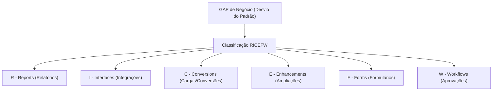

# RICEFW - Reports, Interfaces, Conversions, Enhancements, Forms, Workflows

**Relacionado:** [[ABAP Cloud]], [[Clean Core]], [[ALV - ABAP List Viewer|ALV]], [[CDS - Core Data Services|CDS]], [[RAP - ABAP RESTful Application Programming Model|RAP]], [[IDoc - Intermediate Document|IDoc]], [[PO - Process Orquestration|SAP PO]], [[BTP - Business Technology Platform|SAP BTP]]

---

## 1. O que é RICEFW?

**RICEFW** (frequentemente citado no plural como *Ricefws*) é o acrônimo e a taxonomia padrão utilizada no ecossistema SAP para classificar, orçar, gerenciar e documentar todos os **desenvolvimentos customizados** (código "Z").

Na metodologia SAP, quando o processo padrão do ERP não atende integralmente a uma necessidade do cliente, identifica-se um **GAP** (lacuna de processo). Todo GAP aprovado para desenvolvimento é categorizado em uma das 6 letras do RICEFW.

---

## 2. As 6 Categorias na Prática

| Letra | Categoria | Finalidade | Tecnologias Clássicas (ECC) | Tecnologias Modernas ([[ABAP Cloud]] / Clean Core) |
| :---: | :--- | :--- | :--- | :--- |
| **R** | **Reports** *(Relatórios)* | Extrair dados do banco e exibir informações tabulares ou analíticas para tomada de decisão. | Transações `SE38`, telas de seleção Dynpro, relatórios em [[ALV - ABAP List Viewer\|ALV]]. | [[CDS - Core Data Services\|CDS Views]] analíticas, SAP Fiori Elements e relatórios via [[RAP - ABAP RESTful Application Programming Model\|RAP]]. |
| **I** | **Interfaces** *(Integrações)* | Trocar dados de forma síncrona ou assíncrona entre o SAP e sistemas externos/legados. | [[IDoc - Intermediate Document\|IDoc]], RFCs diretas, [[SOAP - Simple Object Access Protocol\|SOAP Web Services]], [[PI - Process Intagration\|SAP PI]] / [[PO - Process Orquestration\|PO]]. | APIs OData públicas liberadas (*Released APIs*), SAP Integration Suite (Cloud Integration / CPI) e Event-Driven Architecture. |
| **C** | **Conversions** *(Conversões / Cargas)* | Programas pontuais ou rotinas para migrar dados legados para o SAP (clientes, materiais, saldos). | Programas com BDC (*Batch Data Communication*), chamadas em lote de BAPIs, LSMW. | *SAP S/4HANA Migration Cockpit* (transação `LTMC`/aplicativo Fiori) e APIs públicas de importação. |
| **E** | **Enhancements** *(Ampliações)* | Inserir regras de negócio customizadas em pontos específicos do código padrão SAP sem modificá-lo. | *User Exits*, *Customer Exits* (`SMOD/CMOD`), *BAdIs* clássicas, *Enhancement-Points*. | *Developer Extensibility* (BAdIs liberadas para Cloud em ADT) e *Key-User Extensibility*. |
| **F** | **Forms** *(Formulários)* | Documentos de saída impressos ou gerados em PDF para envio a clientes, fornecedores ou fisco. | *SAPscript* (legado), *Smart Forms*. | *Adobe Forms* (PDF interativo/estático via Adobe Document Services - ADS) e formulários Fiori. |
| **W** | **Workflows** *(Fluxos)* | Automação e orquestração de processos de aprovação entre diferentes usuários e alçadas. | *SAP Business Workflow* clássico (transações `SWDD`, `SBWP`). | *Flexible Workflow* nativo do S/4HANA e *SAP Build Process Automation* no [[BTP - Business Technology Platform\|SAP BTP]]. |

---

## 3. O Problema que o RICEFW Resolve (Por que existe?)

### Sem governança de RICEFW (Caos de Projeto)
* O cliente pede centenas de customizações sem especificação clara.
* A gestão não sabe se o esforço é de um desenvolvedor ABAP júnior (um relatório simples) ou de um especialista sênior em middleware (uma interface complexa com mensageria).
* Os objetos customizados não têm código de rastreio, dificultando testes e homologações.

### Com governança de RICEFW (Controle e Produtividade)
1. **Rastreabilidade e Escopo:** Cada GAP recebe um código identificador (ex: `GAP_R012`, `INT_003`). Esse código acompanha a Proposta de Solução (DPS), a Especificação Técnica (ET), as tarefas no Jira/Azure DevOps e a evidência de testes.
2. **Dimensionamento de Horas:** Fórmulas de estimativa de esforço usam o tipo do RICEFW e sua complexidade (Baixa, Média, Alta ou Muito Alta).
3. **Distribuição de Squad:** Permite alocar o profissional correto para cada demanda (ex: profissional focado em CPI para **I**, consultor com perfil funcional/ABAP para **C**, etc.).

---

## 4. RICEFW no Modelo Clássico vs. Clean Core

| Critério | Modelo Clássico (ECC) | Modelo Clean Core (S/4HANA & Nuvem) |
| :--- | :--- | :--- |
| **Local do Código** | Direto no ERP (código `Z` acoplado ao Core). | No Core apenas via [[ABAP Cloud]] (APIs liberadas) ou fora do Core (*Side-by-Side* no [[BTP - Business Technology Platform\|BTP]]). |
| **Acesso a Dados** | Acesso irrestrito a tabelas de banco (`SELECT` direto em `MARA`, `VBAK`, etc.). | Somente através de [[CDS - Core Data Services\|CDS Views]] públicas autorizadas. |
| **Custo de Upgrade** | **Muito alto:** Cada nova versão ou patch do SAP exigia refatorar dezenas de RICEFWs que quebravam. | **Zero ou Mínimo (*Upgrade-Stable*):** Contratos de APIs garantem que os RICEFWs continuem funcionando após atualizações. |

---

## 5. Variações da Sigla

No mercado e em metodologias de consultorias, a sigla pode aparecer com pequenas variações:
* **RICEF:** Versão mais antiga (omite o *Workflow*).
* **WRICEF:** Coloca o *Workflow* no início para priorizar fluxos de aprovação.
* **FRICEW:** Variação comum em algumas consultorias globais.
* **Ricefws:** Forma plural informal usada no cotidiano de squads e especificações técnicas.
