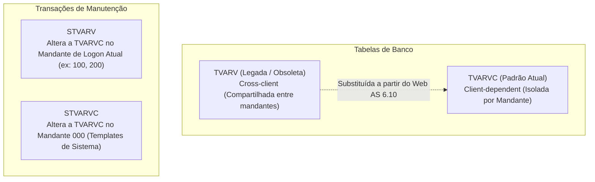
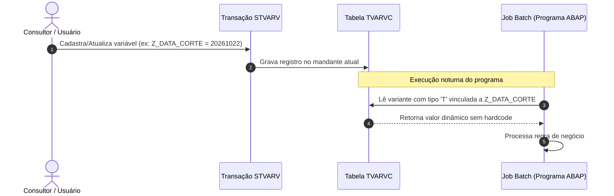

# STVARV e TVARVC - Variáveis de Seleção e Parâmetros

**Relacionado:** [[APP Tabela de Parametros]], [[ALV - ABAP List Viewer|ALV]], [[ABAP Cloud]], [[Clean Core]], [[Roteiro de Estudos SAP]]

---

## 1. O que é a STVARV e a TVARVC?

No ecossistema SAP, **TVARVC** é uma tabela transparente padrão e **`STVARV`** é a transação utilizada para manter os seus dados no mandante atual de trabalho.

Sua finalidade principal na documentação oficial da SAP é atuar como um repositório central de **variáveis de seleção globais**. Ela permite que valores (como centros, contas, códigos de empresa, intervalos de datas ou caminhos de arquivos) sejam alterados dinamicamente em **variantes de programas** sem que ninguém precise editar a variante manualmente ou modificar o código-fonte ABAP.

### Decomposição do Nome Técnico
* **T** = *Table* (Tabela de banco de dados).
* **VAR** = *Variables* (Variáveis de seleção).
* **V** = *Values / Variants* (Valores dinâmicos para variantes de programas).
* **C** = *Client-dependent* (Dependente do mandante — cada mandante possui seus próprios valores).

---

## 2. Diferenças Cruciais: TVARV vs. TVARVC e STVARV vs. STVARVC

Historicamente, existem distinções técnicas que costumam gerar confusão entre desenvolvedores iniciantes:

| Objeto | Tipo | Escopo | Descrição e Uso |
| :--- | :--- | :--- | :--- |
| **`TVARV`** | Tabela | Independente de mandante (*Cross-client*) | Tabela original das versões clássicas do SAP R/3. Tornou-se **obsoleta** porque qualquer alteração afetava todos os mandantes do servidor simultaneamente. |
| **`TVARVC`** | Tabela | Dependente de mandante (*Client-dependent*) | Tabela padrão substituta. Possui o campo `MANDT`, garantindo que os dados de teste (DEV/QAS) e produção (PRD) permaneçam isolados. |
| **`STVARV`** | Transação | Mandante atual | Abre a tela de manutenção da tabela `TVARVC` para o **mandante no qual você está logado**. É a transação usada no dia a dia. |
| **`STVARVC`** | Transação | Mandante `000` | Criada pela SAP (via Notas como a 770084) para manter variáveis no mandante mestre `000` (usada em variantes de sistema com prefixos `SAP&` ou `CUS&`). |

---

## 3. Tipos de Variáveis Suportados (P vs. S)

A tabela TVARVC organiza os parâmetros em duas abas/estruturas:

1. **Parâmetros (`TYPE = 'P'`):**
   * Armazenam um **valor único simples** (ex: `BUKRS = '1000'` ou um endereço de e-mail).
   * Utiliza apenas o campo `LOW` da tabela.
2. **Opções de Seleção / Ranges (`TYPE = 'S'`):**
   * Armazenam **tabelas de seleção completas**, suportando múltiplos valores, exclusões e intervalos (ex: centros de `1000` até `1050`, exceto `1020`).
   * Utiliza a estrutura clássica de range: `SIGN` (I/E), `OPTI` (EQ, BT, CP, NE...), `LOW` e `HIGH`.

### Estrutura Técnica dos Campos da TVARVC
| Campo | Descrição Técnica | Exemplo |
| :--- | :--- | :--- |
| `MANDT` | Mandante de trabalho | `100` |
| `NAME` | Nome da variável (chave com até 30 posições) | `Z_CENTRO_FATURAMENTO` |
| `TYPE` | Tipo de entrada (`P` = Parâmetro, `S` = Opção de Seleção) | `S` |
| `NUMB` | Número sequencial da linha do range | `0000`, `0001` |
| `SIGN` | `I` (Include) ou `E` (Exclude) | `I` |
| `OPTI` | Operador relacional (`EQ`, `BT`, `GE`, `LE`, etc.) | `BT` |
| `LOW` | Valor limite inferior / Valor único | `1000` |
| `HIGH` | Valor limite superior (em intervalos) | `1050` |

---

## 4. Como Vincular uma TVARVC a uma Variante de Programa

O principal uso oficial da TVARVC é alimentar telas de seleção de programas batch (`SE38` / `SA38`) sem intervenção manual:

1. Na tela de manutenção de variantes do programa, acerte os **Atributos da Variante** (*Variant Attributes*).
2. Na linha do campo desejado, marque a coluna **Variável de Seleção** (*Selection Variable*).
3. Pressione `F4` e selecione o tipo **`T`** (*Table Variable from TVARVC*).
4. Na coluna **Nome da Variável**, selecione no `F4` a entrada cadastrada previamente via transação `STVARV`.
5. Salve a variante. Toda vez que o job rodar em segundo plano, ele lerá o valor mais atual da tabela `TVARVC`.

---

## 5. Por que as Empresas Criam Soluções Próprias (Limitações da TVARVC)

Apesar de útil e nativa, a TVARVC possui limitações graves de arquitetura em grandes corporações, o que motiva o surgimento de ferramentas como o [[APP Tabela de Parametros]]:

| Limitação da TVARVC | Como a TVARVC opera | Como uma Tabela/App de Parâmetros resolve |
| :--- | :--- | :--- |
| **Falta de Hierarquia** | **Estrutura Plana:** Todas as variáveis de todos os setores (SD, MM, FI, RH) ficam misturadas em uma lista única. | Organização em níveis: **Módulo** **`**=>**`** **Parâmetro** **`**=>**`** **Valor**. |
| **Segurança e Alçada** | **Tudo ou Nada:** Quem tem autorização na transação `STVARV` pode alterar qualquer variável da empresa inteira. | Autorização segregada por módulo (ex: usuário fiscal só visualiza e edita parâmetros de FI). |
| **Usabilidade** | Interface clássica e árida do SAP GUI (telas Dynpro cinzas). | Aplicação moderna em **SAP Fiori**, amigável e acessível via navegador. |
| **Rastreabilidade** | Histórico básico de modificação por usuário, sem justificativa de negócio obrigatória. | Logs de auditoria claros com justificativa de mudança de parâmetro de negócio. |

---

## 6. TVARVC no SAP S/4HANA e Clean Core

* **No SAP S/4HANA On-Premise e Private Cloud:** A tabela `TVARVC` e a transação `STVARV` continuam funcionando para suportar rotinas e variantes batch clássicas.
* **No modelo [[Clean Core]] e [[ABAP Cloud]]:**
  * O acesso direto a telas SAP GUI antigas como a `STVARV` é desencorajado.
  * Em rotinas em nuvem, o agendamento de jobs ocorre via **Application Jobs** (aplicativo Fiori nativo).
  * Parâmetros globais de negócio são gerenciados por serviços de configuração dedicados (*Custom Business Configurations* ou tabelas com objetos de configuração no SAP BTP).
