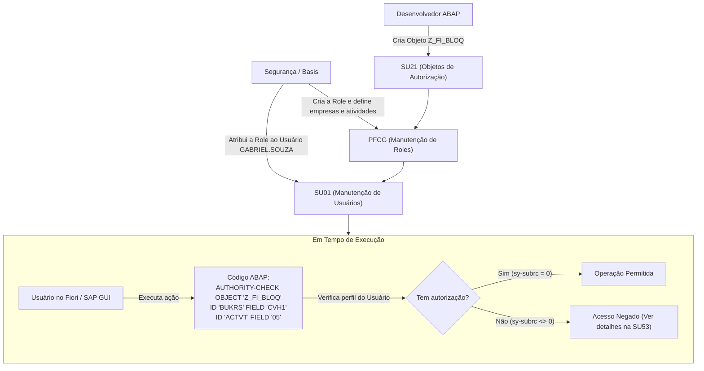

---
aliases:
  - "Transações SAP"
  - "TCodes SAP"
  - "Principais Transações SAP"
  - "Guia de Transações SAP"
  - "T-Codes"
tags:
  - sap
  - abap
  - transacoes
  - tcodes
  - sap-gui
  - desenvolvedor
  - basis
  - guia-de-referencia
type: "concept"
status: "reviewed"
summary: "Guia prático de referência com as principais transações (TCodes) do ecossistema SAP, organizadas por desenvolvimento ABAP, depuração, Fiori, integração e governança."
---

# Transações SAP – Guia das Principais Transações (TCodes)

**Relacionado:** [[Roteiro de Estudos SAP]], [[Orientao a Objetos no ABAP|Orientação a Objetos no ABAP]], [[ALV - ABAP List Viewer|ALV]], [[CDS - Core Data Services|CDS]], [[RAP - ABAP RESTful Application Programming Model|RAP]], [[STVARV e TVARVC - Variaveis de Selecao e Parametros|STVARV/TVARVC]], [[IDoc - Intermediate Document|IDoc]]

---
## 1. Comandos de Navegação e Prefixos no SAP GUI

| Prefixo de Comando | Ação Executada                                                                                            |
| :----------------- | :-------------------------------------------------------------------------------------------------------- |
| **`[TCode]`**      | Executa a transação substituindo a tela atual (válido apenas a partir da tela inicial *SAP Easy Access*). |
| **`/n[TCode]`**    | Encerra a transação ativa na janela atual e abre a nova transação no mesmo modo.                          |
| **`/o[TCode]`**    | Abre a nova transação em uma nova janela (*Session* / modo paralelo) sem fechar a atual.                  |
| **`/n`**           | Cancela o processamento atual e retorna para o menu inicial *SAP Easy Access*.                            |
| **`/h`**           | Ativa o modo de **depuração** (*Debugging*) imediatamente no processamento da tela atual.                 |
| **`/nend`**        | Encerra todas as sessões abertas e faz logoff do SAP solicitando confirmação.                             |
| **`/nex`**         | Encerra todas as sessões e faz **logoff forçado imediato**, sem confirmação e sem salvar dados pendentes. |

---

## 2. Visão Consolidada: O Arsenal de Transações do Desenvolvedor Sênior

Esta tabela reúne todas as transações indispensáveis utilizadas rotineiramente por um desenvolvedor sênior para codificação, depuração em tempo real, auditoria de performance, testes de APIs Fiori, integrações e governança.

| Transação | Categoria | Nome / Função | Uso Diário pelo Desenvolvedor Sênior |
| :--- | :--- | :--- | :--- |
| **`SE80`** | Desenvolvimento | *Object Navigator* | Navegação central por pacotes, programas, classes, funções e dicionário de dados. |
| **`SE24`** | Desenvolvimento | *Class Builder* | Criação e manutenção de classes globais, métodos e interfaces orientadas a objetos (*ABAP OO*). |
| **`SE38`** | Desenvolvimento | *ABAP Editor* | Edição e execução de relatórios, programas executáveis e rotinas de inclusão (*Includes*). |
| **`SE11`** | Dicionário de Dados | *ABAP Dictionary (DDIC)* | Modelagem de tabelas transparentes, estruturas, domínios, elementos de dados e visões clássicas. |
| **`SE16N`** | Dicionário de Dados | *General Table Display* | Inspeção direta de dados em tabelas do banco, validação de chaves e checagem de integridade. |
| **`SE14`** | Dicionário de Dados | *Database Utility* | Ajuste estrutural de tabelas físicas no banco quando há inconsistências de campos ou chaves. |
| **`SE37`** | Desenvolvimento | *Function Builder* | Criação, documentação e execução de testes unitários em Módulos de Função e RFCs. |
| **`SE93`** | Desenvolvimento | *Maintain Transaction Codes* | Criação e amarração de transações customizadas (`Z`/`Y`) a programas, métodos e telas. |
| **`SE91`** | Desenvolvimento | *Message Maintenance* | Criação e gestão de classes de mensagens padronizadas de retorno para o usuário ou logs. |
| **`SE18`** | Ampliações | *BAdI Builder (Definition)* | Análise da definição de pontos de ampliação standard da SAP (*Business Add-Ins*). |
| **`SE19`** | Ampliações | *BAdI Builder (Implementation)* | Implementação de lógica customizada em BAdIs clássicas e novas (*Kernel BAdIs*). |
| **`/h`** | Depuração | *Activate Debugging* | Comando digitado no campo de transação para interceptar e depurar a tela ativa imediatamente. |
| **`ST22`** | Troubleshooting | *ABAP Dump Analysis* | Análise da causa-raiz de erros fatais (*Short Dumps*), pilha de chamadas e variáveis de memória. |
| **`SM50`** | Troubleshooting | *Work Process Overview* | Monitoramento dos processos de trabalho da instância, identificação de rotinas presas e loops infinitos. |
| **`SM66`** | Troubleshooting | *System-Wide Work Processes* | Visão consolidada de processos de trabalho de todos os servidores do ambiente para checar travamentos globais. |
| **`SM12`** | Troubleshooting | *Lock Entries (Enqueue)* | Identificação de deadlocks, conflitos de concorrência e eliminação controlada de bloqueios órfãos. |
| **`SLG1`** | Troubleshooting | *Application Log* | Consulta e auditoria de logs de negócio gravados por rotinas automáticas e interfaces. |
| **`ST05`** | Performance | *Performance Trace (SQL Trace)* | Gravação de trace de banco de dados para analisar tempo de query, índices e planos de execução no HANA. |
| **`SAT`** | Performance | *ABAP Runtime Analysis* | Medição de consumo de tempo e memória dividida entre Lógica ABAP vs. Banco de Dados vs. Sistema. |
| **`/IWFND/GW_CLIENT`** | Fiori & OData | *SAP Gateway Client* | Simulação de chamadas HTTP (GET, POST, PATCH) para testar serviços OData diretamente no SAP GUI. |
| **`/IWFND/MAINT_SERVICE`** | Fiori & OData | *Activate and Maintain Services* | Publicação, ativação e amarração de serviços OData do SAP Gateway a artefatos CDS/RAP. |
| **`/IWFND/ERROR_LOG`** | Fiori & OData | *Gateway Error Log* | Diagnóstico imediato de erros de requisições HTTP e payloads JSON vindos de aplicativos Fiori. |
| **`/UI2/FLP`** | Fiori & OData | *Fiori Launchpad* | Acesso ao portal Fiori no navegador para teste funcional da visão final do usuário. |
| **`/UI2/INVAL_CACHES`** | Fiori & OData | *Invalidate All Caches* | Limpeza de cache estático do Fiori quando alterações visuais ou metadados de UI não atualizam. |
| **`SM37`** | Background | *Job Overview* | Acompanhamento do status de execução, cancelamento e leitura de logs de rotinas em background. |
| **`SM36`** | Background | *Define Background Job* | Agendamento de programas executáveis vinculados a variantes de seleção específicas. |
| **`STVARV`** | Background | *Selection Variables* | Manutenção de parâmetros dinâmicos e variáveis de seleção globais na tabela `TVARVC`. |
| **`SM59`** | Integração | *RFC Destinations* | Testes de conexão de rede, autorização, certificados SSL e configuração de destinos RFC/HTTP externos. |
| **`WE02` / `WE05`** | Integração | *IDoc List* | Monitoramento de mensageria assíncrona, status de transmissão e erros de preenchimento em IDocs. |
| **`WE19`** | Integração | *IDoc Test Tool* | Disparo de testes e injeção controlada de payloads de IDocs sem depender de sistemas legados. |
| **`SOAMANAGER`** | Integração | *SOA Management* | Configuração técnica de Web Services SOAP, criação de endpoints, chaves de segurança e WSDLs. |
| **`AL11`** | Integração | *SAP Server Directories* | Consulta de pastas, arquivos e diretórios de interface no sistema operacional do servidor SAP. |
| **`CG3Y` / `CG3Z`** | Integração | *Download / Upload File* | Transferência direta de arquivos planos entre a máquina local e os diretórios do servidor (`AL11`). |
| **`SE09` / `SE10`** | Governança | *Transport Organizer* | Criação de tarefas, documentação, liberação e consulta de Ordens de Transporte (*Workbench* e *Customizing*). |
| **`STMS`** | Governança | *Transport Management System* | Consulta da fila de importação de ordens para checar o avanço de deploys entre DEV, QAS e PRD. |
| **`SU53`** | Segurança | *Display Authorization Check* | Verificação imediata do último objeto de autorização que falhou no teste de permissão do usuário. |
| **`PFCG`** | Segurança | *Role Maintenance* | Inspeção de papéis (*Roles*), objetos de autorização atribuídos e menus de acesso dos perfis. |
| **`SU01`** | Segurança | *User Maintenance* | Checagem de parâmetros de sessão (*Parameter IDs*), tipo de usuário e papéis atribuídos para testes. |
| **`SNOTE`** | Manutenção | *SAP Note Assistant* | Busca, análise de impacto e aplicação de notas técnicas oficiais de correção de bugs liberadas pela SAP. |
| **`SPRO`** | Customizing | *SAP Reference IMG* | Navegação pela estrutura de parametrização funcional para entender como as regras de negócio estão configuradas. |
| **`BP`** | Dados Mestres | *Business Partner* | Consulta e validação de cadastros unificados de parceiros de negócio (Clientes, Fornecedores e Crédito). |
| **`FB03`** | Negócio (FI) | *Display Document* | Exibição de lançamentos contábeis gerados por programas, interfaces ou faturamentos para validação técnica. |
| **`FBL5N` / `FBL1N`** | Negócio (FI) | *Customer / Vendor Line Items* | Consulta de partidas em aberto e compensadas para validação de conciliações e desenvolvimentos financeiros. |

---

## 3. Desenvolvimento ABAP e Dicionário de Dados (ABAP Workbench & DDIC)

Estas são as ferramentas de criação de objetos, programas, classes e tabelas do dia a dia do desenvolvedor ABAP.

| Transação | Nome / Função | Para que serve |
| :--- | :--- | :--- |
| **`SE80`** | *Object Navigator* | Central de desenvolvimento integrada do ABAP. Permite navegar e editar todos os objetos de um pacote (*Package*), programa, classe ou módulo de função. |
| **`SE38`** | *ABAP Editor* | Editor de código-fonte para criação, alteração e execução direta de programas executáveis (*Reports*) e rotinas de inclusão (*Includes*). |
| **`SE24`** | *Class Builder* | Ferramenta para criação, visualização e edição de Classes Globais e Interfaces Orientadas a Objetos (*ABAP OO*). |
| **`SE11`** | *ABAP Dictionary (DDIC)* | Manutenção das estruturas do banco de dados: Tabelas Transparentes, Visões clássicas, Estruturas, Elementos de Dados e Domínios. |
| **`SE16N`** | *General Table Display* | Consulta dinâmica e visualização rápida de registros de tabelas do banco de dados (versão mais moderna e flexível que a `SE16`). |
| **`SE14`** | *Database Utility* | Utilitário de banco de dados para ajustar tabelas físicas no banco quando ocorrem erros estruturais ou alterações de chaves primárias. |
| **`SE37`** | *Function Builder* | Criação, modificação, documentação e testes unitários de Módulos de Função (*Function Modules* e RFCs). |
| **`SE91`** | *Message Maintenance* | Criação e manutenção de Classes de Mensagens utilizadas em instruções ABAP (`MESSAGE e001(zfi_msg)`). |
| **`SE93`** | *Maintain Transaction Codes* | Criação e manutenção de códigos de transação customizados (TCodes `Z` ou `Y`), vinculando-os a programas ou telas. |
| **`SE18`** | *BAdI Builder (Definition)* | Consulta e definição de pontos de ampliação de negócio padrão (*Business Add-Ins* - BAdIs clássicas e novas). |
| **`SE19`** | *BAdI Builder (Implementation)* | Criação e ativação da implementação de código customizado para BAdIs. |
| **`SMARTFORMS`** | *Smart Forms* | Ferramenta visual para criação e manutenção de formulários impressos legados de faturamento, pedidos e etiquetas. |
| **`SFP`** | *Form Builder (Adobe Forms)* | Ferramenta de formulários moderna baseada em PDF e tecnologia Adobe Document Services (ADS). |

---

## 4. Depuração, Diagnóstico e Análise de Performance

Ferramentas essenciais para encontrar a causa-raiz de erros (*bugs*), travamentos de processos e gargalos de lentidão.

| Transação | Nome / Função | Para que serve |
| :--- | :--- | :--- |
| **`ST22`** | *ABAP Dump Analysis* | Consulta detalhada de erros fatais de tempo de execução (*Short Dumps* / `RABAX_STATE`), indicando linha de código, pilha de chamadas e variáveis no momento da quebra. |
| **`ST05`** | *Performance Trace* | Rastreamento avançado de banco de dados (*SQL Trace*), RFC e chamadas de enfileiramento. Permite avaliar planos de execução e otimizar queries e CDS Views. |
| **`SAT`** | *ABAP Runtime Analysis* | Medição minuciosa de tempo de CPU, consumo de memória e chamadas internas de métodos para otimização de performance (substituta da clássica `SE30`). |
| **`SM50`** | *Work Process Overview* | Monitoramento em tempo real dos processos de trabalho da instância atual. Permite ver programas em execução, processos travados e matar sessões. |
| **`SM66`** | *System-Wide Work Processes* | Visão global de todos os processos de trabalho ativos em todos os servidores do ambiente (*Landscape*). |
| **`SM12`** | *Lock Entries (Enqueue)* | Visualização e liberação manual de registros bloqueados por concorrência de usuários ou programas abortados (*Enqueue Locks*). |
| **`SM04`** | *User List* | Exibe os usuários logados na instância atual, com quantidade de janelas abertas e consumo de memória. |
| **`SLG1`** | *Application Log* | Leitura e auditoria de logs de aplicação de negócio gerados por programas e interfaces (funções `APPL_LOG_*`). |
| **`SLG0`** | *Log Object Definition* | Cadastro de Objetos e Subobjetos de Log que alimentam a `SLG1`. |

---

## 5. Processamento em Background e Variáveis de Seleção

Transações voltadas para o controle de rotinas assíncronas noturnas e parâmetros flexíveis.

| Transação | Nome / Função | Para que serve |
| :--- | :--- | :--- |
| **`SM36`** | *Define Background Job* | Agendamento e configuração de Jobs em background (horários, periodicidade, programa e variante). |
| **`SM37`** | *Job Overview* | Monitoramento da fila de jobs agendados, cancelamento de rotinas travadas e visualização dos logs de execução de jobs. |
| **`STVARV`** | *Selection Variables (Current Client)* | Manutenção de variáveis globais e intervalos de seleção na tabela `TVARVC` para uso em variantes de programas do mandante atual. |
| **`STVARVC`** | *Selection Variables (Client 000)* | Manutenção de variáveis globais de variantes no mandante matriz `000`. |

---

## 6. SAP Fiori, OData e Serviços Web

Transações de suporte à esteira moderna de desenvolvimento Fiori e APIs do SAP S/4HANA.

| Transação                  | Nome / Função                    | Para que serve                                                                                                                                      |
| :------------------------- | :------------------------------- | :-------------------------------------------------------------------------------------------------------------------------------------------------- |
| **`/UI2/FLP`**             | *Fiori Launchpad*                | Abre o portal web do usuário no navegador padrão com os blocos (*tiles*) e aplicativos Fiori.                                                       |
| **`/IWFND/MAINT_SERVICE`** | *Activate and Maintain Services* | Registro, publicação e ativação de serviços OData do **SAP Gateway** (vincular serviços OData a *Service Bindings* de CDS/RAP).                     |
| **`/IWFND/GW_CLIENT`**     | *SAP Gateway Client*             | Cliente de testes HTTP embutido no SAP GUI para simular requisições REST/OData (GET, POST, PATCH, DELETE) diretamente contra o serviço.             |
| **`/IWFND/ERROR_LOG`**     | *Gateway Error Log*              | Rastreamento e diagnóstico detalhado de falhas em chamadas OData originadas por aplicativos Fiori.                                                  |
| **`/UI2/FLPCM_CUST`**      | *Launchpad Content Manager*      | Ferramenta moderna do S/4HANA para consultar, criar e gerenciar Catálogos de aplicativos Fiori e seus mapeamentos de navegação (*Target Mappings*). |
| **`/UI2/FLPD_CUST`**       | *Fiori Launchpad Designer*       | Ferramenta de configuração clássica para montagem visual de Catálogos e Grupos de blocos Fiori no navegador.                                        |
| **`/UI2/INVAL_CACHES`**    | *Invalidate All Caches*          | Limpa o cache estático do Fiori Launchpad quando uma alteração de layout, catálogo ou anotação não reflete no navegador.                            |
| **`SICF`**                 | *Maintain Services (ICF)*        | Árvore de serviços do *Internet Communication Framework*. Usada para ativar ou desativar endpoints HTTP e nós de comunicação web.                   |

---

## 7. Integrações (RFC, Web Services, IDoc e Servidor de Arquivos)

Ferramentas de comunicação do SAP com o ecossistema externo (sistemas legados, APIs, barramentos de mensageria).

| Transação | Nome / Função | Para que serve |
| :--- | :--- | :--- |
| **`SM59`** | *RFC Destinations* | Criação, teste de conexão e configuração de credenciais de destinos RFC (*Remote Function Call*) e conexões HTTP com sistemas externos. |
| **`SOAMANAGER`** | *SOA Management* | Portal web administrativo para configuração de Web Services baseados em SOAP (gerar endpoints, consultar WSDLs e certificados de segurança). |
| **`SPROXY`** | *Enterprise Services Browser* | Consulta e geração de objetos ABAP Proxy gerados a partir do repositório corporativo de serviços (PI/PO ou Integration Suite). |
| **`WE02` / `WE05`** | *IDoc List* | Monitoramento, busca e consulta de status de processamento de documentos intermediários (*IDocs* de entrada e saída). |
| **`WE19`** | *IDoc Test Tool* | Ambiente de testes para simular e reprocessar IDocs manualmente sem afetar a fila real de transmissão. |
| **`WE20`** | *Partner Profiles* | Configuração de perfis de parceiros de comunicação para definir quais tipos de IDoc cada sistema pode enviar ou receber. |
| **`BD87`** | *Status Monitor for ALE Messages* | Reprocessamento em massa de mensagens e IDocs com falha. |
| **`AL11`** | *SAP Server Directories* | Navegador de pastas e arquivos no sistema operacional do servidor de aplicação SAP. |
| **`CG3Y`** | *Download File* | Baixa arquivos do diretório do servidor de aplicação (`AL11`) diretamente para a máquina local. |
| **`CG3Z`** | *Upload File* | Envia arquivos da máquina local para as pastas do servidor de aplicação (`AL11`). |

---

## 8. Governança, Transportes e Segurança

Controle de Ordens de Transporte entre ambientes (DEV > QAS > PRD) e auditoria de perfis de acesso.

| Transação            | Nome / Função                     | Para que serve                                                                                                                                    |
| :------------------- | :-------------------------------- | :------------------------------------------------------------------------------------------------------------------------------------------------ |
| **`SE09` / `SE10`**  | *Transport Organizer*             | Criação, inclusão de tarefas, liberação e consulta de Ordens de Transporte (*Workbench* para código e *Customizing* para parâmetros).             |
| **`STMS`**           | *Transport Management System*     | Gerenciador do fluxo de importação de Ordens de Transporte entre as filas dos ambientes do projeto.                                               |
| **`SPRO`**           | *Customizing - SAP Reference IMG* | Menu mestre de parametrização funcional do sistema (guia de implementação de regras de negócio de FI, SD, MM, etc.).                              |
| **`SU01` / `SU01D`** | *User Maintenance*                | Manutenção (SU01) e visualização (SU01D) de cadastros de usuários, parâmetros de sessão e papéis associados.                                      |
| **`PFCG`**           | *Role Maintenance*                | Criação e manutenção de perfis de autorização (*Roles*) e concessão de objetos de segurança técnica.                                              |
| **`SU53`**           | *Display Authorization Check*     | Exibe os objetos de autorização que falharam no último teste de permissão do usuário. Fundamental para identificar bloqueios de perfil de acesso. |

### 🔐 Detalhamento de Segurança: SU01 vs. PFCG

A gestão de segurança no SAP baseia-se na separação entre **Identidade (QUEM)** e **Permissões (O QUE)**:

#### 👤 SU01 – Manutenção de Usuários (O "Quem")
Gerencia o cadastro e as preferências individuais da conta do usuário no mandante:
* **Dados de Logon:** Define o tipo de usuário (`Dialog` para pessoas, `System` para rotinas/jobs em background, `Communication` para chamadas RFC/APIs externas) e controla senhas/bloqueios de acesso.
* **Valores Fixos (*Defaults*):** Configura fuso horário, formato de data (`DD.MM.AAAA`), notação decimal (`1.000,00`) e idioma de inicialização.
* **Parâmetros de Usuário (*Parameter ID*):** Permite pré-preencher campos em telas do SAP (ex.: definir a Empresa padrão `BUK = CVH1`).
* **Atribuição de Funções (*Roles*):** Vincula as roles criadas na `PFCG` diretamente à conta do usuário.

#### 🛡️ PFCG – Manutenção de Funções / Perfis (O "O Que")
Centraliza o desenho de permissões e privilégios que os usuários podem exercer:
* **Menu da Função:** Define a lista de transações, programas e aplicativos Fiori visíveis no menu do usuário.
* **Objetos de Autorização (*Authorization Objects*):** Regras granulares que definem o que pode ser feito dentro de cada tela (ex.: `S_TCODE` para transações, `F_BKPF_BUK` para empresas contábeis, ou objetos customizados como `Z_FI_BLOQ`).
* **Geração do Perfil Técnico:** Na aba Autorizações, ao gerar a role (ícone do chapéu vermelho), o SAP compila as regras em um perfil técnico que o kernel verifica durante a execução do comando `AUTHORITY-CHECK` no código ABAP.

---

## 9. Administração de Sistema e Infraestrutura (SAP Basis)

O **SAP Basis** (*Business Application Software Integrated solution*) é a camada de infraestrutura tecnológica, administração de servidores, banco de dados e comunicação do SAP. Conhecer essas transações ajuda o desenvolvedor a entender a saúde do ambiente e diagnosticar gargalos técnicos de infraestrutura sem depender exclusivamente de suporte.

| Transação | Nome / Função | Para que serve |
| :--- | :--- | :--- |
| **`SM21`** | *System Log* | Log técnico de eventos do servidor. Registra quedas de processos de trabalho, falhas de banco de dados, cancelamentos de sessões e erros de comunicação em nível de sistema operacional. |
| **`ST02`** | *Tune Summary / Buffers* | Monitoramento dos buffers e consumo de memória compartilhada do SAP. Permite avaliar se tabelas e telas estão com alta taxa de swap por falta de memória configurada. |
| **`ST04` / `DB02`** | *Database Performance / Space* | Monitoramento do banco de dados (ex.: SAP HANA, Oracle, SQL Server). Permite checar espaço em disco, crescimento de tabelas, índices fragmentados e gargalos de I/O. |
| **`ST06` / `OS07N`** | *Operating System Monitor* | Monitoramento em nível de sistema operacional: consumo de CPU, memória RAM física disponível e tempo de resposta de discos do servidor de aplicação. |
| **`SM51`** | *SAP Servers Overview* | Lista todos os servidores de aplicação (*Application Servers*) ativos no ambiente (*Landscape*) e seus respectivos processos de trabalho. |
| **`SM02`** | *System Messages* | Criação e envio de comunicados e avisos globais que aparecem como janelas pop-up na tela de todos os usuários logados (muito usado para avisar paradas e manutenções). |
| **`RZ10`** | *Edit Profiles* | Manutenção e configuração dos arquivos de parâmetros de perfil das instâncias do SAP (*Default Profile*, *Instance Profile*). |
| **`RZ11`** | *Profile Parameter Maintenance* | Consulta e alteração dinâmica (em tempo de execução) de parâmetros técnicos de perfil do SAP NetWeaver (ex.: timeout de sessões, segurança de senhas). |
| **`SPAD`** | *Spool Administration* | Gerenciamento e configuração de impressoras, dispositivos de saída, tipos de papel e formatos de página do SAP. |
| **`SP01` / `SP02`** | *Spool Requests* | Fila geral de ordens de impressão (*Spool*) geradas por relatórios e formulários do sistema (`SP01` para todos os usuários; `SP02` para os spools do próprio usuário logado). |
| **`SNOTE`** | *SAP Note Assistant* | Download, verificação de compatibilidade e aplicação de notas de correção oficiais (*SAP Notes*) liberadas pela SAP. |
| **`SPAM` / `SAINT`** | *Support Package Manager / Add-On Tool* | Aplicação de pacotes de atualização de suporte (*Support Packages*) e instalação de componentes adicionais (*Add-ons*) no ambiente. |
| **`SCC4`** | *Client Administration* | Configuração e controle de segurança de mandantes (*Clients*). Define se o mandante está aberto para desenvolvimento/customizing ou protegido como produtivo. |
| **`SCC1` / `SCC1N`** | *Client Copy - Selected Requests* | Cópia local de Ordens de Transporte de um mandante para outro **dentro do mesmo servidor** (muito utilizada em DEV para sincronizar customizações em mandantes de teste unitário). |
| **`SCCL` / `SCC3`** | *Client Copy Local / Copy Logs* | Execução de cópias completas de mandantes e visualização dos logs e status das cópias realizadas. |

---

## 10. Transações Funcionais Clássicas Fundamentais para Desenvolvedores

Mesmo atuando como técnico, o desenvolvedor precisa validar dados de teste, documentos contábeis e pedidos nos módulos de negócio.

| Módulo    | Transação     | Nome / Função              | Para que serve                                                                       |
| :-------- | :------------ | :------------------------- | :----------------------------------------------------------------------------------- |
| **BP**    | **`BP`**      | *Business Partner*         | Cadastro central unificado de Clientes, Fornecedores e Contas de Crédito no S/4HANA. |
| **FI**    | **`FB03`**    | *Display Document*         | Exibição de lançamentos e documentos contábeis financeiros.                          |
| **FI-AR** | **`FBL5N`**   | *Customer Line Items*      | Consulta de partidas individuais (títulos em aberto e compensados) de clientes.      |
| **FI-AP** | **`FBL1N`**   | *Vendor Line Items*        | Consulta de partidas individuais (faturas e pagamentos) de fornecedores.             |
| **FI-GL** | **`FAGLL03`** | *G/L Account Line Items*   | Consulta de partidas individuais de contas do Livro Razão (*General Ledger*).        |
| **SD**    | **`VA03`**    | *Display Sales Order*      | Visualização de ordens de venda comercial.                                           |
| **SD**    | **`VF03`**    | *Display Billing Document* | Visualização de faturas e notas de saída.                                            |
| **MM**    | **`ME23N`**   | *Display Purchase Order*   | Exibição detalhada de pedidos de compras.                                            |
| **MM**    | **`MM03`**    | *Display Material*         | Visualização do cadastro de materiais e produtos.                                    |

---

## 📌 Termos e Conceitos para Adicionar em `03_Resources/SAP/Conceitos`
- `[[Transacoes SAP - Principais Transacoes|Transações SAP - Principais Transações]]` — Guia estruturado de TCodes essenciais de desenvolvimento, depuração, integração, governança, Basis e módulos de negócio.
