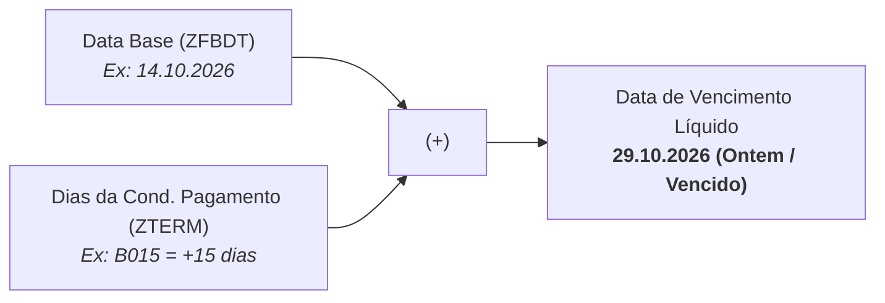

# Como Alterar a Data de Vencimento de Faturas e Títulos no SAP FI (`FB02`)

---

## 1. Por que esse conhecimento é essencial para Desenvolvedores?

Durante o desenvolvimento e homologação de projetos no SAP S/4HANA envolvendo os módulos **FI-AR** (*Contas a Receber*) ou **FSCM** (*SAP Financial Supply Chain Management / Gestão de Crédito*), é extremamente comum precisar testar regras de negócio baseadas em tempo:

* Robôs de **bloqueio por inadimplência** (como o nosso projeto `[[03 - DEL-R2R-009 - Guia de Testes e Homologação|DEL-R2R-009]]`);
* Rotinas automáticas de **cobrança e régua de cartas** (*Dunning / Transação F150*);
* Apuração de juros, multas ou liquidação financeira de títulos.

Como o ambiente de desenvolvimento/qualidade (ex.: mandantes 100 e 120) nem sempre possui títulos vencidos na data exata de hoje, o desenvolvedor precisa saber **manipular o vencimento de um documento contábil para o passado ou para o futuro** sem precisar estornar e relançar a fatura.

---

## 2. Como o SAP Calcula a Data de Vencimento Líquido?

No módulo financeiro do SAP, a data de vencimento final de uma fatura **não é um campo digitado diretamente no banco de dados**. Ela é o resultado de uma fórmula aritmética calculada em tempo real com base em dois campos principais:

### Os Dois Campos Cruciais:
1. **Data Base (`ZFBDT` - *Baseline Date*):** É a data de referência a partir da qual o prazo de pagamento começa a contar (geralmente a data do documento ou a data de entrada da mercadoria).
2. **Condição de Pagamento (`ZTERM` - *Terms of Payment*):** Define os prazos e descontos cadastrados na tabela `T052` (por exemplo: `B015` soma 15 dias; `B030` soma 30 dias; `B000` é vencimento imediato/à vista).

> [!TIP]
> **Fórmula Prática:**  
> $$\text{Data de Vencimento Líquido} = \text{Data Base} + \text{Dias da Condição de Pagamento}$$
> Para adiantar ou atrasar o vencimento de uma fatura, você só precisa **alterar a Data Base**!

---

## 3. Passo a Passo: Alterando o Vencimento na Transação `FB02`

A transação **`FB02`** (*Modificar Documento Contábil*) permite alterar campos operacionais de partidas em aberto no financeiro, mesmo após a fatura ter sido contabilizada.

### Etapa 1: Acessar o Documento Contábil
1. Na barra de comando do SAP GUI, digite **/nFB02** e pressione `Enter`.
2. Preencha os parâmetros de cabeçalho:
   * **Nº documento:** Digite o número da fatura contábil (ex.: `1800000071`).
   * **Empresa:** Código da empresa contábil (ex.: `CVH1`).
   * **Exercício:** Ano fiscal do lançamento (ex.: `2026`).
3. Pressione **`Enter`**.

---

### Etapa 2: Acessar o Item de Cliente (Partida em Aberto)
1. O SAP exibirá a lista de lançamentos contábeis (débitos e créditos).
2. Dê um **duplo clique** sobre a linha correspondente ao cliente (geralmente o **Item 1** com chave de lançamento `01 - Fatura`).

---

### Etapa 3: Alterar a Data Base
Na tela de detalhes do item, localize o bloco **Dados adicionais**:

1. Identifique a **Condição de pagamento** configurada (ex.: `B015`).
2. Calcule a data base necessária:
   * Se a condição soma **15 dias** e você quer que a fatura vença **ontem (`29.10.2026`)**:
     * Defina a **Data base** como **`14.10.2026`** (`14 + 15 = 29`).
   * Se quiser que vença há 5 dias atrás:
     * Defina a **Data base** como **`10.10.2026`** (`10 + 15 = 25`).
3. Clique em **Salvar** (**Ctrl + S** ou ícone do disquete).

---

## 4. O Aviso `F5149`: Como Tratar?

Ao tentar salvar um vencimento que fica no passado, o SAP GUI exibirá uma janela de ajuda (*Performance Assistant*) ou uma mensagem amarela na barra inferior:

> **Mensagem `F5149`:** *Vencimento líquido a DD.MM.AAAA situa-se no passado.*

### O que significa?
* **Não é um erro impeditivo:** O SAP possui mensagens do tipo **E** (*Error - impede salvar*), **W** (*Warning - alerta*) e **I** (*Information*). A mensagem `F5149` é classificada como **Warning (W)**.
* Ela serve apenas para alertar o operador contábil de que ele está gravando uma data retroativa.

### Como liberar a gravação:
1. Feche a janelinha do *Performance Assistant* no **`X`**.
2. Com o cursor na tela da transação, pressione **`Enter`** uma vez no teclado.  
   *(No SAP, dar `Enter` sobre um Warning amarelo significa: "Estou ciente e desejo prosseguir").*
3. Pressione **`Ctrl + S`** para salvar.
4. O SAP exibirá no rodapé a mensagem verde:  
   **“As modificações foram gravadas”**.

---

## 5. Dicas de Ouro para Desenvolvedores ABAP

### A. Onde consultar o vencimento calculado sem fazer conta de cabeça?
Para validar se o vencimento líquido realmente ficou no passado:
1. Acesse a transação **/nFBL5N** (*Partidas em Aberto de Clientes*);
2. Informe o cliente e a empresa;
3. No relatório ALV, adicione a coluna **Vencimento Líquido** (*Net Due Date*). A data calculada e os dias em atraso aparecerão explicitamente com status vermelho (vencido).

### B. Por que alguns campos ficam cinzas (bloqueados) na `FB02`?
No SAP FI, você não pode alterar valores contábeis (`WRBTR`), conta razão (`HKONT`) ou cliente (`KUNNR`) via `FB02` por princípios de auditoria fiscal.  
Apenas campos de cobrança (Data base, Condição de pagamento, Forma de pagamento e Bloqueio de pagamento) permanecem editáveis enquanto o título estiver em aberto. As regras de quais campos podem ser modificados são definidas no customizing pela transação **`OB32`**.

---

## 6. Resumo Rápido (Cheat Sheet)

| Objetivo | O que fazer na `FB02` | Efeito |
| :--- | :--- | :--- |
| **Simular Título Vencido** | Retroagir a **Data base** (`ZFBDT`) para dias antes de hoje. | Título entra na régua de inadimplência (atraso >= 1 dia). |
| **Simular Título a Vencer** | Avançar a **Data base** (`ZFBDT`) para frente. | Título sai da régua de inadimplência (saldo vencido zera). |
| **Ignorar Aviso Amarelo (`F5149`)** | Pressionar **`Enter`** e depois **`Ctrl + S`**. | Confirma o vencimento no passado e grava no banco. |
