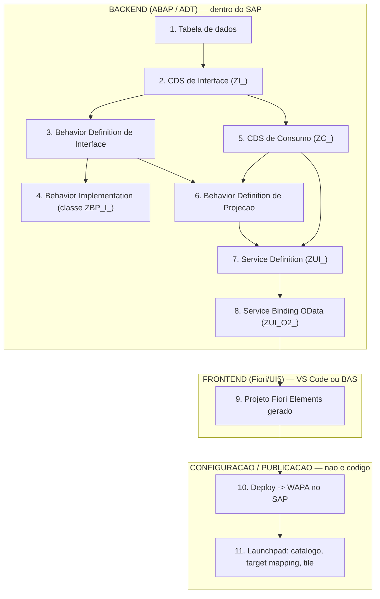

# Guia de Arquitetura — Como Construir uma Aplicação Fiori com RAP do Zero

**Relacionado:** [[CDS - Core Data Services|CDS]], [[Roteiro de Estudos SAP]]

---

## 1. Visão geral em 1 minuto

Uma aplicação Fiori + RAP é construída em três camadas: Backend, Frontend e Configuração/Publicação. A construção segue essa ordem porque cada camada depende de objetos criados e ativados anteriormente.

Uma etapa só deve começar depois que suas dependências estiverem criadas, salvas e ativadas. O fluxo acima é o mapa principal deste guia.

---

## 2. Siglas e conceitos usados neste guia

| Sigla/Termo | Significado | Explicação simples |
|---|---|---|
| **ABAP** | Advanced Business Application Programming | A linguagem de programação do SAP. |
| **ADT** | ABAP Development Tools | O plugin do Eclipse (ou extensão do VS Code) usado para criar e editar objetos ABAP. |
| **CDS** | Core Data Services | Uma forma moderna de criar "visões" de dados dentro do SAP, escritas em uma linguagem parecida com SQL. |
| **RAP** | ABAP RESTful Application Programming Model | O modelo padrão da SAP para transformar uma CDS em um serviço completo, com regras de negócio e operações (criar, alterar, excluir, ações customizadas). |
| **Behavior Definition** | — | O arquivo que **declara** o que pode ser feito com uma entidade (ex.: "esta entidade permite a ação X"). |
| **Behavior Implementation** | — | A classe ABAP que **executa de fato** a lógica declarada na Behavior Definition. |
| **OData** | Open Data Protocol | O "idioma" que a internet usa para consultar dados do SAP a partir de uma URL. É isso que conecta o backend ABAP ao frontend Fiori. |
| **Service Definition** | — | O "contrato": diz quais CDS de consumo e ações estarão disponíveis como serviço. |
| **Service Binding** | — | A "porta publicada": transforma o contrato (Service Definition) em uma URL OData real, acessível de fora do SAP. |
| **UI5 / Fiori Elements** | — | O framework de frontend da SAP. "Fiori Elements" é uma variação que **gera a tela automaticamente** a partir dos metadados do OData, sem precisar programar telas na mão. |
| **List Report** | — | Um tipo de tela Fiori Elements: uma lista/tabela com filtros, seleção de linhas e botões de ação. |
| **Object Page** | — | Um tipo de tela Fiori Elements que mostra o detalhe de um único registro. |
| **WAPA** | Web Application (SAPUI5 ABAP Repository) | O "pacote fechado" com os arquivos do frontend, depois de publicado dentro do SAP (também chamado de objeto BSP). |
| **BSP** | Business Server Pages | O tipo de objeto técnico do SAP que armazena aplicações web — é o "contêiner" onde o WAPA é guardado. |
| **Launchpad** | — | A tela inicial do Fiori, com os ícones (tiles) que o usuário clica para abrir os aplicativos. |

---

## 3. Divisão Backend, Frontend e Configuração

**Backend (ABAP, feito no ADT/Eclipse, vive dentro do SAP):**
Tabela → CDS de Interface → Behavior de Interface → Classe de Implementação → CDS de Consumo → Behavior de Projeção → Service Definition → Service Binding.

**Frontend (UI5/Fiori Elements, feito no VS Code ou BAS, vive como projeto de arquivos):**
`manifest.json`, `Component.js`, `annotations/`, `i18n/`, `localService/`.

**Configuração/Publicação (não é código-fonte):**
Deploy, WAPA no SAP, catálogo, target mapping e tile do Launchpad.

---

## 4. Mapa de nomenclatura genérica

Esta tabela traduz os nomes técnicos para o padrão oficial de nomenclatura (`01-[REDESIM]-Padrões de Desenvolvimento.md`), com um exemplo real ao lado para referência:

| Camada | Objeto genérico | Regra de nome | Exemplo real já implementado |
|---|---|---|---|
| Dado | Tabela | `ZT[MD]_<descrição>` (ou reaproveitar tabela já existente) | `ZTFI_LOG_INTEG` |
| Backend | CDS de Interface | `ZI_[MD]_<descrição>` | `ZI_FI_LOG_BARRAMENTO` |
| Backend | Behavior Definition de Interface | mesmo nome da CDS de Interface | `ZI_FI_LOG_BARRAMENTO` |
| Backend | Classe de Behavior Implementation | `ZBP_I_[MD]_<descrição>` (sugerido automaticamente pelo ADT) | `ZBP_I_FI_LOG_BARRAMENTO` |
| Backend | CDS de Consumo | `ZC_[MD]_<descrição>` | `ZC_FI_LOG_BARRAMENTO` |
| Backend | Behavior Definition de Projeção | mesmo nome da CDS de Consumo | `ZC_FI_LOG_BARRAMENTO` |
| Backend | Service Definition | `ZUI_[MD]_<descrição>` | `ZUI_FI_LOG_BARRAMENTO` |
| Backend | Service Binding OData V2 - UI | `ZUI_O2_[MD]_<descrição>` | `ZUI_O2_FI_LOG_BARRAMENTO` |
| Backend | Service Binding OData V4 - UI (opcional) | `ZUI_O4_[MD]_<descrição>` | `ZUI_O4_FI_LOG_BARRAMENTO` |
| Frontend | Projeto Fiori local | nome livre, minúsculo, sem espaço | `log_integracao_b2b` |
| Config/Publicação | WAPA publicado no SAP | `ZZ1_<nome-abreviado-do-app>` (máx. 12 caracteres) | `ZFI_INTEG_B2B` |

`[MD]` é o código do módulo funcional do processo (ex.: `FI` para Financeiro, `MM` para Materiais, `SD` para Vendas, `CA` quando o objeto é reutilizável por qualquer módulo).

---

## 5. Ordem de construção — e por que ela existe

### Backend (feito no ADT/Eclipse, dentro do SAP)

1. **Tabela de dados** — é a base de tudo. Se for uma tabela nova, ela nasce aqui; se for uma tabela já existente que precisa de um campo novo (ex.: um identificador técnico único), o ajuste também acontece aqui, **antes** de qualquer CDS ser criada. Sem ela, não há o que ler.
2. **CDS de Interface** (`ZI_`) — a primeira "visão" sobre o dado. Uma CDS de Interface pode juntar mais de uma tabela (ex.: a tabela principal + uma tabela auxiliar só para consulta), calcular campos e definir a chave. Ela é chamada de "Interface" porque ainda não é para o usuário final — é a base técnica que as próximas camadas vão reaproveitar.
3. **Behavior Definition de Interface** — declara **o que pode ser feito** com essa entidade: criar, alterar, excluir e/ou ações customizadas (ex.: "reenviar", "aprovar", "cancelar"). É só uma declaração, ainda sem lógica escrita.
4. **Classe de Behavior Implementation** (`ZBP_I_`) — aqui entra o código ABAP de verdade, que executa cada ação/operação declarada no passo 3. Só é possível escrever essa classe depois que a ação já foi declarada — é o ADT que sugere automaticamente a estrutura dela.
5. **CDS de Consumo** (`ZC_`) — uma segunda "visão", construída em cima da CDS de Interface (nunca direto na tabela), voltada para a tela do usuário. É aqui que entram rótulos em português, moeda, indicador visual (verde/vermelho), filtros e a ordem das colunas.
6. **Behavior Definition de Projeção** — repassa (não recria) o que a Behavior de Interface já permite, decidindo o que fica visível para o Fiori. Depende dos passos 3 e 5 já existirem.
7. **Service Definition** (`ZUI_`) — empacota a CDS de Consumo como um "serviço" formal, pronto para ser publicado.
8. **Service Binding** (`ZUI_O2_`) — publica esse serviço como uma URL OData real. É só depois desta etapa estar ativa que o serviço pode ser "enxergado" de fora do SAP.

### Frontend (feito no VS Code ou SAP Business Application Studio)

9. **Geração do projeto Fiori Elements** — uma ferramenta lê os metadados do Service Binding publicado (passo 8) e **gera automaticamente** a tela (em geral um List Report — uma lista com filtros e seleção). Isso só funciona se o passo 8 já estiver ativo e publicado; a ferramenta precisa consultar o serviço para saber quais campos existem.
   - Mesmo quando a tela de detalhe (Object Page) não é usada, o gerador costuma criar essa estrutura "por baixo dos panos" — não é preciso removê-la, apenas não customizá-la.

### Configuração / Publicação (não é escrita de código, é "encanamento")

10. **Deploy → WAPA** — o projeto frontend (arquivos JavaScript/JSON/HTML) é compilado e enviado para dentro do SAP, virando um objeto interno (BSP/WAPA). Só depois desse passo o app existe fisicamente dentro do sistema SAP.
11. **Launchpad (catálogo, target mapping, tile)** — é a etapa de "vitrine": cria o ícone clicável e o caminho que leva até o app publicado no passo 10. Normalmente feito por outra equipe (Basis/administração do Launchpad), não pelo desenvolvedor do app.

---

## 6. Papel de cada objeto (tabela de referência rápida)

| Categoria no ADT | Objeto | Camada | O que ele faz |
|---|---|---|---|
| Dictionary → Database Tables | Tabela | Backend | Guarda o dado persistido de verdade. |
| Core Data Services → Data Definitions | CDS de Interface | Backend | Une tabelas e prepara o dado bruto para uso técnico. |
| Core Data Services → Behavior Definitions | Behavior Definition (Interface) | Backend | Declara o que pode ser feito com a entidade. |
| Source Code Library → Classes | Classe de Behavior Implementation | Backend | Executa a lógica de cada operação/ação declarada. |
| Core Data Services → Data Definitions | CDS de Consumo | Backend | Prepara o dado para a tela: rótulos, filtros, moeda, cores. |
| Core Data Services → Behavior Definitions | Behavior Definition (Projeção) | Backend | Decide o que da Interface fica visível no serviço. |
| Core Data Services → Metadata Extensions *(opcional)* | Metadata Extension | Backend | Alternativa para colocar anotações de UI **fora** da CDS, quando não se quer misturar dado e visual no mesmo arquivo. |
| Business Services → Service Definitions | Service Definition | Backend | Empacota a CDS de Consumo como um serviço formal. |
| Business Services → Service Bindings | Service Binding | Backend | Publica o serviço como uma URL OData acessível. |
| Projeto local (VS Code/BAS) | `manifest.json` | Frontend | O "documento de identidade" do app: nome, serviço usado, tipo de tela (List Report/Object Page), bibliotecas necessárias. |
| Projeto local (VS Code/BAS) | `Component.js` | Frontend | Ponto de entrada técnico do app (geralmente não precisa ser editado à mão). |
| Projeto local (VS Code/BAS) | `annotations/annotation.xml` | Frontend | Anotações de UI feitas **no frontend** (opcional — neste padrão, prefere-se colocar tudo já na CDS de Consumo, deixando este arquivo praticamente vazio). |
| Projeto local (VS Code/BAS) | `i18n/i18n.properties` | Frontend | Textos fixos da tela (título, descrição do app) em português. |
| Projeto local (VS Code/BAS) | `localService/` | Frontend | Cópia local do metadado do serviço, usada só para testes/mock, sem depender do SAP ligado. |
| BSP Library → BSP Applications | WAPA | Configuração/Publicação | O app frontend já compilado e guardado dentro do SAP. |
| Fiori Launchpad Designer | Catálogo técnico, target mapping, tile | Configuração/Publicação | Faz o app aparecer e ser clicável para o usuário final. |

---

## 7. Passo a passo resumido de execução

1. Definir a tabela (nova ou ajuste em tabela existente) e ativá-la.
2. Criar a CDS de Interface (`ZI_[MD]_<descrição>`) e ativá-la.
3. Criar a Behavior Definition de Interface, declarando as operações/ações necessárias.
4. Gerar e implementar a classe de Behavior Implementation (`ZBP_I_[MD]_<descrição>`).
5. Criar a CDS de Consumo (`ZC_[MD]_<descrição>`) com as anotações de UI (rótulos, filtros, criticidade, moeda).
6. Criar a Behavior Definition de Projeção, repassando (`use`) o que deve ficar visível.
7. Criar o Service Definition (`ZUI_[MD]_<descrição>`), expondo a CDS de Consumo.
8. Criar o Service Binding (`ZUI_O2_[MD]_<descrição>`), publicar e conferir no Preview antes de seguir.
9. Gerar o projeto Fiori Elements (List Report, com ou sem Object Page) apontando para o Service Binding publicado.
10. Validar o app localmente (dados aparecem, ações funcionam) antes do deploy.
11. Configurar o deploy (`ui5-deploy.yaml`) com nome do WAPA, pacote e transporte, e executar o deploy.
12. Confirmar no SAP que o WAPA foi criado no pacote correto.
13. Solicitar à equipe responsável a criação do catálogo, target mapping e tile no Launchpad.

---

## 8. Erros comuns e pontos de atenção

- **Criar a CDS de Consumo antes de ativar a CDS de Interface** → erro de "objeto não encontrado", porque a de Consumo faz `projection on` a de Interface.
- **Esquecer de ativar um objeto após criar/editar** → o próximo objeto da cadeia não consegue enxergá-lo, mesmo que o arquivo já esteja salvo.
- **Gerar o projeto Fiori antes do Service Binding estar publicado** → o gerador não encontra o serviço para ler os campos.
- **Confundir Service Definition com Service Binding** → o primeiro é só o "contrato"; o segundo é a "porta publicada" que gera a URL OData.
- **Achar que o deploy do frontend cria o tile no Launchpad** → o deploy só publica o app dentro do SAP; o tile é uma etapa separada.
- **Colocar lógica de negócio dentro da Behavior Definition** → ela apenas declara o que existe; a lógica fica na classe de Behavior Implementation.

---

## 9. Checklist final

-  Tabela criada/ajustada e ativa.
-  CDS de Interface ativa, com a chave correta.
-  Behavior Definition de Interface declarando as operações/ações certas.
-  Classe de Behavior Implementation escrita e ativa.
-  CDS de Consumo com anotações de UI revisadas (rótulos em português, moeda, criticidade).
-  Behavior Definition de Projeção expondo só o necessário.
-  Service Definition criado.
-  Service Binding publicado e testado no Preview.
-  Projeto Fiori gerado e validado localmente com dados reais.
-  Deploy configurado (`ui5-deploy.yaml`) e executado com sucesso.
-  WAPA confirmado no pacote correto dentro do SAP.
-  Pedido de tile/catálogo/target mapping enviado à equipe do Launchpad.

---

**Fonte de base para este guia:** PRD "Logs de Integração com o Barramento" e conferência dos objetos reais equivalentes já ativos no sistema (tabela, CDS, Behavior, Service Definition/Binding e projeto frontend), com nomes generalizados conforme o Padrão de Desenvolvimento REDESIM.
