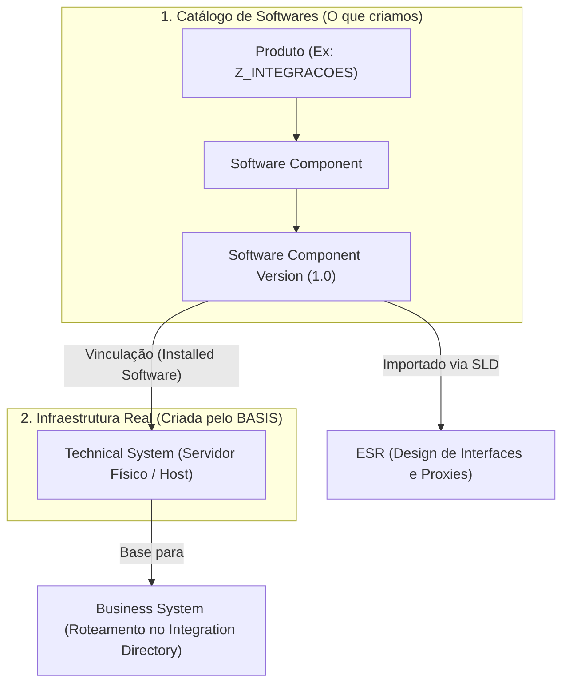

# 🛠️ Tutorial: Como Criar um Produto no SAP NetWeaver SLD

**Relacionado:** [[SLD - System Landscape Directory|SLD]], [[ESR - Enterprise Services Repository|ESR]], [[PI - Process Intagration|SAP PI]], [[PO - Process Orquestration|SAP PO]]

---

## 🎯 Objetivo e Contexto

No [[SLD - System Landscape Directory|SLD]], um **Produto (Product)** representa a unidade comercial abstrata de um software (ex: *SAP S/4HANA*, ou um software próprio como *Sistema de Vendas Web*). 

Para que possamos criar desenvolvimentos customizados no [[ESR - Enterprise Services Repository|ESR]] (Message Types, Service Interfaces, Mappings, Proxies), precisamos de um **Software Component Version (SWCV)** que vive debaixo de um **Produto**.

> [!NOTE]
> O **Produto** funciona como uma "pasta mãe" ou pacote geral. O objeto que realmente é transportado e importado no ESR para armazenar seus desenvolvimentos é a **Software Component Version**.

---

## 📋 Pré-requisitos

1. **Acesso à Interface Web do SAP NetWeaver / SLD:**
   * URL típica: `http://<host_netweaver>:<porta_http>/sld` (porta Java padrão geralmente é `50000`, `50100` ou similar).
   * Ou através da página principal de ferramentas do PI/PO: `http://<host>:<porta>/dir` $\rightarrow$ link **System Landscape Directory**.
2. **Autorizações de Usuário:**
   * Usuário com permissão de escrita/administração no SLD (ex: roles `SAP_SLD_ADMIN` ou `SAP_SLD_CONFIGURATOR`).

---

## 🚀 Passo a Passo

### 1. Acessar a Tela de Produtos no SLD
1. Abra o navegador e acesse a URL do SLD.
2. Faça login com suas credenciais administrativas de integração.
3. Na página inicial do SLD, localize a seção **Software Catalog** (Catálogo de Softwares).
4. Clique na opção **Products** (Produtos).

---

### 2. Iniciar o Assistente de Criação
1. Na lista de produtos, você verá todos os produtos SAP instalados (catálogo padrão fornecido via CR Content).
2. Para criar um produto customizado da sua empresa, clique no botão **New Product...** (Novo Produto).
3. O assistente de criação (*Product Definition Wizard*) será aberto.

---

### 3. Preencher os Dados do Produto
Preencha os campos obrigatórios solicitados pelo assistente:

| Campo | O que preencher | Exemplo / Convenção |
| :--- | :--- | :--- |
| **Name** | Nome técnico e descritivo do produto | `Z_ECOMMERCE_SUITE` ou `PROD_INTEGRACOES_INTERNAS` |
| **Vendor** | Identificador da sua empresa ou cliente | Formato de domínio reverso: `empresa.com.br` ou `customer.com` |
| **Version** | Número da versão inicial | `1.0` |

> [!TIP]
> **Convenção de Vendor:** Nunca use `sap.com` como vendor para produtos próprios. Use sempre o domínio da sua empresa (ex: `minhaempresa.com.br`) para garantir que os namespaces criados posteriormente no ESR fiquem isolados dos objetos padrão da SAP.

4. Clique em **Next** (Avançar).

---

### 4. Definir a Software Component Version (SWCV)
Geralmente o assistente solicitará a criação imediata de pelo menos um **Software Component** atrelado ao produto:

1. Selecione a opção para criar um novo Software Component (ou avance para a etapa de componentes).
2. Preencha as propriedades do componente:
   * **Name:** Nome do componente técnico (ex: `Z_SWC_VENDAS` ou `SC_INTEGRACOES`).
   * **Vendor:** Mantém o mesmo vendor do produto (`empresa.com.br`).
   * **Version:** Versão do componente (ex: `1.0`).
   * **Production State:** Selecione o estado do ciclo de vida, normalmente `Released` ou `Customer`.
3. Clique em **Finish** / **Create** para concluir o assistente.

---

### 5. Validação
1. Após salvar, você será redirecionado para a lista de Produtos.
2. Utilize o campo de filtro para buscar pelo nome que você criou (ex: `Z_*`).
3. Clique sobre o produto criado e verifique na aba **Software Components** se a sua versão `1.0` está devidamente listada e ativa.

---

### 6. Vincular o Componente ao Sistema Existente (Installed Software)

> [!IMPORTANT]
> **Você não cria o sistema!**
> A máquina física ou lógica (o *Technical System*) já foi criada e registrada pelo time de **BASIS**. A sua única tarefa é ir até esse sistema existente e avisar ao SLD: *"Este servidor tem o meu componente de software instalado nele"*.

#### Passo a passo da vinculação:
1. Retorne à página inicial do SLD.
2. Na seção **System Landscape**, clique em **Technical Systems** (Sistemas Técnicos).
3. Selecione o tipo de sistema técnico no menu suspenso:
   * **Third-Party:** Para servidores externos, legados, APIs ou parceiros.
   * **AS ABAP:** Para servidores padrão do ERP SAP (ECC ou S/4HANA).
4. Localize na lista e clique sobre o **Sistema Técnico existente** com o qual você vai integrar.
5. Acesse a aba **Installed Software** (Softwares Instalados).
6. Localize o seu **Produto** na lista (ou clique em **Add New Product...**).
7. Marque a caixa de seleção da sua **Software Component Version** (ex: `1.0 of Z_SWC_VENDAS`).
8. Clique em **Save** (Salvar).

> [!WARNING]
> **A "Regra de Ouro" do Troubleshooting:**
> Se no futuro você abrir o **Integration Directory (ID)** para configurar as rotas/canais e o sistema emitir um erro dizendo que *"a interface não é suportada por este Business System"* ou *"nenhum componente de software compatível foi encontrado"*, o motivo é este: **esqueceram de marcar a caixinha do componente na aba Installed Software do Technical System**.

---

## 🔄 Próximos Passos na Cadeia de Integração

Criar o produto e a versão do componente no SLD é apenas o primeiro degrau. A sequência de desenvolvimento geralmente é:

1. **Importação no [[ESR - Enterprise Services Repository|ESR]]:**
   * Abra a ferramenta do ESR (Integration Builder / Java Web Start ou Eclipse NWDS).
   * Vá em **Tools** $\rightarrow$ **Transfer from System Landscape Directory...**
   * Selecione o seu novo Software Component Version e importe-o para o repositório.
2. **Criação de Namespaces:**
   * Dentro do componente no ESR, crie o namespace técnico (ex: `http://empresa.com.br/xi/vendas`).
3. **Desenvolvimento dos Cenários:**
   * Crie Message Types, Service Interfaces e Mappings.
4. **No ERP ABAP:**
   * Acesse a transação `SPROXY` para visualizar o SWCV e gerar os ABAP Proxies locais no dicionário do ERP.

---

## ⚠️ Cuidados e Boas Práticas

* **Evite caracteres especiais:** Não use acentos, espaços ou caracteres especiais nos nomes técnicos de Produto e Software Component.
* **Planejamento de Versões:** Se o componente mudar drasticamente de versão no futuro (ex: release 2.0), você criará uma nova versão no mesmo produto dentro do SLD, facilitando o gerenciamento do ciclo de vida.
* **Governança:** Em ambientes corporativos produtivos, o SLD de Desenvolvimento é replicado para Qualidade e Produção (SLD Bridge / sincronização automática), portanto mantenha o padrão de nomenclatura estritamente alinhado com a equipe de Basis e Arquitetura.
